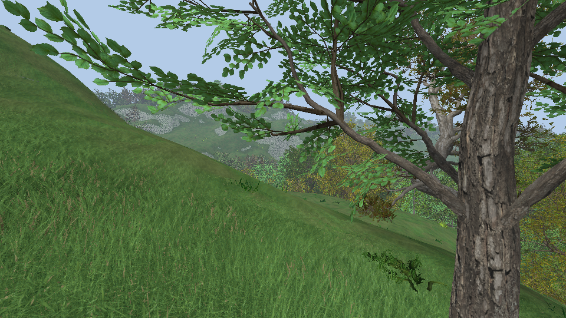
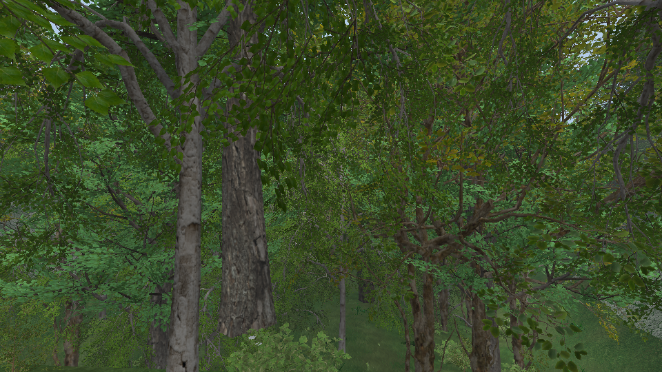

# Forests

Forests in patches over the marching cubes terrain: thick woods of several kinds on the gentle land, open grass
with a few flowers, bushes and lone trees everywhere else. The plants are the SpeedTree species of
[vegetation.md](vegetation.md); the shade under them is a map of crown shadows, not a shadow map.





```bash
cd build && ./RelWithDebInfo/dynamical.exe scene=forest          # free camera, VR
cd build && ./RelWithDebInfo/dynamical.exe scene=forest_walk     # the camera walks through a forest
build/venv/Scripts/python tools/forest_video.py                  # the walk as build/artifacts/forest_video/*.mp4
```

Scene variables: `forest_seed`, `patch_size`, `coverage`, `max_slope`, `forest` (the definition file), and for
`forest_walk` `distance`, `speed`, `eye_height`.

## Files

| File | Role |
|---|---|
| `src/logic/vegetation/forest.{h,cpp}` | `ForestField` (where the forests are), `ForestDefinition` (stands and layers), `forestCandidates`, `ForestSys` |
| `resources/forest/tautavel.forest.json` | The stands, their layers and species (42 of the library's 80) |
| `src/renderer/tree_shade.{h,cpp}` | `TreeShade`: the map of crown shadows, binding 1 of the view set |
| `src/view/camera_walk.{h,cpp}` | `CameraWalk`: picks a line through a forest, routes around the plants, walks the camera |
| `resources/scenes/forest.scene.json`, `forest_walk.scene.json` | The scenes |
| `tools/forest_video.py` | Renders `forest_walk` to an MP4 (`--scene` for another walk) |
| `tests/unit/forest.cpp` | `FOREST.1` to `FOREST.3`, and `FOREST.map` (a map of the forests, skipped by default) |

## Where the forests are

`ForestField` gives a cover from 0 (open grass) to 1 (thick forest) and a stand (the kind of forest) at any (x, z).

- **Patches**: a 4 octave simplex noise, one forest and the open land next to it per period (`patch_size`, 320 m).
  The noise has no known distribution, so its quantiles are measured once: `coverage` (0.5) is the part of the
  gentle land under forest, `edge` (0.1) the part where the forest thins out. Cover goes from 0 to 1 across the edge.
- **Slope**: the cover is multiplied by a mask that goes from 1 to 0 between `max_slope - slope_fade` (15°) and
  `max_slope` (24°). The slope is that of the heightfield part of the terrain between two points `slope_reach`
  (48 m) on each side: the slope of the land, not of a bump. On this terrain (median slope 17° at that scale) 21 %
  of the land ends up thick forest and 60 % open.
- **Stands**: a second noise (`stand_size`, 130 m), made uniform through its measured distribution and cut in as
  many equal parts as the definition has stands. Plants near a limit take either side.

The field is defined on a lattice of 8 m anchored to the world and is linear between the nodes: a chunk reads a
block of nodes with two noise grids (`nodes`), a point query reads four (`cover`), both see the same values.

`FOREST_MAP=map.ppm dynamical_tests -tc="FOREST.map*" --no-skip` writes 4 km of it (green: cover, red: slope,
blue: stand; `FOREST_SEED`, `FOREST_PATCH`, `FOREST_SLOPE`, `FOREST_REACH` change the parameters).

## What grows

`resources/forest/tautavel.forest.json` lists stands, each a list of layers, and `everywhere` layers that do not
belong to a stand:

```json
{ "where": "forest", "spacing": 6, "fill": 0.9, "clump": 0, "max_slope": 30, "scale": [1.15, 1.7],
  "species": { "quercus_pedonculata_adulte": 3, "charme": 2 } }
```

A layer has one candidate per cell of a grid of `spacing` metres anchored to the world, jittered inside its cell.
It is kept with a probability of `fill` times a function of the cover: `forest` cover², `edge` 4·cover·(1 - cover),
`open` (1 - cover)², `all` 1. `clump` (metres) keeps the layer to clumps of that size (ferns, flowers, bushes).
`species` are weights. Trees of a `forest` layer are a quarter smaller where the forest thins out.

Three stands: pines (Aleppo and mountain pines, junipers, lentisks under them), oaks (pedunculate and holm oaks,
hornbeams, hazels, ferns), alders and birches (with elms, poplars, willows and their saplings). Each has a canopy
layer, an understory in clumps and a ground layer. Everywhere: young trees and bushes on the edges, and in the open
a lone tree every few hundred metres, a few bushes, drifts of daisies, knapweed and plantain. The canopy trees are
scaled up (1 to 1.7): SpeedTree's models branch low, taller ones leave room to walk under.

`forestCandidates` only depends on the field, the layer and the cell, so a plant does not depend on which chunk
asks or on the order the chunks load in. `ForestSys` puts the candidates of a chunk on its ground: the highest
surface of each column of density samples, read between the columns, on the cubes the chunk owns; the slope of the
ground under the plant must be under the layer's `max_slope`. Plants are entities with `Transform` + `Plant`, listed
in the chunk's `ChunkForest` and destroyed with it. Fixed-clock runs plant every chunk the frame it is generated,
other runs two chunks a frame. At the default view distance (768 m, 43 chunks of surface) about 85 000 plants are loaded.

The species are given to the vegetation pass up front (`VegetationPreload`), 6 at a time: 42 species, 318 textures,
about 6 GB of video memory uncompressed, loaded in a few seconds. `VegetationStats::species_loading` counts the
ones still loading; captures and the camera walk wait for it.

## Shade

`TreeShade` (always there, empty without plants) keeps a 2048 × 2048 map of the world seen from above, one texel a
metre, that wraps around. Each `Plant` taller than 1.5 m adds the shadow of its crown as two soft discs (the middle
and the top of the crown) where the sun puts them on the ground; they are taken back when the plant is destroyed.
A texel holds the optical depth of the crowns over it. The map is uploaded again when it changes and bound next to
the `ViewUBO` (set 0, binding 1), so any pass can read it.

`treeShade(position, above)` in `terrain.frag.glsl`, `grass.frag.glsl` and `vegetation.frag.glsl` turns the depth
into shade, with a noise that lets flecks of sun through near the camera. The sun is dimmed by the shade and the
sky light by 35 to 40 % of it. A plant reads the map at the point of the ground its fragment's shadow would fall
on, so trunks and bushes are dark under the canopy; a tall plant leaves the shade as it goes up, its own shadow is
not on its own crown. The shaders stop reading the map 700 m from the camera, before the wrap could show.
`RenderSettings::tree_shade` (0.85, debug menu) is the strength.

No shadow of the terrain or of trunks, no shadow that moves with a plant: plants are not expected to move.

## Drawing

The vegetation pass draws one call per plant and material, so plants outside a cone around the desktop camera's
view are skipped (`vegetation_params.cull`). With 85 000 plants loaded and 6 000 drawn in a thick forest (10 million triangles) the forest
walk renders 3000 frames in 27 s at 1280 × 720 on an RTX 5080, loading included (over 110 frames per second).

## The walk

`CameraWalk` moves the desktop camera at eye height:

1. **Line**: within `search` (1200 m) of the origin, lines of `distance` (280 m) in 16 directions from a grid of
   start points. A line must be open for its first and last 45 m and forest in between; it scores by its cover,
   by how many stands it crosses and by the slope of the heightfield along it. The 30 best are walked on the real
   ground (the marching cubes surface, `TerrainField`) and the gentlest wins. `start` and `heading` give the line
   instead.
2. **Route**, once the terrain and the plants are loaded: the cheapest path on a 0.5 m grid over a corridor 72 m
   wide around the line. Trunks are walls; what a plant has at the height of the eye costs more the deeper the path goes through it
   (read from the geometry of each species: how far it reaches by height and direction); steep ground costs, rock most of all. The path is
   then smoothed.
3. **Walk**: toward the point of the path 4 m ahead with a critically damped turn, the eye following the ground
   without its bumps, the view swaying a little from side to side.

`lead`, `soil` and `herds` (all off in `forest_walk`) make it a walk over the open land too: the soil patches it
crosses and the herds along it count in the choice of the line, and the camera looks at them
([tautavel-walk.md](tautavel-walk.md)).

Capture sequences keep their pace when a frame has to wait (terrain, plants): the frames after it are as late.

## Not done

- Wind, colliders for the trunks, real shadows.
- Less grass under thick forest: the grass pass does not read the shade for its height.
- Instancing: one draw call per plant and material.
- The forests follow the slope of the heightfield only: the 3D noise of the terrain is seen plant by plant.
