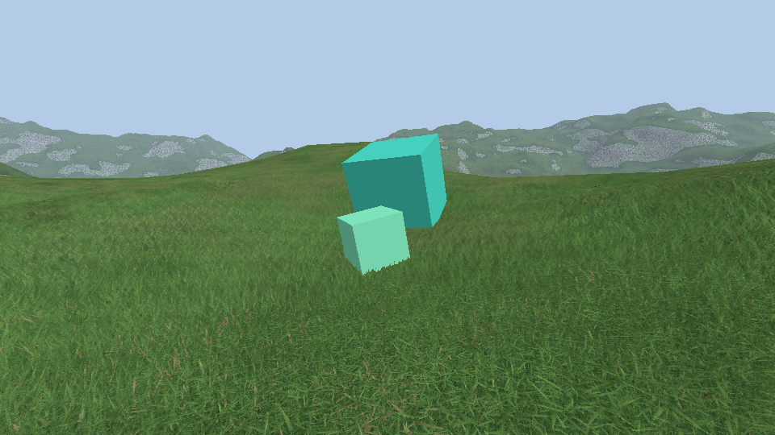
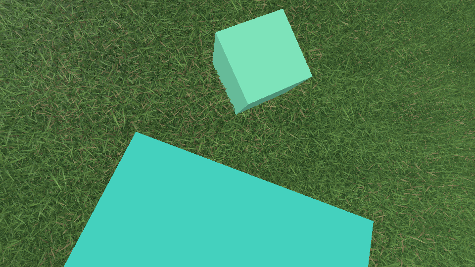

# Grass

Grass has no blade geometry. `GrassPass` draws the terrain chunks a second time as a shell at the top of the grass, and each pixel finds its blade in rays baked once against a 3D model of grass. This is the Unity `grass45` shader (`Assets/Terrain/grass`, `Texture45Generator.cs` and `grassShader45.shader`) rebuilt for this engine; it replaces the 2019 lookup of 2D rays against circles.





The lookup itself is described here. What makes it look less like a tile (layers of several sizes and heights, patches, blade colours, curved blades, shadows) was added in ten steps, each with its design and what came out of it: [grass/plan.md](grass/plan.md).

## Files

| File | Role |
|---|---|
| `src/logic/grass/grass_model.{h,cpp}` | Generates the tile of grass blades (`generateGrassTile`), exports it as OBJ |
| `src/logic/grass/grass_bake.{h,cpp}` | Ray tracer over the repeated tile (`GrassTracer`), baker (`bakeGrass`), file, mips, CPU mirror of the shader lookup (`lookupGrass`) |
| `src/renderer/passes/grass_pass.cpp` | Loads or bakes the rays, uploads the two textures, draws the shells |
| `src/renderer/shaders/grass.{vert,frag}.glsl` | The shell and the lookup |
| `tools/raycast/main.cpp` | Command line baker, OBJ export, comparison with ray tracing |
| `tests/unit/grass.cpp` | `GRASS.1` to `GRASS.7` |
| `tests/capture/grass.capture.json` | Fixed cameras over the same grass, to compare captures |

The baker is part of `dynamical_sim` (no Vulkan), so the viewer, the tool and the tests share it. `dynamical` bakes `resources/grass_raycast.bin` in its run directory the first time (1 s in RelWithDebInfo, not measured in Debug) and again when the file's key no longer matches `GrassBakeParams` or the baker version. Nothing baked is committed.

## The grass model

`generateGrassTile` builds one tile, 1 × 1 on the ground: 9 × 9 tufts on a jittered grid, 4 to 7 blades per tuft that fan out and bend away from its center (463 blades, 8334 triangles). A blade is a strip folded in a V along its length, with smooth normals and a random id. The tallest tip is at 0.98; the seed fixes everything.

`GrassTracer` repeats the tile to infinity: its acceleration grid covers one tile and each cell lists the triangles of whichever copy reaches it, so a ray walks from tile to tile until it hits a blade or the ground plane. Every baked ray therefore hits something.

## What is baked

Tile space: x and z on the ground in tiles, y from 0 at the roots to 1 at the top of the grass.

- **Oblique rays** (3D texture, 256 × 256 × 64): rays going down at 45°, for 64 azimuths. Texel (x, z, a) is the ray that crosses **the middle of the grass** (y = 0.5) above (x, z): it starts half a tile before, at y = 1, and would reach the ground half a tile after.
- **Top rays** (2D texture, 256 × 256): rays straight down.

Each texel is RGBA8: r the height of the hit (0 ground, 1 top), g b its normal, facing the ray, in octahedral coordinates, a the id of the blade (0.5 on the ground). Texels are baked at their centers, the textures repeat on every axis (the azimuth wraps) and have mips: 19 MB on the GPU.

## The lookup

For a pixel of the shell and one layer, in `grass.frag.glsl` (and `lookupGrass` on the CPU):

1. **Tile space ray.** The blades grow along `base_normal`, lean with the terrain normal (`follow_terrain`) and with the wind. Leaning shears tile space around the ground: a point at height y is `y × lean` away from its root, so roots do not move whatever the wind and the normal do. The view ray becomes a straight ray in tile space, with an azimuth and a `reach` (tiles crossed while going down the whole grass: 1 at 45°, 0 from the top).
2. **Middle of the grass.** The ray is looked up where it crosses y = 0.5, in the oblique rays of its azimuth. That baked ray goes through the same point; the two rays part by the same amount at the top and at the bottom instead of drifting all the way down from a shared entry point.
3. **Carry the hit to the view ray.** The baked ray met a blade `0.5 - height` tiles after the middle. Blades are mostly vertical, so the view ray meets the same blade over the same place, higher or lower: `height = 0.5 - (0.5 - baked) / reach`. At 45° this is the baked hit itself.
4. **Towards the top rays.** Between 45° and the vertical, height and normal are interpolated with the top down texel of the same point (smoothstep of the elevation, `top_start`).
5. **Layers.** The grass is `layers` tall layers (2) and an undergrowth: the same tile turned by the golden angle, shifted, at its own tile size and height, bent by its own noise. Each is looked up as above; the closest hit on the ray wins.
6. **Depth and light.** The hit gives the distance along the view ray, written to `gl_FragDepth` (`depth_greater`: never in front of the shell). The normal goes back to world space through the sheared tile axes. Blades are darker under the canopy, shadowed by their neighbours, let some light through, and have their own colour.

The terrain pass knows the grass is there: under it the terrain is dark and its depth is pushed back by the grass height, because the grass pass only knows the ground as a plane under each pixel and its hits can end up a little under the real terrain ([grass/03-patches.md](grass/03-patches.md)).

Rays closer to the horizontal than a reach of 3 are looked up as if they had it, which keeps the hits of hill crests close. Mips are chosen from the size of the pixel on the ground, not from the lookup coordinates (they jump between blades and at the azimuth wrap).

The shell is `height × smoothstep(0.68, 0.86, normal.y)` above the terrain, per vertex, and cut where the pixel's normal is under 0.74: grass gets shorter towards the rock and stops with it.

## How close to ray tracing

`raycast --preview out.png` renders the tile ray traced and looked up, side by side, and prints the mean error of the hit height, in grass heights, over 40 000 rays from every side (one layer, 256 × 256 × 64):

| Elevation | 15° | 30° | 45° | 60° | 75° | 90° |
|---|---|---|---|---|---|---|
| Lookup | 0.12 | 0.12 | 0.10 | 0.16 | 0.17 | 0.03 |
| Constant height (the mean) | 0.11 | 0.13 | 0.16 | 0.17 | 0.17 | 0.17 |

45° and 90° are what is baked: their error is the texture filtering (blades are 6 texels wide at the root) and, at 45°, the interpolation between two azimuths. From 30° to 45° the lookup stays at that floor. Two ranges are no better than a flat surface in depth, they only carry the look of the blades: under about 20°, where hits gather around the middle of the grass, and between 45° and 90°, which blends two views.

Anchoring matters: with the same rule but the rays looked up at their entry point at the top of the grass, the error at 30° was 0.22 instead of 0.11 on 128 texels (`GRASS.4` checks this without textures, at 25°, 35°, 55° and 65°).

## Settings

`RenderSettings::Grass`, live in the debug menu (Grass): tile size (1 m), height (0.6 m), base normal, follow terrain, wind strength and speed, top blend start, noise frequency and amplitude, and those of the steps of [grass/plan.md](grass/plan.md): layers, layer spread, undergrowth, patch size and amount, layer patches, curve, colour variation, dryness, shadow, canopy, silhouette, azimuth dither. Texture size, azimuth count and the model are `GrassBakeParams` / `GrassModelParams` defaults; changing them changes the key and the next run bakes again.

```bash
cmake --preset vcpkg -DDYNAMICAL_BUILD_TOOLS=ON
cmake --build build --config RelWithDebInfo --target raycast
build/RelWithDebInfo/raycast out.bin --obj tile.obj --preview preview.png   # [--size 256] [--angles 64] [--seed 7]
```

## Limits

- Seen from inside the grass (camera under the shell), the shell is culled and the terrain shows around the camera.
- Views between 45° and the vertical blend two baked views; blades look stretched away from the point under the camera.
- Two azimuths 5.6° apart are interpolated: thin blades ghost slightly when the texture is magnified (half removed by `azimuth_dither`, at the price of some grain).
- The ground between the blades is drawn 12 % of the grass height above the terrain, and the terrain steps back under the grass: something buried less than the grass height under flat ground shows through it.
- Shadows are between blades of one layer only: nothing else casts a shadow on the grass, and the grass casts none.
- Crests further than about 10 m end in a smooth line.
- About 16 to 22 texture fetches per pixel. The frame time was not measured, and VR was not tried.
