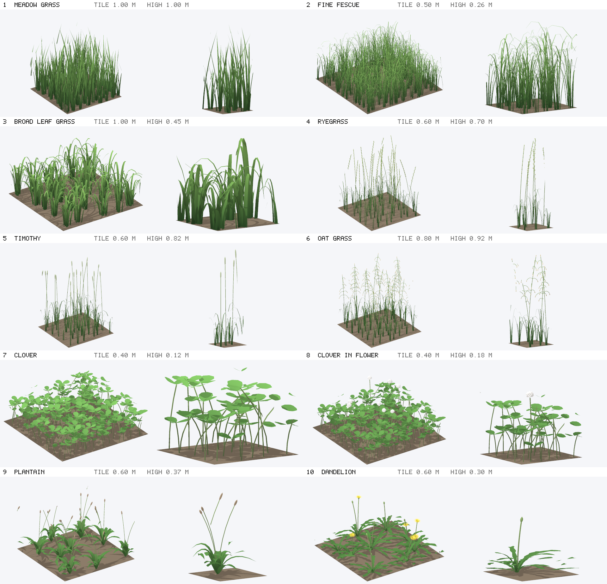

# Plants of the grass: ten tiles to bake rays on

The rays of [grass.md](../grass.md) are baked on one tile of straight blades. Here are nine more tiles, of the plants that grow with grass: `GrassKind` in `src/logic/grass/grass_model.h`, `GrassModelParams::kind`. Each is a tile like the first (roots in 1 x 1, the tallest tip at `max_height`, repeated to infinity by `GrassTracer`), so `bakeGrass` and the lookup take any of them as they are.



Left: the whole tile. Right: a slice through its middle (40 % of the tile), from the side. Ray traced by `GrassTracer` in the proportions the plants were modelled at.

| | Kind (`--kind`) | What | Tile | Height | Triangles |
|---|---|---|---|---|---|
| 1 | `meadow` | Tufts of straight blades: the grass of the engine, unchanged | 1 m | 1 m | 7 938 |
| 2 | `fescue` | Fine fescue: dense tufts of hair thin, arching blades | 0.5 m | 0.26 m | 30 800 |
| 3 | `cocksfoot` | Clumps of broad leaves, the tips hang | 1 m | 0.45 m | 7 740 |
| 4 | `ryegrass` | Thin stems with a flat spike of spikelets on alternate sides (wheat, much thinner), a tuft at the foot | 0.6 m | 0.70 m | 9 694 |
| 5 | `timothy` | Stems with a dense cylindrical head | 0.6 m | 0.82 m | 5 274 |
| 6 | `oat` | Stems with an open panicle: whorls of thin branches, a spikelet hanging from each | 0.8 m | 0.92 m | 15 636 |
| 7 | `clover` | Three leaflets on a stalk | 0.4 m | 0.12 m | 9 126 |
| 8 | `clover_flower` | The same with round white heads of florets | 0.4 m | 0.18 m | 10 998 |
| 9 | `plantain` | Ribwort: a rosette of lance shaped leaves, brown heads on bare stalks | 0.6 m | 0.37 m | 4 944 |
| 10 | `dandelion` | A flat rosette of toothed leaves, yellow flowers and buds | 0.6 m | 0.30 m | 8 386 |

## How they are made

- Modelled in metres on a tile of their own size (`GrassKindInfo::tile_size`), then brought to the 1 x 1 tile, the tallest tip at `max_height`. `GrassModel::tile_size` and `height` keep the metres: a layer that shows a kind should have that tile size and height, or the plants are stretched.
- Four pieces (`Builder` in `grass_model.cpp`): `ribbon` (a blade or a leaf folded in a V along a spine, any width along it: lance, teeth), `tube` (a stem with three or four sides: a ray has to meet it from every azimuth), `blob` (a spindle: spikelets, heads, florets, buds) and `leaflet` (a round, hollow leaf).
- Nothing is thinner than about a texel of the 256² bake on its tile (stems and branches of 2.2 to 5 mm), or the rays would meet it in one texel and miss it in the next.
- `GrassModel::parts` says what each vertex belongs to (blade, stem, leaf, flower, seed), and gives it its colour (`GrassModel::colours`): green by the height for blades, a paler green for stems, a deeper one for leaves, the colours of the kind (`GrassKindInfo::flower`, `seed`) for the rest. The rays bake that colour ([14-colour-map.md](14-colour-map.md)).
- The meadow is the same triangles as before.

## Tools

```
raycast --gallery plants.png                       # the picture above
raycast --kind clover --metres --obj clover.obj    # one tile, in metres (without --metres : the 1 x 1 tile that is baked)
raycast clover.bin --kind clover --preview p.png   # bake it, and compare the lookup with ray tracing
```

## What was checked

- `GRASS.11`: every kind is the same for a seed, stays between the ground and the start of the rays, has unit normals, a part per vertex, less than 50 000 triangles, and rays from the top meet it.
- Ryegrass baked with the default parameters (5.3 s): the mean error of the looked up hit height is 0.02 of the grass height from the top, 0.06 at 67.5°, 0.11 at 45°, and **no better than a constant height at 15°, 30° and 60°**, between the baked elevations. Thin stems far apart are the hard case of blending two elevations: what one meets the other misses. The other kinds were not measured.

## Not done

- The engine draws one kind at a time, everywhere (`grass_kind=clover` on the command line, the meadow without it). Mixing them needs one baked file per kind (or an array of them) and a kind per layer or per patch in `grass.frag.glsl`.
- Tile space normals are right for a layer with the proportions of the tile only.
