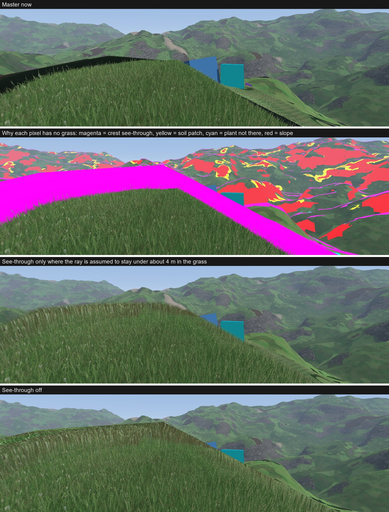
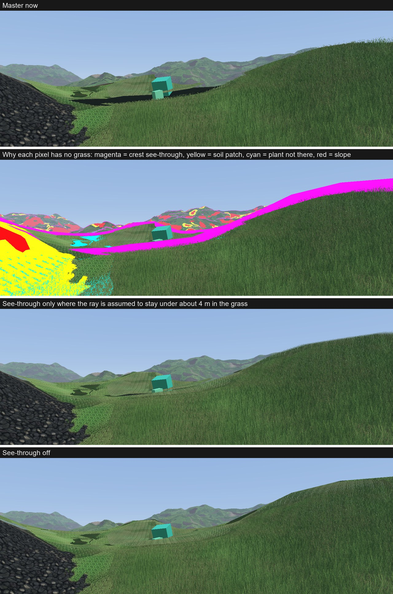
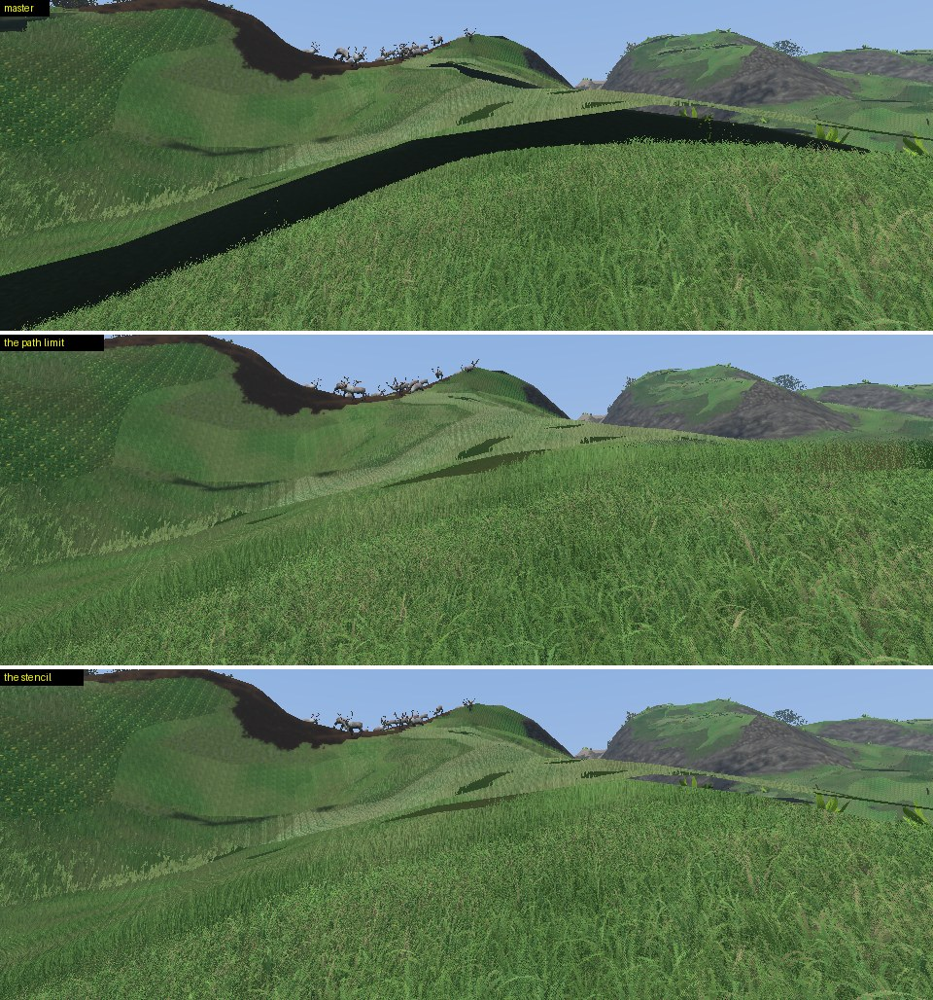

# 13. Seen through where the ground falls away

**Goal.** Grass with nothing behind it (on a crest, at the edge of a step down) was a full surface up to its top: a smooth line against the sky. What is behind must show between the blades. Step 9 cut blades on the crests from the angle of the view on the ground alone, which cannot tell a crest from flat ground seen from far, so it was kept weak and faded out after a few metres.

## Design

**What the ray really does.** The lookup knows the ground as a plane under the pixel: a ray that enters the grass goes down for ever and always ends on a blade or on the ground. Over ground that bends down along the view, it does not. With `sink` the height the ray loses on the ground per metre of its way and `falling` how much the ground bends down along the view (per metre), the ray is

```
depth(l) = sink × l - falling × (flat × l)² / 2        flat : horizontal part of the view vector
```

under the top of the grass after `l`: `sink² / (2 × falling × flat²)` at its deepest, then it comes out of the grass again, with the air behind it. **What the lookup met deeper than that is not there**: the pixel is discarded, fully, and whatever is behind shows. On flat ground and in hollows `falling` is zero or less and nothing is cut: the ray does meet grass further on.

The cut is a depth under the shell, so it works across the layers, and it goes to zero where the ray only touches the grass: the blades thin out to their tips towards the line of the crest.

**How the ground bends** comes from the second derivatives of the terrain density, as the normal comes from the first. The ground is where the density is 0: its height `h(x, z)` is an implicit function, and

```
h_x  = -F_x / F_y
h_xx = -(F_xx + 2 F_xy h_x + F_yy h_x²) / F_y        (xz and zz alike)
```

from the differences of the 18 samples around a sample (`groundCurve`, `src/logic/terrain/ground_curve.h`). The marching cubes shader computes it at both ends of an edge and gives `(h_xx, h_xz, h_zz)` to every vertex; the grass shader takes it along the view: `falling = -(h_xx tx² + 2 h_xz tx tz + h_zz tz²)`. Per vertex and not from screen derivatives of the normal: those are constant over a triangle and wrong where triangles are seen edge on, which is where the cut happens.

**Vertex.** The terrain vertex stays 32 bytes: the normal is octahedral now (2 floats, decoded in `terrain.vert.glsl` and `grass.vert.glsl`), and the texture coordinates nothing read are gone: position, normal, curve.

## Settings

`silhouette` ("See through on crests" in the debug menu, 0 to 3, default 1): 0 cuts nothing, 1 cuts what is under the deepest point of the ray, more cuts higher. The rule of step 9 is gone.

## Check

`GRASS.10`: `groundCurve` on a sphere (top and side), a hollow, a plane and a wall; the cut depth against the deepest point of the ray stepped along its way. Captures `grass_crest` (a crest a few metres away) and `grass_far` of `tests/capture/grass.capture.json`. A debug picture of `falling` over the hills: crests and hollows come out smooth, without the triangles.

## Result

Done. On a crest a few metres away blades stand one by one against what is behind. Further away (texels are means of blades) the cut is a line a little under the top of the grass, ragged by a few pixels.

- A first version let the ray see `sqrt(16 / 3 × fall / sink)` times deeper, for the way the real ray stays in the grass around its deepest point (as much to meet as the straight ray of the lookup had met that much deeper, with blades thinner towards their tips). It is closer to what dense grass 1 m high does and left only a few pixels cut: dropped, `silhouette` under 1 gives it back.
- On a hill of 15 m of radius the cut starts 12° before the line of the crest.
- Where the real ground is still under the ray although the parabola says it is not, the dark earth of the terrain pass shows between the blades. That turned out to be whole bands: see below.
- Not done: nothing is cut for an object standing behind the grass on flat ground (a blade there hides it as before), and the cut does not know the shell of the grass changes height.

## Dark bands under the crests

**What was seen.** In `grass_far` and `grass_crest` a band of near black ran under the line of the crests, some 35 pixels high at 1920 × 1080 in `grass_crest`, where there should have been grass.





**How it was found**, with variants of `grass.frag.glsl` compiled next to the build and run with the same executable:

- every `discard` replaced by a flat colour (second row of the pictures: magenta the cut of this step, yellow a patch of soil, cyan a plant that is not there, red a slope): the bands are the cut of this step and nothing else;
- the shell drawing nothing: the bands are under the line of the terrain itself. The rays there do not pass over the hill, they end on its ground, which the terrain pass draws dark under the grass on purpose;
- the cut switched off: no band.

**Why.** The parabola takes the bend of the ground at the pixel for the bend all along the ray. The curve of a vertex comes from the densities one cube around it (4 m): it says nothing of the ground further on. Dropped pixels that show dark ground, by the ground the parabola keeps the ray in the grass over (`2 × sink / (falling × flat)`):

| Path in the grass | `grass_crest` | `grass_far` |
|---|---|---|
| under 4 m | 1.5 % | 0.4 % |
| 4 to 8 m | 8.5 % | 24 % |
| 8 to 12 m | 51 % | 48 % |

By how deep the parabola takes the ray instead, the crest sorts well (3 % dark under half the height of the grass, 54 to 75 % over it) but the ridge of `grass_far`, seen along its length, does not (28 % between a quarter and a half).

**A first fix, replaced.** A pixel was seen through only where that path is short: all of them up to 4 m, none from 6 m, a dither between the two. It took the bands away (dark pixels among those the cut dropped: 39 427 to 626 in `grass_crest`, 11 741 to 668 in `grass_far`) and most of the step with them: on a crest of 50 m of radius only the rays that go 4 to 9 cm into the grass were still cut, and a dithered line of dark pixels stayed where the two met.

**Fix.** Whether the ray comes out of the grass is not a question for the pixel: it is one for the geometry, and the shell answers it. A ray that leaves the grass over a crest crosses the shell a second time, from under it: there is a back face of the shell behind the pixel, in front of the ground. A ray that ends on the ground of the hill has none. So the shell is drawn three times (`GrassPass::record`, pipelines `backs`, `pipelines`, `cuts`):

1. its back faces, with `grass_back.frag.glsl`: nothing but a 1 in the stencil where they pass the depth test against the terrain;
2. its front faces where the stencil is 0, with `silhouette` 0: whole grass;
3. its front faces where the stencil is 1, with the cut of this step.

With the bands the strong cut of the Result above lost its reason: it had been kept because the first version "left only a few pixels cut", and nearly all the pixels it did cut were the bands. On the strip where the ray does come out, over the line of the terrain, it left nothing but a few blades: the crest ended on the line of the ground, smooth, the height of the grass lower. That strip gets the first version back: the ray meets as much grass as the straight ray of the lookup `sqrt(16 / 3 × fall / sink)` times deeper than its deepest point (1 to 8 times), and what the lookup met on the ground of the tile is always dropped, since the ray never gets down to it (it showed as a brown band between the blades). Blades stand one by one against what is behind, up to the top of the grass (`grass_crest`).

The path limit is gone (`grassSeeThroughPath`, `grassSeeThroughTrust`, `see_path`). The render passes of the scene have a stencil for it (`Context::sceneDepthFormat`: D32 + S8 where the GPU has it, else no stencil and no cut at all); `SunVisibility` reads the depth through a view of its own.



**What it costs.** The vertices of the shell three times instead of once (the back faces have an empty fragment shader); every pixel still runs `grass.frag.glsl` once, the stencil test picks which draw. Not measured apart.

**What is left.**

- Where two crests are one behind the other on the same pixel, the mark of the near one also lets the far one be cut, as before this fix.
- Over the line of the terrain the cut still trusts the bend of the ground at the pixel for how deep the ray goes: too much or too little is cut there, but what shows is what is really behind.
- Where the vertex has no bend along the view (`falling` 0 or less) nothing is cut, even over the line of the terrain: the crest is a full surface there.
- The ground still shows where a ray gets under the shell from its edge: see the next section.

## The ground under the grass

The terrain pass draws the ground under the grass dark (`under_grass`): seen from above between two blades, that is right. Seen along the ground it is not: a ray only gets under whole grass without meeting a blade where it came in under the edge of the shell (the lower edge of the grass of a hillside seen from below, grass that thins out in front of thicker grass), and it would have met the blades from the side. `terrain.frag.glsl` draws the ground as them there: the green of the grass half way up, where the view makes less than 15 to 37 degrees with the ground, in place of 0.2 times the earth. The dark wedges under the lower edge of the grass of the hillsides are dark green ones; they are still there.
