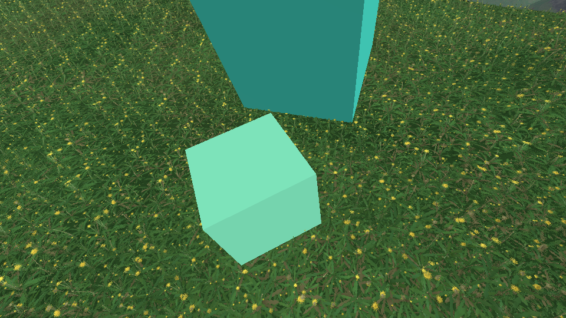
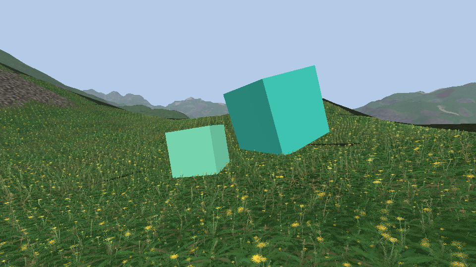
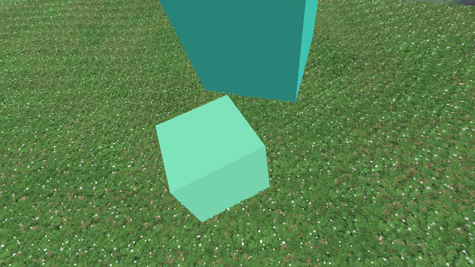
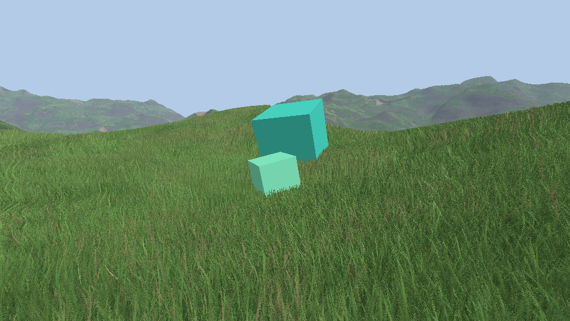

# A colour map next to the rays

The rays stored where a blade is met (height), how it faces (normal) and which blade it is (id). They now store its colour too, so that what is not green can be baked: the flowers and seeds of [13-plants.md](13-plants.md).

`grass_kind=dandelion` and `grass_kind=clover_flower`, the cameras of `tests/capture/grass.capture.json`.

## What is stored

Four textures for the oblique rays and four for the rays from the top, all with mips, trilinear and 16 times anisotropic:

| Texture | Texel | In blocks | Read |
|---|---|---|---|
| height | R8 | BC4, 0.5 byte | by every layer, several times |
| normal | RG8, octahedral | BC5, 1 byte | once, for the closest hit |
| blade id | R8 | BC4, 0.5 byte | once |
| **colour** | RGBA8 sRGB | **BC1 sRGB, 0.5 byte** | once |

The first idea was to split the 24 bits of the normal and the id in two, half for the normal and half for the colour. Two values packed in a byte cannot be filtered (the mean of two packed bytes is not the pack of the means) nor put in blocks, and the grass is read filtered at grazing angles everywhere. A texture of its own costs half a byte a texel and one more fetch per pixel, and loses nothing.

- `GrassRaycast::oblique_colour`, `top_colour`: RGBA8 laid out like the rays, sRGB bytes (`encodeGrassColour`), alpha 255. Saved in `grass_raycast.bin` after the rays (magic `DYGRAS3`, bake version 4: old files are baked again).
- `makeGrassColour` (`grass_textures.h`) makes the texture of the pass, `encodeBC1` its blocks: the two ends on the line of the largest spread of the 16 colours, always in the four colour mode.
- Uploaded as `R8G8B8A8_SRGB` or `BC1_RGB_SRGB_BLOCK`: the sampler gives linear colours, filtered. Bindings 8 and 9 of set 1.

## What the colour is

`GrassModel::colours`, a linear colour per vertex from its part: blades are green by their height (`grass_root_colour` to `grass_tip_colour`, the two colours `grass.frag.glsl` had), stems a paler green, leaves a deeper one, flowers and seeds the colours of their kind. The ground between the plants is the root colour. `GrassTracer::Hit::colour` is the colour where a ray meets a triangle.

In `grass.frag.glsl` the colour read for the closest hit replaces `mix(root_color, tip_color, baked)`; the variation from blade to blade, the dry blades, the shadows and the canopy go on top as before. `RenderSettings::Grass::baked_colour` (the Grass section of the debug menu), 0: the green by the height alone, as before.

## What was checked

- `GRASS.12`: sRGB bytes and back; from the top, each texel of the colour map is the colour of what the ray straight down meets (dandelions: flowers are met, the ground is the root colour); yellow in the oblique rays; texture sizes, level after level; a block of two colours through BC1; the whole map through BC1 moves by 3.9 / 255 on average at 64² (1.9 / 255 at 256², 3 % of the values over 8 / 255).
- 15 grass tests pass. The engine was captured with the meadow, the dandelions and the clover in flower: the rays take 56.1 MB in blocks, the bake 3.7 to 4.2 s.
- The meadow: its colour map is the same gradient the shader had, read from a texture.

## Not done

- The meadow was not compared pixel for pixel with the picture before (the colour is now filtered instead of computed from the filtered height), and the `base` goldens were not recorded again.
- Dry blades are picked by their id whatever their part: a flower in a dry patch turns to straw.
- Frame time was not measured.
