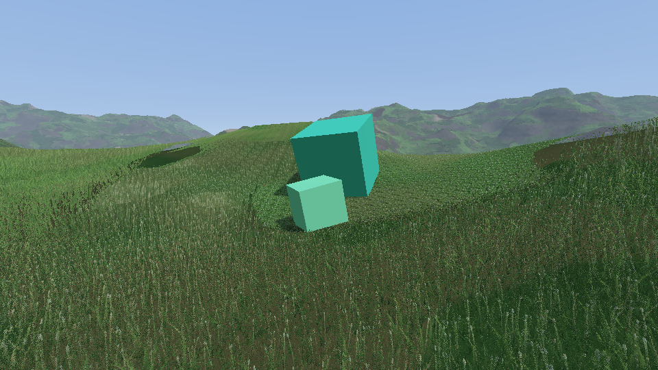
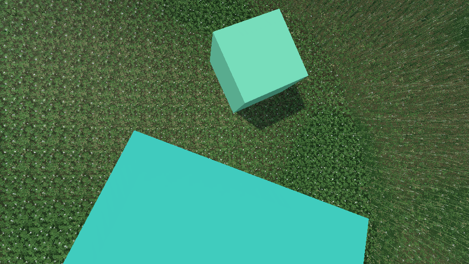
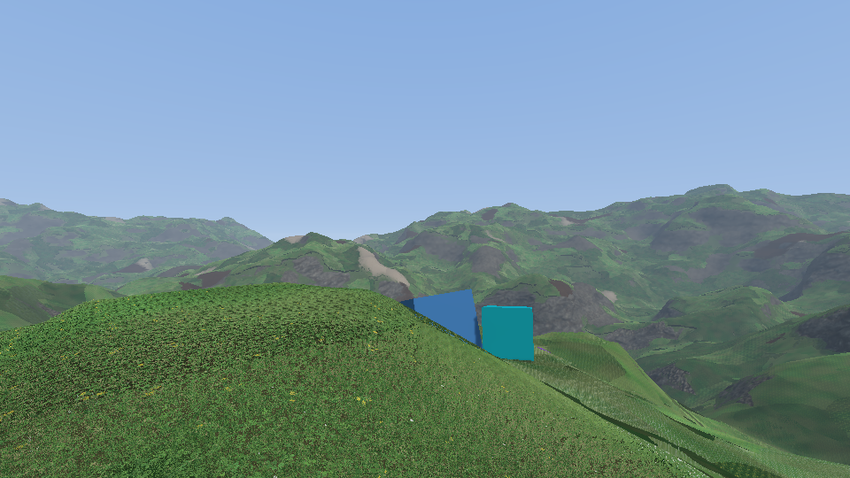

# Species : how much of each plant, and how tall, from its own noises

The ten kinds of tiles of [13-plants.md](13-plants.md) grow together. Each kind has two Perlin noises in octaves over the world: one says how much of it there is, the other how tall it grows. The kinds whose first noises are the highest at a place grow there together, and the shell of the grass is at the top of the tallest of them.

Before, small plants only grew where one height map of the grass was low, a fixed layer of short meadow grass was under the tall kinds, and the shell was as high over clover as over short grass (0.55 m). Decisions taken with Paul for this rework: the kinds still compete (the best noises win), each kind has its own height noise and the shell is the tallest kind of the place, tall grass only thins the small plants (never to none), four kinds at most at a place and no fixed undergrowth.

## The noises

- A 256² RGBA texture that repeats, a Perlin noise in 3 octaves per channel (each octave half as wide and 0.4 times as strong, `bakeSpeciesNoise`, `logic/grass/grass_species.h`).
- **How much** of each of the ten kinds: the texture read three times, at scales 1, 1.37 and 0.73, so the three do not repeat together. `species.size` (40 m) is the first octave, about the size of a patch.
- **How tall** each kind: the same texture read three more times, wider and elsewhere (scales 0.53, 0.61, 0.47: octaves of about 80, 40 and 20 m). A kind is `1 - patch_amount` (0.55) to 1 times its modelled height (`GrassModel::height`: clover about 0.11 m, meadow grass 1 m, times `grass_params.height`).

## Which kinds grow at a place

- **The four best** (`grassSpeciesAt`, `species()` in `grass.frag.glsl`). The kinds whose noises plus `abundance` are the highest are the layers of the grass, from the one there is most of. `layers` (4) is how many are looked up.
- **How many plants of each** (`keep`, by `species.overlap`, 0.8). The first kind is as dense as its noise is over the second one's, the others as theirs are close to the first: all of the plants of a tile half a blend width inside a patch, half of them where two patches meet, none as far outside. Over 900 m, 16 % of the land has one kind, 23 % two, 22 % three and 40 % four.
- **Plant by plant.** The id of a plant is its rank in a best-candidate order of its tile (`tileSites`), so a layer at density `keep` shows the plants whose id is under it: fewer and fewer, still evenly spread, no line (`hitPlant`).
- **No line where kinds trade places.** A kind that is about to leave the four for the fifth loses its last plants just before (`grass_species::fade`, a quarter of the blend width). A layer whose kind has gone is the first kind again: none of it at first, as dense as the first layer half a blend width further (it was all of it at once).
- **Few and small, then many and tall.** The last plants of a kind at the edge of its patch are 0.15 of the height it has there, those of a kind that keeps half of its plants are whole (`grass_species::stunted`). The top of the plants has no step where a tall kind comes into a patch of clover.
- **The shade of tall grass** (`species.shade`, 0.5) replaces the rule on the height of the grass. How tall the tall kinds of the place grow (their height noises, weighted by how close each is to the best tall kind: `GrassSpecies::canopy`, 0 to 1) is taken from the noise of the small kinds (fescue, clover, clover in flower, plantain, dandelion): `shade` less where the tall grass is at its tallest, `shade` more where it is at its shortest. Never none: a small kind whose noise is high enough grows under tall grass. Over 900 m a small kind is first at 19 % of the places under tall grass (43 % without the shade) and at 73 % of those under short grass (43 %).
- Read once per pixel at the root of the ray at the middle of the shell: it does not move with the view.
- `overlap` 0: one kind at a place, edges like lines. `species.size` 0: the meadow everywhere, as tall as the height map of [11-height-map.md](11-height-map.md). `grass_kind=clover`: that kind everywhere, as tall as its own noise.

## The shell at the top of the plants

- `GrassTopField` (`grass_species.h`) makes the same choice on the CPU and gives the top of the plants of a place: the tallest of the kinds that have a plant there. `GrassPass::update` bakes it in the 65² map of each chunk that [11-height-map.md](11-height-map.md) had (one layer of the 2D array per chunk slot; baked again, 16 chunks a frame, when the species, `patch_amount` or the kind of `grass_kind` change).
- A texel is the tallest plant within 2 m of its vertex (sampled every 2 m, the same samples on the edge two chunks share): the shell goes straight from a vertex to the next, 4 m on, and plants come and go within less. With heights of 0.2 for the small kinds and 0.7 to 1 for the tall ones, the shell is 0.1 over the plants on average and 0.06 under them at worst; a plant that is over the shell is drawn as tall as the shell. Without the 2 m the shell was 0.5 under plants in places, with 4 m it was 0.14 to 0.17 over them.
- `grass.vert.glsl`: `shell = height × map_top × map × cover`, `cover` the slope and the soil as before (a varying now: what the fragment shader did where the grass ends, by the height of the shell, is done by it, a shell that is low over clover is not an end of the grass).
- `grass.frag.glsl`: a layer is as tall as its kind grows there, no taller than the shell. The shorter a layer is under the tallest one of the pixel, the darker (what the undergrowth had).

## The rays of ten kinds

- One file per kind, `resources/grass_raycast_<kind>.bin` (58 MB each), baked when missing or stale: 1.1 to 4.4 s each, 24 s for the ten the first time.
- All in the same images: the layers of a kind follow those of the kind before. An image has 2048 layers at most on most GPUs, so a kind has 204 (azimuths 72, 56, 48 and 28 from the lowest rays up, instead of 96, 64, 64 and 32), and the tiles are 192² instead of 256²: **252 MB** in blocks for the ten (56 MB for the meadow alone before).
- Tile size, height and abundance of each kind, the small ones and `grass_kind` go to the shader as specialization constants.

## What was checked

- `GRASS.13`: the noise is the same for a seed and repeats; over 900 m every kind is first on more than 0.5 % of the land, grows short somewhere and tall elsewhere; the first kind keeps half of its plants at least, the others half at most, in the order of their noises; up to four kinds together; small plants are first less than half as often under tall grass as without the shade, and more often under short grass; a quarter of a metre on, the density of the first kind moves by 0.09 at most (0.15 allowed) and its height by 0.006; without overlap one kind at a place; a forced kind has all of its plants.
- `GRASS.15`: the top of a place is the tallest of its kinds; the map of a chunk is the same for the same parameters and on the edges two chunks share, over the plants (0.08 under allowed) and not far over them (0.12 on average allowed), low over the small plants and high over tall grass; another shade or amount is another key; a forced kind has the shell at its height; without the species the map is the height map of the meadow, which only counts there.
- `GRASS.14` (the plants of a tile and the first ones of their order stand apart) is unchanged.
- Captures of `base` (above), and against the build before: the Grass pass takes 1.54 ms instead of 1.21 at 1920 × 1080 on the `grass_times` views (four lookups a pixel instead of three, and three more reads of the noises), 0.66 instead of 0.46 from far.

## Not done

- The terrain is still pushed back under the grass by the height of the tallest grass (`under_grass` in `terrain.frag.glsl`), not by the shell of the place.
- A camera under the shell sees the ground in the colour of grass from the side, as before; over small plants the shell is under the eyes now.
- The shell drops by up to 0.9 m over a few metres where a clearing of small plants meets tall grass: its triangles (4 m) show on that edge from some views.
- The meadow lost some sharpness when the ten kinds came (192² texels a tile, fewer azimuths).
- The `base` goldens were not recorded again. Not run in VR.
