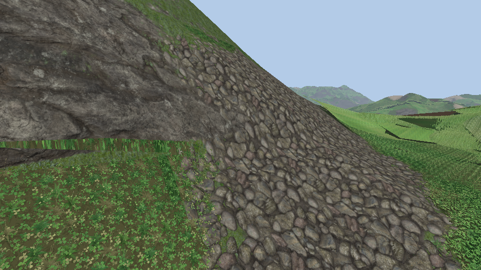

# Species in patches

The ten kinds of tiles of [13-plants.md](13-plants.md) grow together: each has its patches, and the small plants only grow where the grass is short.

## Which kind grows where

- Each kind has its own Perlin noise in octaves (3, each half as wide and 0.4 times as strong), a channel of a 256² RGBA texture that repeats (`bakeSpeciesNoise`, `logic/grass/grass_species.h`). Ten kinds: the texture is read three times, at scales 1, 1.37 and 0.73, so the three do not repeat together. `species.size` (40 m) is the first octave, about the size of a patch.
- **Small or tall** (`GrassKindInfo::small`): fescue, clover, clover in flower, plantain and dandelion are small; meadow grass, cocksfoot, ryegrass, timothy and oat are tall. Where the height map of the grass ([11-height-map.md](11-height-map.md)) is under `species.low` (0.4 of the way from the shortest grass to the tallest) the small ones grow, elsewhere the tall ones. Soil patches and slopes lower the grass too: small plants along them.
- **The patches blend** (`species.overlap`, 0.8; 0 to 1). The three kinds whose noises plus `abundance` are the highest are the tall layers. A kind is as dense as its noise is over the next one's: all of the plants of its tile half a blend width inside its patch (the width is `overlap` in units of the noise), half of them where two patches meet, none as far outside. Where no other kind is close the layers are all of the first kind. Over 900 m two kinds grow together on 78 % of the land.
- **Plant by plant.** The plants of a tile stand where best-candidate sampling puts them (`tileSites` in `grass_model.cpp`: each plant the furthest of many candidates from the ones before it, on the tile as it repeats, a Poisson disk kind of spread), and the id of a plant is its rank in that order, the same over its blades, stem and head (`GrassModel::ids`). The first plants of the order are spread evenly too, so a layer at density `keep` shows the plants whose id is under it: fewer and fewer towards the edge of a patch, still evenly spread, no line. The shader reads the id of what each thinned layer met (`hitPlant`, one more fetch for those layers) and a plant that is not there leaves the ground of its layer: the other layers show behind it.
- Small and tall plants blend the same way: over the middle of a band of heights around `species.low` (`overlap` x 0.45 of the range) the height of the grass adds a little to the noise of the tall kinds and takes it from the small ones, further out it adds a lot. A noise of a few metres on the height winds that line, which is straight between the vertices of the terrain otherwise. The short meadow grass under the tall kinds thins with them, there is none under the small plants.
- The soil patches drop plants by the same ids, evenly spread now. The dry blades are picked by another order of the ids.
- `overlap` 0: one kind at a place, edges like lines.
- Read once per pixel at the root of the ray at the middle of the shell (`species()` in `grass.frag.glsl`), like the height patches: it does not move with the view. `grassSpeciesAt` is the same choice on the CPU.
- A layer is as tall as its kind (`GrassModel::height` times `grass_params.height`), no taller than the grass of the place, on a tile of the size of its kind.

## The rays of ten kinds

- One file per kind, `resources/grass_raycast_<kind>.bin` (58 MB each), baked when missing or stale: 1.1 to 4.4 s each, 24 s for the ten the first time.
- All in the same images: the layers of a kind follow those of the kind before. An image has 2048 layers at most on most GPUs, so a kind has 204 (azimuths 72, 56, 48 and 28 from the lowest rays up, instead of 96, 64, 64 and 32), and the tiles are 192² instead of 256²: **252 MB** in blocks for the ten (56 MB for the meadow alone before).
- Tile size, height and abundance of each kind, the small ones and `grass_kind` go to the shader as specialization constants.
- `grass_kind=clover` on the command line: that kind everywhere. `species.size` 0 (the Grass section of the debug menu): the meadow everywhere.

## What was checked

- `GRASS.13`: the noise is the same for a seed and repeats; over 900 m every kind takes more than 0.5 % of the land; small kinds only where the grass is short outside the band; the first kind keeps half of its plants at least and the two first kinds a whole tile together; a quarter of a metre on the density of a kind moves by 0.12 at most (0.15 allowed); without overlap one kind at a place.
- `GRASS.14`: the plants of a tile, and the first 10, 25 and 50 of them, are further apart than 0.45 of the spacing of a grid of as many; every kind has ids over the whole range.
- `GRASS.4` (rays looked up from the middle of the grass against from its top) is a tie at 65° on the new meadow tile (0.219 against 0.217), still clearly better at 25°, 35° and 55°: the check allows 5 % there.
- The captures above, with the blend.

## Not done

- The shell of the grass is as high over the small plants as over short grass (0.55 m): rays cross air before they meet clover, and the terrain is pushed back under it as if the grass was that tall.
- The meadow lost some sharpness (192² texels a tile, fewer azimuths). Frame time was not measured.
- The `base` goldens were not recorded again.
