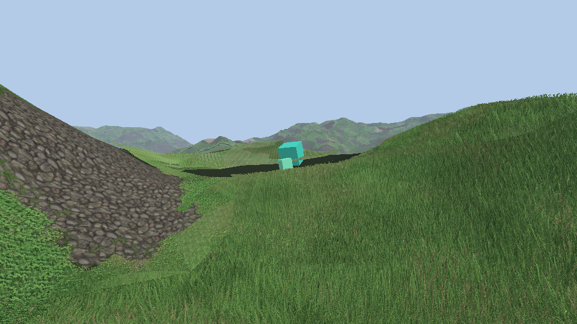
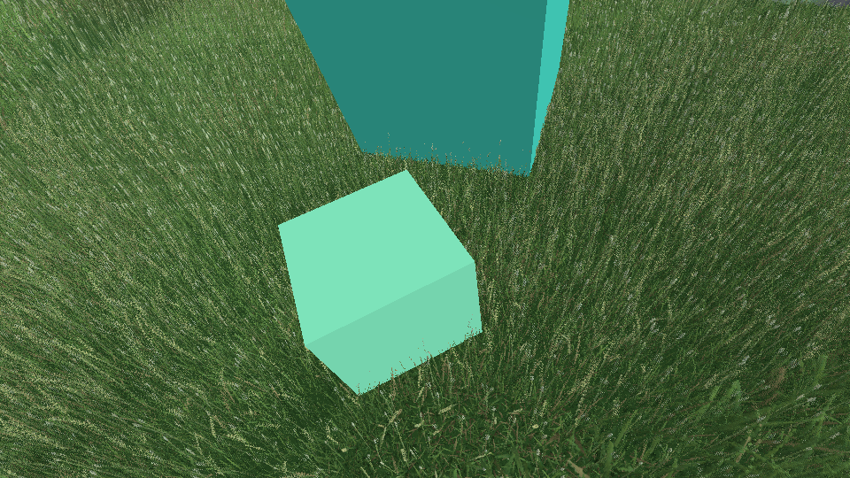

# Species in patches

The ten kinds of tiles of [13-plants.md](13-plants.md) grow together: each has its patches, and the small plants only grow where the grass is short.

## Which kind grows where

- Each kind has its own Perlin noise in octaves (3, each half as wide and 0.4 times as strong), a channel of a 256² RGBA texture that repeats (`bakeSpeciesNoise`, `logic/grass/grass_species.h`). Ten kinds: the texture is read three times, at scales 1, 1.37 and 0.73, so the three do not repeat together. `species.size` (40 m) is the first octave, about the size of a patch.
- **Small or tall** (`GrassKindInfo::small`): fescue, clover, clover in flower, plantain and dandelion are small; meadow grass, cocksfoot, ryegrass, timothy and oat are tall. Where the height map of the grass ([11-height-map.md](11-height-map.md)) is under `species.low` (0.4 of the way from the shortest grass to the tallest) the small ones grow, elsewhere the tall ones. Soil patches and slopes lower the grass too: small plants along them.
- **The patches overlap** (`species.overlap`, 0.5; 0 to 1). The kind whose noise plus its `abundance` is the highest is the first tall layer of the grass; the kinds within `overlap` x 0.7 of it grow with it, as the second layer (and the third, with three layers), the first kind again where there is none. Over 900 m two kinds grow together on 70 % of the land.
- Small and tall plants overlap too: over `overlap` x 0.3 of the heights around `species.low` the two groups compete (the tall kinds get that much more noise the taller the grass, the small ones that much less), and there the best small kind is the undergrowth of the tall ones, at its own height and tile size: clover under ryegrass. 20 % of the land has both. Elsewhere the undergrowth stays short meadow grass under the tall kinds, and is left out under the small plants.
- `overlap` 0: one kind at a place, small plants on one side of a contour of the height map.
- Read once per pixel at the root of the ray at the middle of the shell (`species()` in `grass.frag.glsl`), like the height patches: it does not move with the view. `grassSpeciesAt` is the same choice on the CPU.
- A layer is as tall as its kind (`GrassModel::height` times `grass_params.height`), no taller than the grass of the place, on a tile of the size of its kind.

## The rays of ten kinds

- One file per kind, `resources/grass_raycast_<kind>.bin` (58 MB each), baked when missing or stale: 1.1 to 4.4 s each, 24 s for the ten the first time.
- All in the same images: the layers of a kind follow those of the kind before. An image has 2048 layers at most on most GPUs, so a kind has 204 (azimuths 72, 56, 48 and 28 from the lowest rays up, instead of 96, 64, 64 and 32), and the tiles are 192² instead of 256²: **252 MB** in blocks for the ten (56 MB for the meadow alone before).
- Tile size, height and abundance of each kind, the small ones and `grass_kind` go to the shader as specialization constants.
- `grass_kind=clover` on the command line: that kind everywhere. `species.size` 0 (the Grass section of the debug menu): the meadow everywhere.

## What was checked

- `GRASS.13`: the noise is the same for a seed and repeats; over 900 m every kind takes more than 0.5 % of the land, small kinds only where the grass is short outside the band where both grow, without overlap one kind at a place, and fewer than a quarter of neighbours 3 m apart are of different kinds.
- The captures above, with the overlap.

## Not done

- The shell of the grass is as high over the small plants as over short grass (0.55 m): rays cross air before they meet clover, and the terrain is pushed back under it as if the grass was that tall.
- The meadow lost some sharpness (192² texels a tile, fewer azimuths). Frame time was not measured.
- The `base` goldens were not recorded again.
