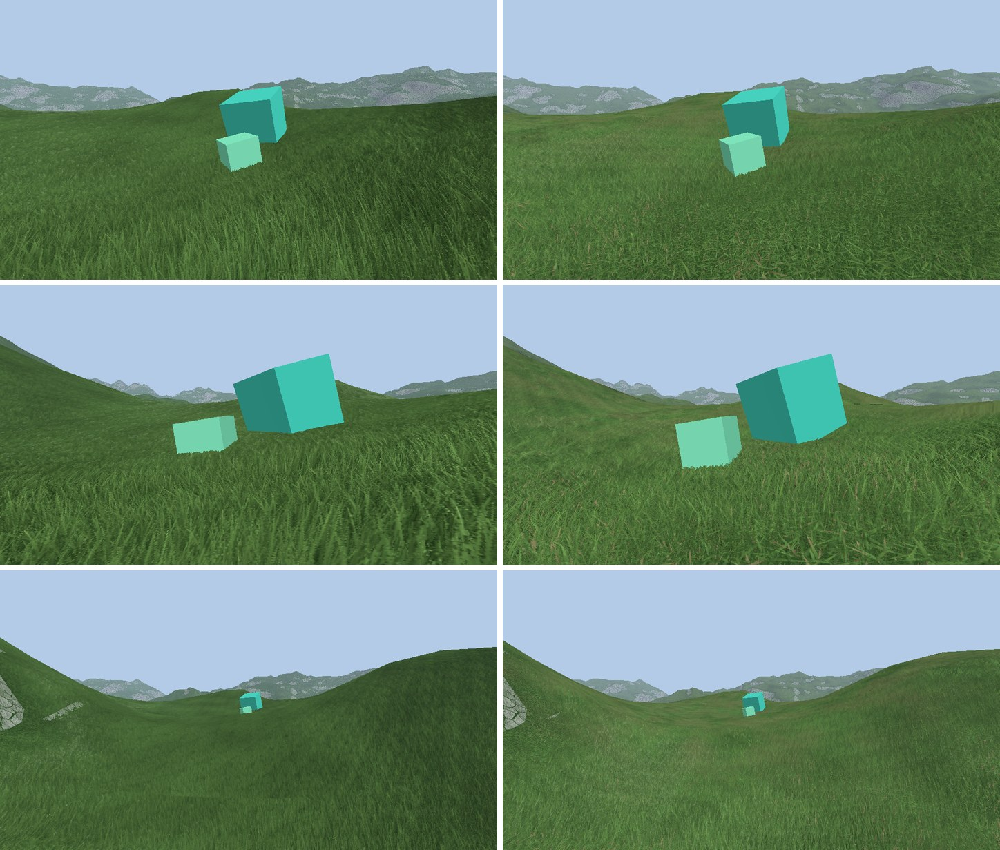

# Grass look: plan

Ten changes to make the grass of [grass.md](../grass.md) look better and repeat less. Each has its own doc; they were done one by one in this order, and each doc ends with what was measured or seen.

**Status: all ten are done.** Before (left) and after (right), same cameras:



The capture spot fell in a short patch of step 3: the grass around the boxes is 0.33 m high on the right, 0.6 m on the left.

What did not go as planned:

- Step 3 needed the terrain pass to step back and darken under the grass ([03-patches.md](03-patches.md)).
- Step 7 takes three fetches, not one ([07-sun-shadows.md](07-sun-shadows.md)).
- Step 9 only works within a few metres ([09-silhouette.md](09-silhouette.md)).
- Step 10: one azimuth per pixel is too grainy at full strength, the default is half ([10-sharper-blades.md](10-sharper-blades.md)).
- Not checked: motion (wind, sliding), VR, frame time. The lookup went from 3 to 5 texture fetches per pixel to about 16 to 22 (3 layers, shadow and canopy).

| Step | Doc | What | Needs a re-bake | Extra fetches per pixel |
|---|---|---|---|---|
| 1 | [01-layer-warp.md](01-layer-warp.md) | Each layer bends its tiling with its own noise | no | 1 per layer (replaces the shared one) |
| 2 | [02-layer-scale.md](02-layer-scale.md) | Each layer has its own tile size | no | 0 |
| 3 | [03-patches.md](03-patches.md) | Tall and short patches, clearings | no | 1 in the vertex shader, 1 per layer |
| 4 | [04-undergrowth.md](04-undergrowth.md) | A shorter, denser layer under the tall ones | no | 1 layer |
| 5 | [05-blade-colour.md](05-blade-colour.md) | A random id per blade in the texture: dry, dark and light blades | yes | 0 |
| 6 | [06-curved-blades.md](06-curved-blades.md) | The lean grows with height: blades curve in the wind (idea 8) | no | 1 per layer |
| 7 | [07-sun-shadows.md](07-sun-shadows.md) | Blade on blade shadows from the oblique and top rays (idea 11) | no | 3 |
| 8 | [08-canopy-occlusion.md](08-canopy-occlusion.md) | Darker under the canopy, from the top rays (idea 12) | no | 1 |
| 9 | [09-silhouette.md](09-silhouette.md) | Blade tips instead of a smooth line on the crests (idea 13) | no | 0 |
| 10 | [10-sharper-blades.md](10-sharper-blades.md) | 256 texels per tile, one azimuth per pixel instead of two blended (idea 14) | yes | 0 |

## What the steps share

**One description of a layer.** Steps 1, 2 and 4 all say "a layer is the same tile, placed differently". After step 2 the shader loop works on a layer described by:

| | Meaning |
|---|---|
| turn, shift | rotation and offset of the tile (already there) |
| scale | size of the tile, times `tile_size` |
| height | top of the layer, as a part of the shell height |
| warp | its own noise offset |

For a layer of height `Hi` and scale `si`, with the shell `H` above the ground and the view ray losing `D` of height per unit of distance (never less than what makes it cross `max_reach` tiles of that layer):

```
enter     = (H - Hi) / D                      distance under the shell before the top of the layer
reach     = |flat ray| / (si T) / (D / Hi)    tiles crossed in the layer
middle    = root space position of the ray at half of Hi
hit       = enter + (1 - height) Hi / D       distance of the hit
```

The layer with the closest hit wins (today: the highest hit, which is the same thing while all layers have the same height).

**Root space.** Every noise that moves or selects blades is read at the root position (tile space times the tile size), never at the shell pixel: a blade must get the same value from every view, or it swims. Offsets that depend on height are zero at the ground: roots stay put.

**Heights are compared by maximum, never blended**, between layers. Blending two heights gives a surface that is neither.

**The texel.** Step 5 changes it once, for steps 5, 7 and 8:

| Channel | Before | After |
|---|---|---|
| r | height of the hit | height of the hit |
| g, b | normal x, y | normal, octahedral |
| a | normal z | blade id (0.5 on the ground) |

**Settings.** New ones go in `RenderSettings::Grass`, the Grass section of the debug menu and the push constants (48 of 128 bytes used today). Every step can be turned off there: 0 gives the picture of the step before.

## How each step is checked

- `tests/capture/grass.capture.json` holds fixed cameras over the same flat grass with two boxes (eye level, low, 45° twice one second apart, top, far, skimming the ground). Captured before and after each step:
  `build/RelWithDebInfo/dynamical capture=<repo>/tests/capture/grass.capture.json capture_dir=<out>` (from `build/`).
- Steps that touch the bake or the CPU mirror extend `tests/unit/grass.cpp`.
- After the last step: unit tests (62 pass), the GPU tests (10 pass), `base_spawn` / `base_ring` goldens re-recorded once with a CHANGELOG entry, and [grass.md](../grass.md) updated.

## Out of scope here

Gust fronts from a scrolling noise, grass bending around objects, several baked tiles, hex tiling (ideas 6, 7, 9, 10), shadows from other objects, and the camera inside the grass.
