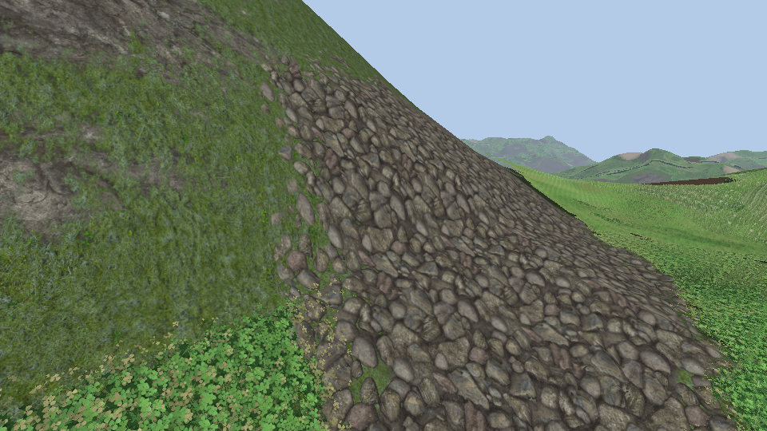
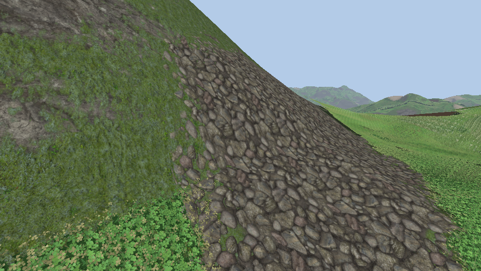

# Relief of the soil: the rays of the grass on the ground textures

The mud, the stones and the sand of [ground.md](ground.md) are flat textures with a normal and a height. Their height map is now built as geometry and rays are baked on it, the way they are on a tile of grass ([grass.md](grass.md)): the terrain shader looks the view ray up in them and reads the textures where the ray meets the stones, not where it meets the plane they are drawn on.

With the relief (stones 12 cm deep), then without:

Towards the horizon the stones hide the gaps behind them and each other's feet; from above nothing moves.

## The bake

- `groundReliefModel` (`logic/terrain/ground_relief.h`): the height channel of a texture, averaged down to 256², a vertex per texel and two triangles between four of them, from y = 0 at the lowest texel to 0.98 at the highest. One more row and column, the first ones again: the tile closes on itself and repeats.
- `bakeGroundRelief` bakes the rays of the grass on that tile (`bakeGrassModel`, the baker of `bakeGrass` on any tile of triangles): the lowest rays, 22.5°, 45° and 67.5° with 48, 40, 32 and 24 azimuths, and the rays from the top. 0.8 s a texture.
- Only the height of the hits is kept: the normal, the colour and the occlusion of a hit are in the texture itself, at the point the ray met.
- `resources/ground_relief_<mud|stones|sand>.bin` in the run directory, baked again when the heights or the parameters change (`groundReliefKey`).

## In the pass

- `TerrainPass::loadRelief`: the heights of the hits of the three textures in one array image (144 layers each, BC4 where the GPU has it, mips), and the rays from the top in another (a layer each). Set 1, bindings 3 and 4. Without the ground textures: a flat texel, and no relief.
- `terrain.frag.glsl`, `reliefAt`: the plane that is drawn is the top of the relief. The ray is known by where it crosses the middle of the relief; the baked rays through that point from the same side, of the two baked elevations around its own, say how far before or after it the stone is (`lookup` of `grass.frag.glsl`, without the dither). `soilLayer` reads its textures at that point of the ground.
- The depth of the pixel is pushed back by how deep the hit is: what stands on the ground hides that much of it.
- How deep: mud 5 cm, stones 12 cm, sand 4 cm (`relief_depths` in `terrain_pass.cpp`), times `RenderSettings::relief` ("Relief of the soil" in the debug menu) and `ground_relief=` on the command line. 0: flat.
- Not on the large tiles the textures are read on far away (40 to 120 m): the relief fades with them.

## What was checked

- `RELIEF.1`: the tile of a round stone: its size, its lowest and highest points, its edges that meet, its top in the middle.
- `RELIEF.2`: the rays from the top are the height map; the lookup gives the height of the hit of traced rays from every side, twice closer than a flat tile at least; the key changes with the heights.
- The captures above (`ground_relief=1` and `0`).

## Not done

- The rock of the steep faces and the earth under the grass have no relief.
- No shadow of a stone on the next one (the grass does it with the same rays).
- The edge of a patch is still decided on the plane: a stone on the edge is cut where the plane says.
- Frame time was not measured: 2 to 4 more fetches for each of the three layers a pixel is in.
