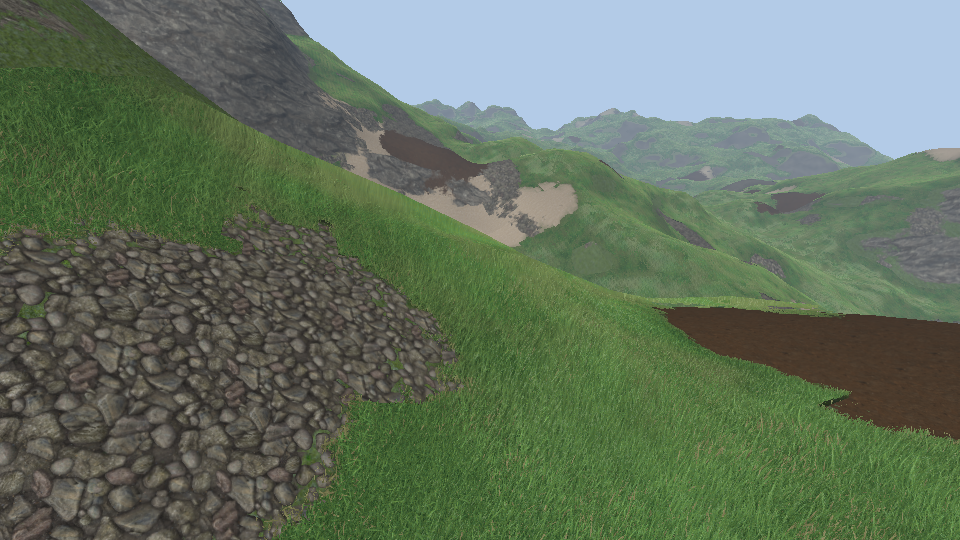
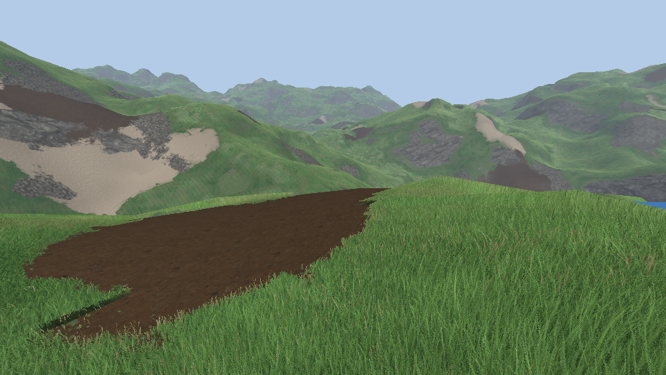
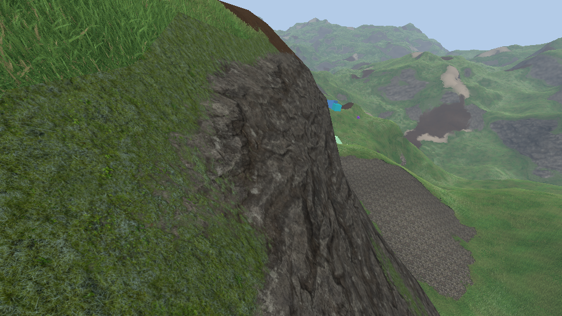
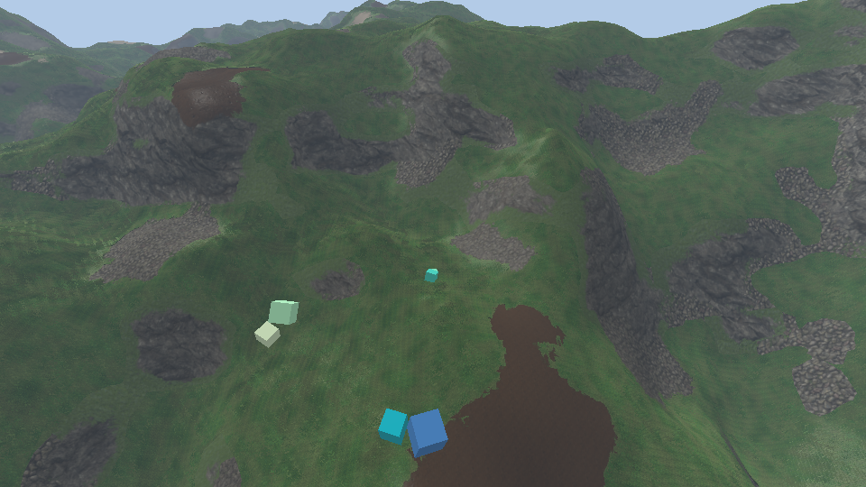

# Ground

What the terrain is made of. Seen from above: earth under the grass, and patches of mud, of stones and of sand
with no grass on them. On the steep faces: rock. The patches are 2D maps baked per chunk from Perlin noise, the
textures are those of the Tautavel Unity project, and where two materials meet the one that stands higher shows:
stones come out of the grass by their tops, mud lies in the hollows, the rock keeps earth on its ledges.









```bash
# Once : the textures, from the Tautavel repository (16 MB in resources/ground, git ignored)
build/venv/Scripts/python tools/ground_import.py --source <Tautavel repo> --lfs <lfs objects>
```

`--source` and `--lfs` are those of `tools/speedtree_import.py` ([vegetation.md](vegetation.md)). Without
`resources/ground` the soil is drawn in flat colours and the rock is `resources/textures/rock.jpg`, as before.

## Files

| File | Role |
|---|---|
| `src/logic/terrain/soil.{h,cpp}` | `SoilField`: where the patches are, the map of a chunk (`bake`), its CPU read (`sampleSoilMap`). In `dynamical_sim` |
| `src/renderer/terrain/soil_maps.{h,cpp}` | `SoilMaps`: the maps on the GPU, binding 2 of the view set; `SoilLayers` (context variable): which layer a chunk has |
| `src/renderer/terrain/chunk_layers.h` | `ChunkLayers`: a layer of a 2D array per chunk slot, shared with the height map of the grass |
| `src/renderer/passes/terrain_pass.cpp`, `shaders/terrain.frag.glsl` | The ground textures and how they are combined |
| `src/renderer/shaders/grass.{vert,frag}.glsl` | No grass on the patches |
| `tools/ground_import.py` | Builds `resources/ground` from the Unity textures |
| `tests/unit/soil.cpp` | `SOIL.1` to `SOIL.3` |

## The soil maps

- **The noise.** One FastNoise2 Perlin fractal per kind (mud 60 m, stones 45 m, sand 90 m for the first of 3
  octaves), anchored to the world. A kind is there where its noise is over a threshold. The threshold is not a
  parameter: `cover` is (the part of the ground the kind takes, 5, 7 and 6 %), and `SoilField` finds the value
  that `cover` of 16384 samples of the noise are over.
- **A distance, not the noise.** The map holds how far into a patch a point is: the noise over its threshold
  divided by its slope (taken over two terrain samples), which is a distance right next to an edge. 0.5 on the
  edge, 0 at 4 m before it, 1 at 4 m after (`edge_width`, 8 m). An edge is then two texels wide wherever the
  noise is steep or flat, the shaders have a slope to work with and their constants are metres.
- **The map.** RGBA8, 67 × 67 for a chunk: a texel on each column of terrain vertices (4 m) like the height map
  of the grass, and one more on each side. R mud, G stones, B sand. A is how tall the grass is: all of it
  6 m away from a patch (`grass_margin`), shorter towards it, none 4.5 m inside. Neighbours bake the same values
  where they overlap.
- **On the GPU.** `SoilMaps` (owned by the renderer, there in every scene) keeps one layer of a 2D array per
  chunk slot (2048 layers, 37 MB), baked on the main thread when the chunk gets its mesh (100 µs) and again, 16
  chunks a frame, when `RenderSettings::soil_params` change. The array is binding 2 of the view set; passes get
  the layer of a chunk from the `SoilLayers` context variable and push it per draw with the origin of the chunk.

## The edge of a patch

A texel every 4 m gives patches with straight edges. Three things on top of the map:

1. **The shaders read it a few metres off** (`soilWarp`: three octaves of value noise, up to 3.65 m, the same
   in `terrain.frag.glsl` and `grass.frag.glsl`): edges wind. That is what the border of the maps is for.
2. **Heights.** A layer is not faded in: it shows where `inside + spread × (height − 0.5) > 0`, `inside` being the
   map minus 0.5 and the height the one of its texture. Stones (spread 0.24, about a metre to each side of the
   edge) first show their tops among the grass, then close up. Mud is the other way round (`fills`): it takes
   the height of what it covers and floods the hollows first, so stones stand out of mud. Order: sand, stones on
   it, mud in both.
3. **The grass goes blade by blade.** Its shell gets shorter from 6 m away (the alpha of the map, read per
   vertex). Over the edge itself (0.8 m to each side) `grass.frag.glsl` finds where the blade it met is rooted,
   reads the bent map there and drops the blade if its id is over what is left of the grass: tufts further and
   further apart, drier, then none. Far away, where blades are not told apart, one line. The terrain is dark
   under the grass and steps back behind it (`under_grass`) by the same amounts.

## The textures

`tools/ground_import.py` writes five layers of 1024², two images each: `<layer>_color.png` (albedo) and
`<layer>_detail.png` (RG normal, B height, A occlusion), and `ground.json` (tile in metres, smoothness, sources).

| Layer | Unity textures | Tile | |
|---|---|---|---|
| mud | `Homo/Terrain/Textures/MuddySand2_1K` (TexturesCom) | 2 m | no height map: the height is integrated from the normal map; albedo × 6 (it is nearly black without the exposure of the HDRP camera) |
| stones | NatureManufacture `T_Ground_Pebbles_01` | 1.8 m | |
| sand | NatureManufacture `T_Ground_Sand_01` | 2.5 m | |
| rock | `Homo/Terrain/Textures/RockCliffGranite_1K` (TexturesCom) | 5 m | height from the normal map; mean colour brought 70 % of the way to the stones': they are pieces of it |
| earth | NatureManufacture `T_Ground_Grass_01` | 2.5 m | mean colour brought towards the green of the grass pass seen from far: no step in colour where the grass ends on a slope |

Normal maps are stored for a texture laid u along x and v along z of the world. Their sign is not assumed: the
importer compares each with the slopes of its height map (correlations 0.63 to 0.95) and flips what is negative.

In the shader:

- **Rock** on what is steeper than about 47° (`normal.y` 0.55 to 0.8, moved by the heights: the earth stays in
  the hollows of the rock). It is laid on the two vertical planes, u along the face and v down. Where a face
  looks between the two, the old shader faded one into the other and both showed at once; now the plane whose
  rock is higher wins (`plane`), with its own normals.
- **Stones at the foot of the rock** (`RenderSettings::scree`): between 28° and 47°, where the grass ends, over
  about a third of those slopes (a noise), with the same height rule as the patches.
- **Far away** a tile of 2 m shows its repeats as a grid. From 40 to 120 m the textures move to tiles 3.1 times
  larger, further still they are blurred. Each layer is also lighter and darker over tens of metres.
- Light: the normal of the terrain plus the normal of the layer, occlusion, and a highlight from the
  smoothness (mud 0.64, wetter in its hollows).

## Settings

`RenderSettings::soil` (on), `soil_params` (`SoilParams`: `seed`, `octaves`, `gain`, `edge_width`,
`grass_margin`, and `wavelength` and `cover` of `mud`, `stones`, `sand`), `scree`. Debug menu: "Soil" under
Terrain, and the "Soil" header.

## Check

- `SOIL.1`: the map is the field on the vertices, neighbours agree where they overlap, the CPU mirror of the
  shader read. `SOIL.2`: over 64 chunks the covers are 4.99, 7.18 and 6.04 % for 5, 7 and 6 (17 % of the ground
  bare), 6 to 12 % of the texels are on an edge, 0.02 % of the steps between texels are over 0.75, no grass well
  inside a patch, the grass is shorter over 40 % of the ground. `SOIL.3`: no cover no patch, thresholds, octave
  limit, key, the map against the distance.
- Captures of `base` from above, at eye level next to a stone patch and a mud patch, and of a rock face (the
  images above).

Limits: the patches know nothing of the terrain (mud on a crest, sand anywhere) nor of the forests, and nothing
reads them but the renderer: walkers and animals do not sink in the mud. Chunks one above the other bake the
same map twice. The goldens of `base` were not recorded again. VR draws the same passes but was not looked at.
