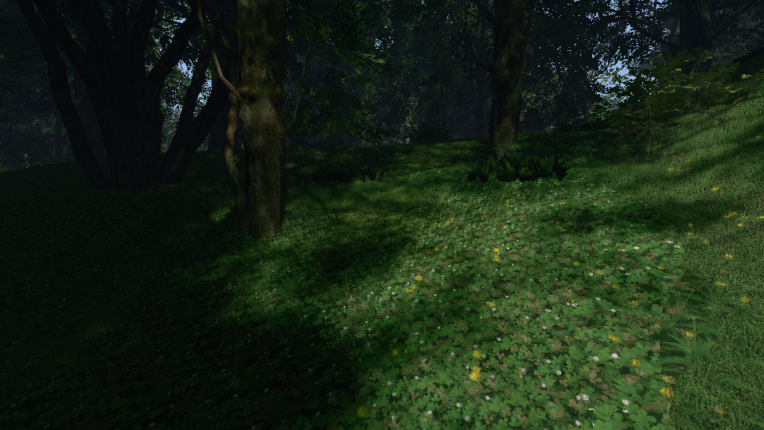
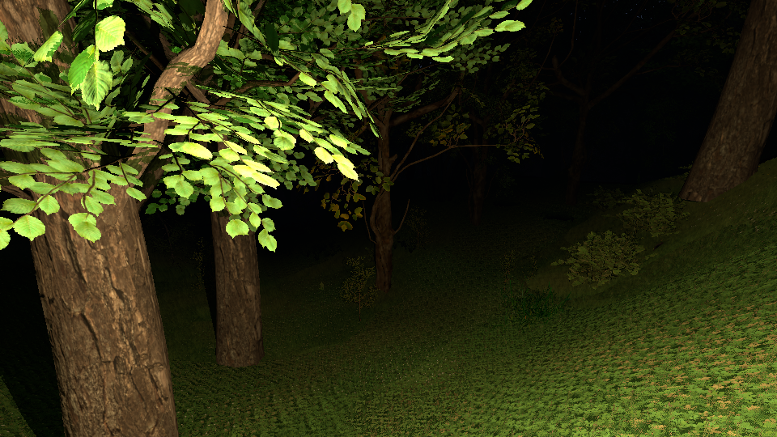
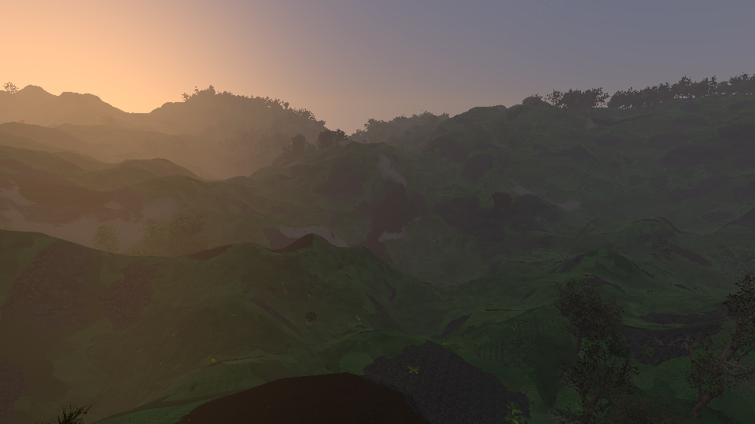
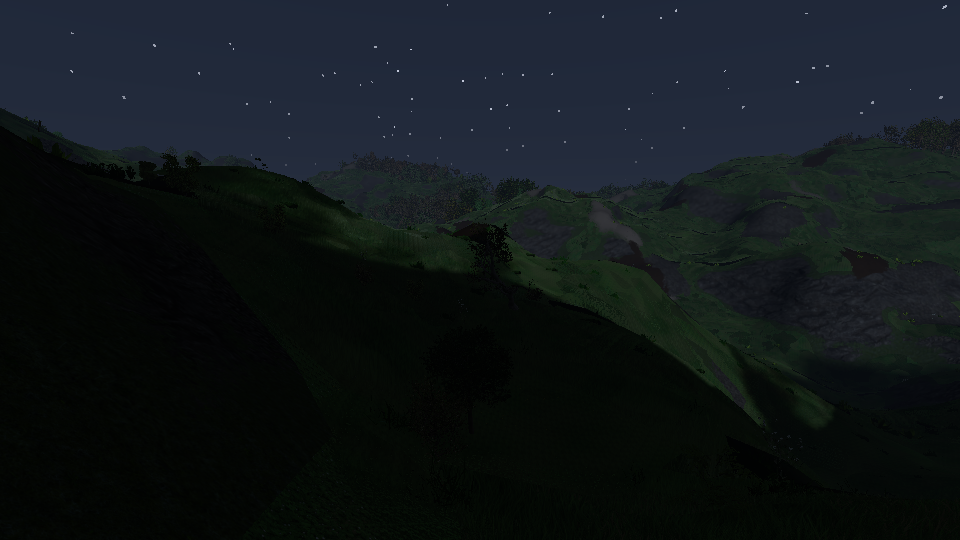
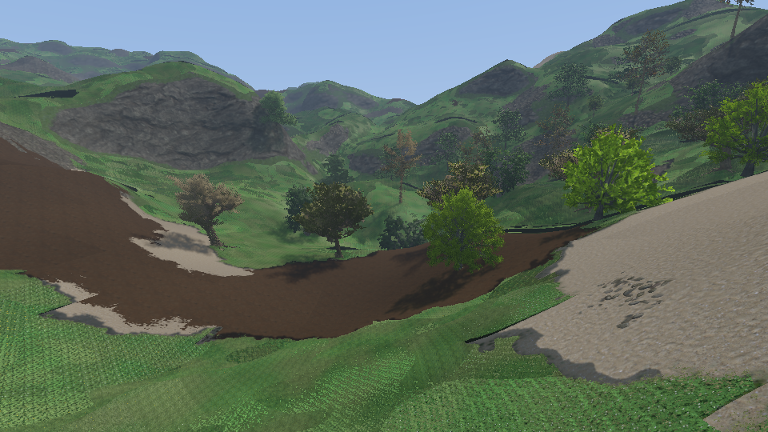
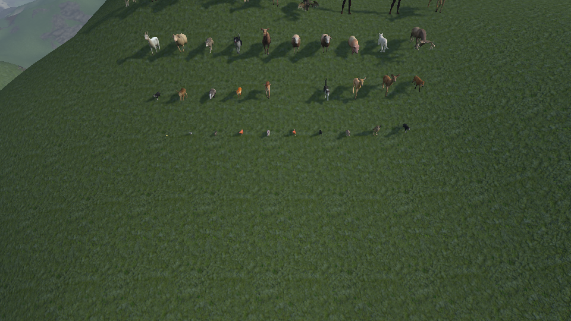

# Lighting: as built

What of [docs/lighting.md](../lighting.md) exists (milestones L1 to L9), where it differs from the design, how to
run it and what it costs. Measures are from an RTX 5080, 1920 x 1080, `forest_walk` (the camera walks from open
land through a forest).

| | |
|---|---|
|  Under the trees at 10:20: sun through the leaves, the rest from the probes |  `forest_torch`: a torch, its shadows, its light in the probes |
|  19:10 |  23:00, the moon casts the shadows |
|  `vegetation_test`: the bright round trees are drawn from their volume |  `animals_test` at 8:00 |

## Running it

Ray tracing is on wherever the GPU has `VK_KHR_ray_query` and `VK_KHR_acceleration_structure`; the log says
`Ray tracing : acceleration structures and ray queries`. Arguments of `dynamical`:

| Argument | |
|---|---|
| `ray_tracing=false` | The fallback on a GPU that has ray tracing: sky, moving sun, torches without shadows, `TreeShade`, billboards |
| `lighting=off\|low\|medium\|high` | The tier of both targets (default: desktop high, VR medium) |
| `probe_rays=<n>` | Rays the probes cast a frame (default 250 000) |
| `far_plants=volumes\|rays\|screen\|none` | Plants far away from their baked volume: in the rays and on screen, one of the two, or neither |
| `var.time=<hours>`, `var.day_length=<seconds>` | Scene variables of the `Sky` system (every scene with terrain has it). `day_length` 0 stops the sun; left out, a day is 1440 s, and the sun is stopped in captures and probes |

The debug menu has a Sky section (time, length of a day, season, "Torch here") and a Lighting section (tiers per
target, ray budgets, far plants, counts).

Scenes: every scene with terrain has the sky; `forest_torch` walks through a forest at dusk with a torch
(`Torch` system); `vegetation_test` lines up, behind the levels of each species, a copy drawn from its volume
(`Plant::lod = Plant::volume`).

## Where the code is

| Part | Files |
|---|---|
| Sky, sun, moon, `Sky` and `Torch` systems | `src/logic/sky/sky.*`, `logic/components/point_light.h` |
| `Lights` UBO (set 0 binding 3) | `src/renderer/lighting/lights.*`, `shaders/include/view.glsl` |
| Sky pass | `passes/sky_pass.*`, `shaders/sky.*.glsl` |
| `RayContext` | `context/ray_context.*` |
| `RayScene`: structures, top level, geometry table | `lighting/ray_scene.*`, `lighting/ray_meshes.h`, `shaders/include/rays.glsl` |
| `SunVisibility` | `lighting/sun_visibility.*`, `shaders/sun_visibility.rt.frag.glsl`, `sun_resolve.frag.glsl`, `composite.frag.glsl` |
| Probes | `src/logic/lighting/probes.*` (classes, light of a probe, bricks: no GPU), `lighting/probe_volume.*`, `shaders/probe_update.rt.comp.glsl`, `shaders/include/probes.glsl` |
| Plant volumes | `lighting/plant_volumes.*`, `shaders/plant_bake.rt.comp.glsl`, `vegetation_volume.*.glsl` |
| Animals in the rays | `passes/animal_pass.*`, `shaders/animal_skin.rt.comp.glsl` |
| What every scene shader shares | `shaders/include/scene.glsl` (`writeLit`, `ambientLight`, `pointLights`), `tree_shade.glsl` |

Shaders: `include/*.glsl` are included, not compiled. A fragment shader that includes `include/scene.glsl` is
compiled twice, `<name>.spv` and with `-DRAY_TRACING --target-env vulkan1.2` `<name>.rt.spv`
(`sceneFragmentShader()` picks one). Files named `*.rt.*.glsl` only exist with ray tracing.

Set 0 of every scene pipeline (`Context::view_layout`, written by `Context::writeViewSet`): 0 `ViewUBO`, 1 tree
shade, 2 soil maps, 3 `Lights`; with ray tracing 4 top level structure, 5 geometry table, 6 leaf textures
(array), 7 table of the bricks, 8 and 9 probe pages (arrays), 10 to 12 plant volumes (arrays).

## The frame

```
systems     TerrainSys : marching cubes, copy of the triangle counts          (compute commands)
passes      AnimalPass::update : skins the animals that cast shadows          (compute)
            PlantVolumes::prepare, RayScene::update : structures, top level   (compute)
            ProbeVolume::update : the rays of the probes                       (compute)
            PlantVolumes::update : some slices of the volume of a species     (compute)
targets     scene passes -> colour, sun, depth; sun rays; resolve; composite + UI
```

## What differs from the design

- **Units.** There is no tone mapping: colours are what the screen shows. The sun is 0.7 at noon, the light of
  the sky on the ground about 0.3, as the shaders had them; the plants' and animals' shaders multiply by 1.43
  (their textures were tuned for a light of 1). `skyRadiance()` (what a ray that misses reads) is the colour of
  the sky half way to grey, times 0.75.
- **Default sun.** Latitude 42.8°, declination 14.8° (August), 10:20: exactly the direction the shaders had
  (`normalize(0.5, 1, 0.5)`), so a scene without the `Sky` system looks as before. East is +X, north -Z.
- **Chunk structures** are not compacted. They are built from the vertex buffer of the slot once the triangle
  count is back (`ChunkTriangles`, `NUM_FRAMES` frames after the mesh), 8 a frame at most.
- **Top level structure**: built again every frame (fast build), never refitted. With the boxes of the far
  plants it holds about 90 000 instances; the instances of the plants are cached per plant
  (`PlantRayTransforms`), the list is still walked every frame.
- **Sun's visibility**: three passes per eye. `colour` is RGBA16F and its alpha says how far over the pixel the
  ray starts (`liftAlpha`): 0.3 m for the grass, whose hits may be under the ground, and for the ground what
  clears the next facet where a 4 m facet turns away from a low sun under normals that still face it
  (`terminatorLift`), and by how far under the ground its depth was pushed back (the relief of the mud, the
  stones and the sand, the ground under the grass: the ray started under the triangle, which hid the sun
  from itself; the stones were black between their tops). The ray also starts nearer the eye by 4 mm per
  metre of distance and per kilometre from the origin of the world: the depth holds near / distance, which
  comes out of the vertex shaders as the difference of two sums of products of world coordinates, and in
  floats, with the near plane at 0.1 m, the distance found again from it is off by that much, another way
  every frame. Bare ground went dark a triangle at a time, for a frame (sand, rock faces). Drawing relative
  to the eye would take the error away at its source; not done. No blue noise texture: a hash per pixel and frame. The history is refused on its distance
  to the eye of the frame before, kept in the alpha of the visibility, and held within 1.5 standard deviations
  of the 5 x 5 rays around.
- **The boxes of the far plants are left out of the per pixel sun rays** unless the sun is under 15°: they are
  beyond the plant geometry range, their shadows only reach the traced pixels at a low sun. Probes always see
  them.
- **Probes.** 250 000 rays a frame and 48 a probe by default, not a million and 64. A ray is an invocation
  (`found` buffer), then a probe gathers its rays: one invocation per probe looping over its rays took 12 ms for the same
  250 000 rays. Classes are also a texture per page (R8), for the passes that fill the probes in the ground and
  refresh the open air (one brick a frame). At most 8 pages (64 bricks, 490 MB); the furthest brick goes when a
  nearer chunk needs one. The schedule: new bricks first with nothing kept, then each brick a quarter of its
  probes at a time, turns coming 1 + (distance in chunks)² times less often; 0.85 of the old value kept.
  Probes within reach of a torch are traced every frame, and for 30 frames after it left, 0.7 kept.
  A bounce on the ground reads a colour from the slope only (not the soil maps), on a plant the mean colour of
  its texture. A leaf seen from under adds the sun that comes through it.
- **Plant volumes**: species under 2 m have none (a billboard far away, no shadow there). Baked 8 slices a
  frame; texels where nothing is hold the mean colour of the leaves. On screen there is no dither between the
  last mesh and the box: the box takes the place of the billboard level at once. The self shadow of a far
  plant is 6 steps towards the sun in its own volume.
- **Animals**: the second level of detail casts the shadow (its indices re-based at load). Refitted every
  frame, built again after 240 to 300 frames.
- **Fallback**: `TreeShade` draws every shadow again when the light has moved by a degree (10° with ray
  tracing, where it only seeds new probes). With 85 000 plants that is a visible pause every 4 s of a 24 minute
  day: to spread over frames if the fallback matters.
- **Terrain edits** are not started.

## Measures

`gpu_times=true` now also logs the whole frame on the clock (`frame`), which includes the compute commands and
the CPU. The machine was shared with other work while these were taken: the clock figures moved by a few ms
from run to run, the pass times did not. The vegetation pass itself goes from 0.6 to 1.0 ms without ray tracing
to 1.2 to 1.9 with it (the probes read per pixel, the far plants from their volumes).

| | ms |
|---|---|
| Sun rays + resolve, high tier (2 rays, 150 m), forest | 1.4 to 3.2 |
| Composite | 0.03 |
| Probes, 250 000 rays a frame (from the length of whole runs, rough) | under 1 |
| Probes, 1 000 000 rays a frame (the same way) | about 6 |
| Vegetation pass, far plants from volumes instead of billboards | + 0.1 to 0.4 |
| Scene passes + sun + composite, high tier | 3.3 to 6.1 |
| The same, medium (1 ray, 60 m) | 2.3 to 4.4 |
| The same, low (1 ray, 25 m) | 2.2 to 4.5 |
| The same, `ray_tracing=false` | 1.1 to 1.4 |
| Whole frame on the clock, high tier | 5 to 9 |
| Whole frame on the clock, `ray_tracing=false` | 4.4 to 7.3 |

Memory: 61 MB a page of probes (6 pages at the default view distance), about 7 MB a species volume, structures
of the chunks and species a few tens of MB.

## Tests and captures

- `LIGHT.1` to `LIGHT.4` (`tests/unit/lighting.cpp`): sun path, one light at a time through a day, sky, `Sky`
  system. `LIGHT.5` to `LIGHT.7`: light of a probe, classes on known densities, bricks and their table.
- Captures wait for `LightingStats::settled()` (structures built, species baked, every probe traced once).
- `tools/visual_test.py golden` and `repeat` run with `ray_tracing=false` unless `--rays`: the pictures of the
  fallback are the reference.
- `tests/capture/lighting*.capture.json`: shots to look at (a forest edge at four times of the day, the torch
  walk, the lineup of volumes, the animals at a low sun). The Debug build runs the validation layer: these
  scenes are clean in it.

## Not done, not verified

- **VR was not run**: no headset in the session that wrote this. The headset target has the same passes per
  eye (`SunVisibility` with one set of images an eye); to check first.
- Opacity micromaps for the leaves, compaction of the structures, refit of the top level structure.
- Depth per probe (light through walls thinner than 4 m), the compact probe layout (20 bytes).
- Dither between mesh and volume, block compression of the volumes.
- The tiers are the design's numbers; only the probe budget was tuned on measures.
