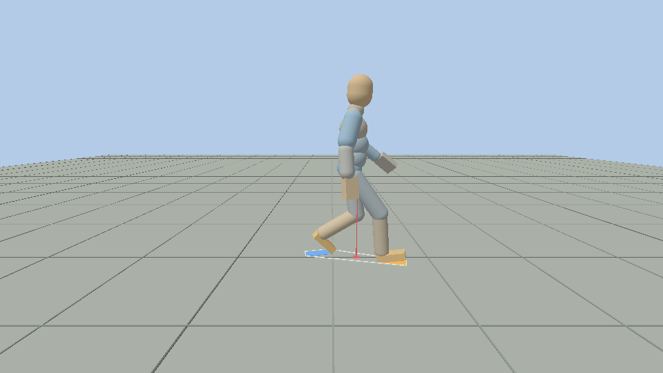
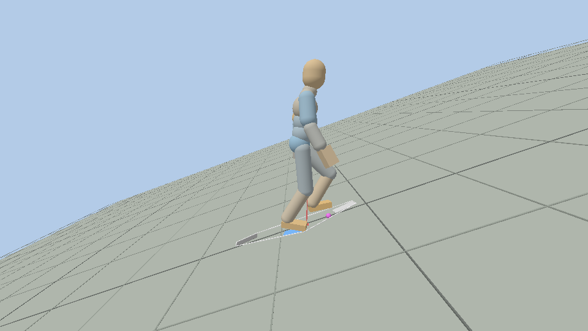
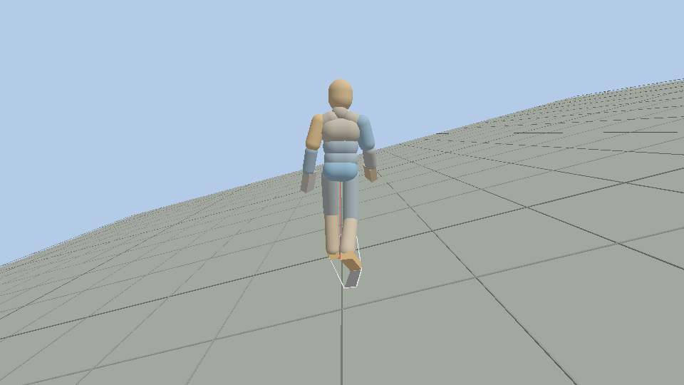

# Kinematic walk with inverse kinematics

*2026-11-10, branch `agents/ik-gait`. Legs only; arms and head are the next chains.*

**Purpose.** See a correct walk on any ground before any physics is asked to produce it: the kinematic
HumanBot walks on tilted planes and on the marching cubes terrain, soles on the ground, the centre of
mass where a walking body keeps it. The same rig feeds `Observation`, so the walk can later be recorded
as imitation data.

```
dynamical scene=ik_walk_slope   var.pitch=12 var.roll=8      # tilted test plane, sliders for everything
dynamical scene=ik_walk_terrain                              # marching cubes terrain, seed 1337
dynamical_tests --test-case="IK*,GAIT*"                      # 19 tests, 6 s
```





## Systems

World fixed lane, 60 Hz, in this order (`resources/scenes/common/ik_world.json`):

| System | File | Does |
|---|---|---|
| `GroundPlane` or `GroundTerrain` | `ground_field.*` | Makes the world's `GroundField` (preinit) |
| `GaitBase` | `gait.*` | Follows the command, advances the stride's phase and the reference point, writes pelvis, trunk, head and arms into `RigPose` |
| `GaitFootIK` | `gait.*` | Plans footprints on the ground, moves each foot through heel strike, flat stance, toe-off and swing, and **creates and updates the legs' `IKChain` and `IKTarget`** |
| `GaitBalance` | `gait.*` | Places the pelvis: height from the legs' reach, horizontal position so that the centre of mass of the solved pose is on its target. Publishes `BalanceState` |
| `Fabrik` | `ik.*` | Solves every chain that has enabled targets, in one batch, and writes joint angles into `RigPose`. Knows nothing of gaits or ground |
| `RigPoseApply` | `ik.*` | Forward kinematics, then `MoveKinematic` on the HumanBot's bodies |
| `PhysicsStep`, `BodySync` | existing | Unchanged |
| `GaitChecks` | `gait.*` | Measures the bodies against the ground, the prints and the limits (`GaitReport`) |
| `Observation@observe` | existing | The trainer's observation, on the kinematic walk |

Host: `GaitView` (`src/view/gait_view.*`) follows the walker, draws the markers and the panel.

## Components

All on the rig entity (the one with `HumanBotSpawn`), except chains and targets, which are entities.

| Component | Written by | Holds |
|---|---|---|
| `Rig`, `RigPose` | `ensureRig`; every system above | The `RigModel` (kinematic tree of the body file, no Jolt) and the pose as joint angles: pelvis world pose + one constraint-frame rotation per joint, identity at rest |
| `IKChain` (entity) | whoever owns the chain | Rig, joints root to tip, rest pole, limits on or off; the last solve's residuals |
| `IKTarget` (entity) | any system | Chain, tip position and rotation, pole, weight, priority, enabled, owner |
| `GaitCommand` | scene, panel, tests | Speed, heading, start |
| `GaitParams` | scene, panel | The gait's laws and shapes (below) |
| `GaitState` | `GaitBase`, `GaitFootIK` | Phase, laws of this tick, both feet (prints, contact, rocker angles) |
| `BalanceState` | `GaitBalance` | Centre of mass, its velocity, extrapolated centre of mass, crouch, support outline, margins |
| `GaitReport` | `GaitChecks` | This tick's and the worst values since 2 s |

**Several systems, one solver.** A target is a persistent entity its owner updates each tick and can
disable. Per chain, the highest priority among the enabled targets wins; equal priorities blend by
weight; a total weight under 1 blends the solution with the pose the chain had. A hand or head system
adds its own chains and targets and needs nothing from the gait.

## Fabrik

`fabrik()` is the textbook solver on positions: forward and backward passes until the tip is within
10 µm of the target (the first point never moves), then each inner point is turned about the line
through its neighbours onto the pole's side. Out of reach, the chain stretches at the target. A straight
chain is bent slightly before iterating, or it would stay straight.

`solveChain()` turns the solved points into joint angles:
1. Points are the joints' anchors; the tip joint's child (the foot) takes the target rotation.
2. Each bone's world rotation comes from its direction and the chain's plane (root to tip line × pole),
   relative to the same construction at the rest pose. There is no dependence on the previous pose, so
   nothing drifts.
3. Root first, each joint is converted to its constraint frame and **clamped to its limits** (twist
   range and elliptical swing cone, as the Jolt constraint). The next bone starts from the clamped
   result.
4. The residuals (tip position, tip rotation, angle the limits took) are returned and stored on the chain.
5. **Yielding limits** (`IKChain::yield`): when the clamped solve misses the target by more than 0.5 mm
   or 0.2°, the chain is solved again without limits. A planted foot comes before a joint limit. The
   chain reports that it yielded and by how much.

Against the law of cosines on 2000 random two-bone targets the knee differs by at most 0.05 mm
(IK.1). FABRIK converges slowly near full extension (57 passes at 98.5 % of the leg's length, 555 at
99.9 %), which is one reason the gait stretches a leg to 99.2 % at most.

## Ground

`GroundField` is a density function, positive inside the ground, with `below(from, distance)` for the
surface. No collider is involved.

- `PlaneField`: pitch about +x then roll about +z. Positive pitch rises toward −z, positive roll toward +x.
- `TerrainField`: the `TerrainGenerator`'s samples. Its surface is the **marching cubes triangles of
  those samples**, meshed in blocks of 4³ cubes on first use, so a sole sits on the drawn ground: the
  heights match the Jolt colliders to 0.008 mm (IK.8). The raw noise would be off by decimetres, the
  cubes being 4 m wide.

A footprint is fitted to the ground under the sole's four corners (two passes), then lifted onto the
highest of nine samples: across an edge between two triangles the sole rests on the edge.

## The gait

Procedural, from published relations. Everything is in `GaitParams`.

| Quantity | Rule | At 1.36 m/s |
|---|---|---|
| Step length | leg × 1.11 × (v / √(g·leg))^0.42 | 0.76 m |
| Stride time | 2 × step / v, at most 1.6 s | 1.12 s (107 steps/min) |
| Stance share | 0.62 − 0.055 per m/s over 1.36 | 62 % |
| Step width | 0.14 m between the soles' paths | |
| Speed on a slope | command × exp(−1.5 · tan slope), at least a quarter of it, and slow enough that a step rises or drops 0.35 m at most. The slope is the steeper of the one under the feet and the one 0.8 m ahead | 1.04 m/s at 10°, 0.79 at 20°, 0.34 at 50°, 0.07 at 80° |
| Pelvis | level to gravity; yaw ±4°, list ±2°; sinks 35 mm at each double support | |
| Trunk | lean 2° + 0.5 × slope along the heading; shoulders turn against the pelvis | 11° at +20° |
| Arms | ±18° at the shoulder against the legs, elbow 10 to 21° | |
| Head | level gaze | |

**A stance, on a print fixed in the world:**
- heel rocker for the first 16 %: the sole lands 15° toes up on its heel edge and rolls flat (uphill it
  lands flatter, by the slope);
- flat until 50 %;
- toe rocker: the sole rolls onto its toe edge, up to 60° at toe-off.

**The heel also rises when the leg asks for it**, which is what makes slopes work without a deep crouch:
- when the ankle would be out of the leg's reach with the hips at their nominal height (earlier uphill
  and in long steps); only for a foot behind its hip, and never past the ankle's swing cone;
- when the ankle reaches its dorsiflexion stop (36° here): on a 20° climb the heel is up most of the stance;
- it comes back down at 2.5 rad/s at most.

**Swing:** from the toe-off pose to the landing pose, with a lift that keeps the sole 25 mm clear of the
ground along the way. The toes come up in the first 60 %. In the air the foot takes the rotation its
ankle allows, and turns to its landing rotation as it comes down. The landing pitch is chosen so that
the ankle is inside its flexion stops under the hips as they will be then: on a steep climb the foot
lands on its toe edge.

**Steep ground.** A landing more than 0.5 m above or below the other foot is pulled back until a leg can
span it (the edge of a drop, the foot of a wall). Ground steeper than 75° is stood on at 75°.

**Knee direction:** half way between the walker's forward and the foot's toes (the soles toe out 12.4°),
and half way between the pelvis and the foot in a turn, so hip and ankle share the yaw.

## Balance

All in the horizontal plane, heights from the ground field.

- **Centre of mass** from the body file's segment masses, after solving the legs.
- **Extrapolated centre of mass** ξ = c + v/ω, ω = √(g / height of c) (Hof). At 1.36 m/s it is 0.44 m
  ahead of the centre of mass: the "in front of the base of support" of a body in motion.
- **Foot placement:** the heel lands at ξ − b, with b = step / (e^(ω·step time) − 1), the offset for
  which an inverted pendulum repeats the same step (0.16 m at 1.36 m/s). The heel is then 0.28 m ahead
  of the centre of mass at strike. The landing is planned during the first 60 % of the swing from the
  measured centre of mass and its velocity, on the path the walker will have turned onto.
- **Pelvis:** `GaitBalance` calls the solver function on a copy of the pose, up to 8 passes, and moves
  the pelvis until the centre of mass is on its target (0.3 mm): the reference point plus a sway toward
  the stance foot (20 mm, the pendulum's between two feet 0.14 m apart). `Fabrik` then solves for real.
- **Height:** as high as both legs reach, no higher than nominal. The worst lack of reach of a step
  becomes a crouch held through the next ones, so the hips do not dip at the same moment of every step.

## Checks

`GaitChecks` reads the bodies after `BodySync`, so it measures what was actually moved.

| Check | Limit | Level, 1.36 m/s | Worst on the slopes below |
|---|---|---|---|
| Planted sole point to ground | 5 mm | 0.04 mm | 0.14 mm |
| Any sole point under the ground | 5 mm | 0.01 mm | 0.09 mm |
| Slip of a planted sole point | 2 mm | 0.04 mm | 0.57 mm |
| Flat sole to its print | 1° | 0.00° | 0.03° |
| Stance IK residual | 2 mm, 1° | 0.01 mm, 0.06° | 0.01 mm, 0.15° |
| Outside the joint limits | 0.1° level, 1.5° on slopes | 0.06° | 1.0° (two landings at 20° up and 15° across) |
| Centre of mass off target | 1 mm | 0.30 mm | 0.30 mm |
| Centre of mass outside the prints' outline | 1 mm | 0 | 0 |
| Lateral margin of ξ to the stance foot's outer edge | > 0 | 109 mm | 94 mm |
| Heel strike off the placement rule | reported | 1.7 mm | 11 mm |
| Mean speed against the law | 3 % | 1.360 | within 0.1 % |

Slopes tested (GAIT.2), as plane pitch, roll and heading; what the walker meets stays within 20° along
and 17° across its path: (±10, 0), (±20, 0), (0, ±15), (±20, ±15) in the four sign pairs, (20, 15) at
180°, (±15, ∓19) at 90°, (12, 12) at 45°, (14, −10) at 300°. All pass every limit.

Other tests: speeds 0.5 to 2 m/s (GAIT.3); start, 90° turn, slow down, stop with the feet together and
flat on an 8° slope (GAIT.4); determinism (GAIT.5); three 24 s routes on the terrain with slopes to 17°
(GAIT.6); joint speeds, no jump between ticks (GAIT.8: knee 390°/s level, 510°/s at +20°); the
observation vector (GAIT.9).

**Any slope** (GAIT.7): planes at ±35° and 50°, and three 40 s lines from the terrain's origin with
slopes to 62°. The feet stay planted: under the ground 0.7 mm at most, slip 0.8 mm, stance IK residual
0.02 mm and 0.2°. GAIT.11 crosses an 80° face: the walker slows to 0.07 m/s, takes 118 steps in 90 s,
and its feet still slip 0.7 mm at most; its centre of mass leaves the outline of its prints by up to 73 mm there.

## Joint limits

**The body files' ankles were widened** (both `heidelbot_notoes` files, 2026-11-10), for 15° side slopes
with a level pelvis. Unity's values stay beside them as `unity_y_deg`, `unity_z_deg`:

| Joint | Limit | Unity | Body file now | Why |
|---|---|---|---|---|
| Ankles | `y_deg`: swing about the foot's long axis (roll) | 20.6° | 29.1° | A 15° side slope with a level pelvis |
| Ankles | `z_deg`: swing about the sole's normal (yaw) | 30.8° | 43.25° | The sole rolls over a toe edge that toes out, on a side slope |

This changes the files' hashes, the physical walker's ankle constraints and the scale of its ankle swing
actions: policies trained before it see a different body, and a Unity re-export restores Unity's values
(re-apply the two numbers). `GaitParams::ankle_roll_extra` and `ankle_yaw_extra` (0) widen further for
the IK only.

**Then the limits give way to a planted foot** (`GaitParams::yield_limits`, on). Up to 20° along and 15°
across the path the walk stays inside the limits, but for a degree at two of the test cases' landings.
Beyond, the limits are passed by what the ground asks: 4° at 35° uphill, 26° at 50°, 39° on the terrain's
62° faces, anything on a wall. With `yield_limits` off the limits always hold and the foot misses its
print instead (GAIT.10).

## Decisions taken on the way

- **Speed drops on slopes** (`slope_slowdown`, 0 turns it off). At the commanded 1.36 m/s a 20° climb
  needed a 20 cm crouch.
- **A stop ends with the feet together:** the clock runs until both feet are down side by side.
- **The heel rises for reach and for the ankle's stop.** Without it the feet could not stay planted
  uphill: a flat foot behind the hip on a 20° climb needs 45° of dorsiflexion.
- **Test planes are a second `GroundField`**, since the density function alone cannot give a
  controlled slope.
- **No `Task`, `Termination`, `Rewards`, `Episode`** in `ik_world`: they park the world when the
  recording episode ends.
- **The terrain scene has no grass pass**: the grass hides the feet.

## Limits and next steps

- **Arms, head:** add `IKChain`s (shoulder, elbow, wrist; spine, spine2, head) and a system that posts
  their targets. The solver handles chains without a pole by the shortest turn from the current pose.
- **Limits inside FABRIK:** joints are clamped after the position solve, root first. A clamped hip or
  knee leaves a position residual; it is reported, not solved around.
- **Smoothness:** pelvis acceleration peaks at 6 m/s² on level ground and 18 m/s² on slopes, where the
  heel-rise rules start and stop. Enough to look right, rough for imitation velocities.
- **Constant forward speed** within a step: a real centre of mass slows and speeds up by about 10 %.
- **Steep ground is walked, not walked well:** past about 25° the joints leave their limits, the walker
  crouches and crawls. Seed 1337 is steep almost everywhere: the worst slope of a 32 m line has a median
  of 44°. Overhangs are not handled: the ground is read straight down.
- **Imitation:** done in [reports/terrain-walker.md](reports/terrain-walker.md): `GaitRoutes` records this walk as GAIL
  demonstrations (`walker_demo_gait`, `walker_demo_terrain`) at 1.36 m/s with limits that hold, and the physical walker
  trained on them walks the terrain within 20° up, 7° down and 12° across.
- **Descents:** at 1.36 m/s the walk crouches downhill (110 mm at −10°, 193 mm at −20°) and its swing knee passes 95°;
  the shank then swings past horizontal, where the observation's heading frame of the shank flips. The demos stop at 7°
  down for that reason. Shorter steps downhill and a pelvis that drops into each step would be the fix.
