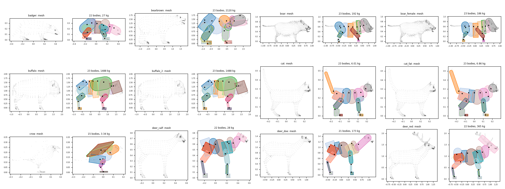
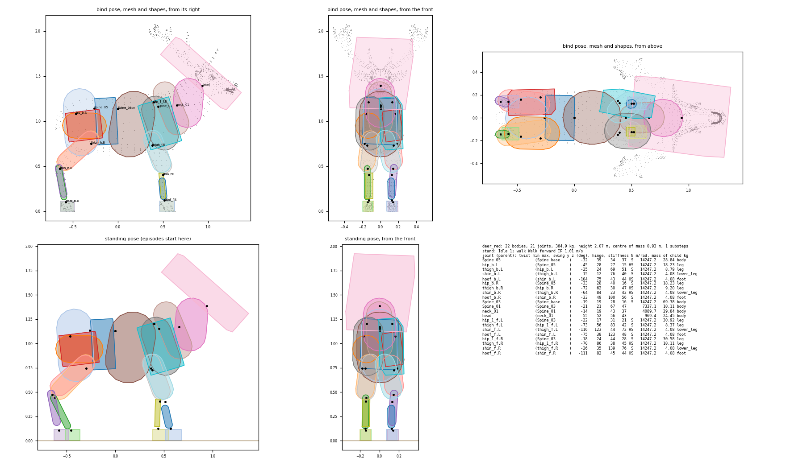
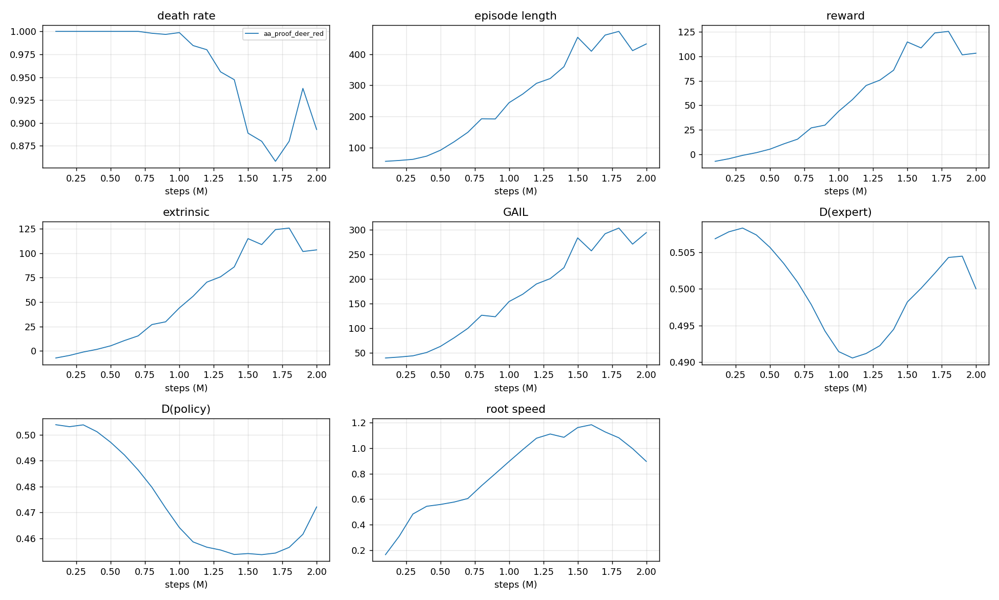
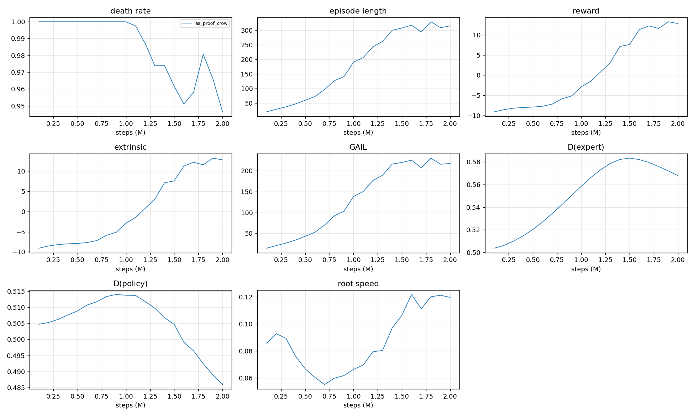
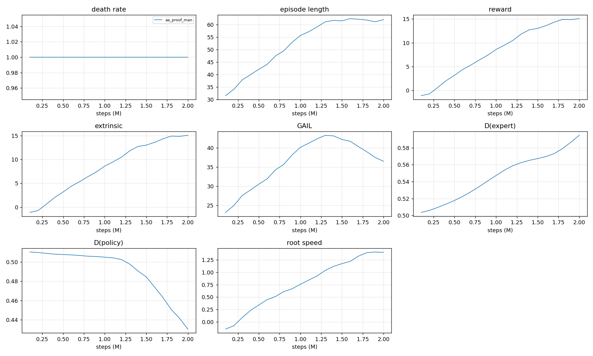
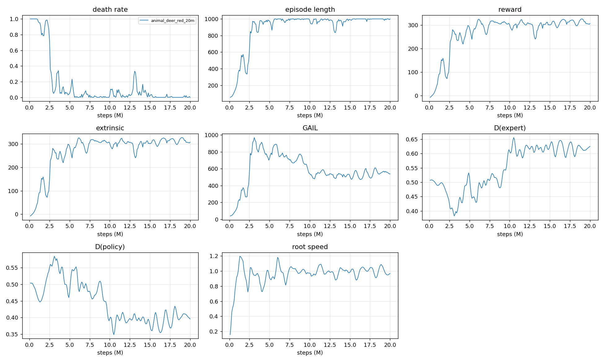
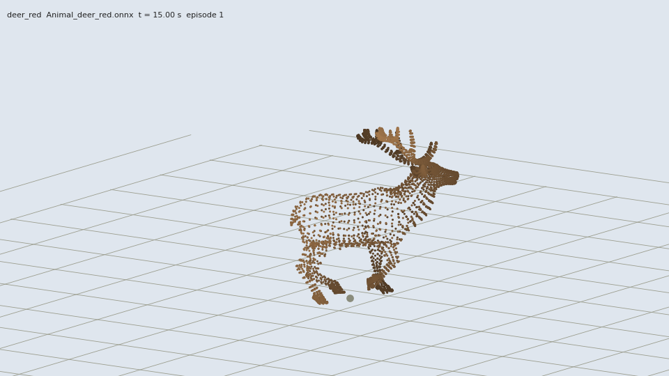
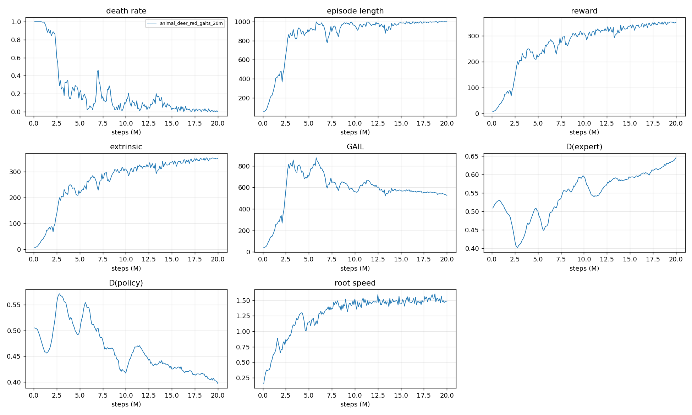

# Animal agents: a physical body, an agent and a training chain for every animal of the library

- **Date:** 2026-11-11, Windows 11, Ryzen 9 9950X3D (32 threads). Main checkout, `master`, **nothing committed**.
- **Task:** [prompts/animal-agents.md](../prompts/animal-agents.md), run without a human. Choices are in
  [decisions.md](decisions.md), the last section.
- Everything below is measured unless a sentence says "I think" or sits under "What I infer".
- **Other sessions worked in this checkout during the run** (grass and soil code, the walker's params): see
  "Not this run's" at the end. It changes how three things here should be read.

## Result

**38 animals train with one command. 15 of them pass every check of their body and of their demonstration; the 23
others train too, with findings listed per animal.** 20 animals have no agent: 7 have no walk clip, 13 have a rig the
rules cannot read.

```
build/venv/Scripts/python tools/train_animal.py --species deer_red --ranges walk_basic --max-steps 20000000
build/venv/Scripts/python tools/train_animal.py --species all      --ranges walk_basic --max-steps 20000000
```

The launcher generates the body when it is stale, freezes the engine, records the demonstration (cached by a key over
the executable, the body, the ranges, the params, every scene and the species' library files), and runs the walker's
trainer. Then `tools/animal_eval.py --run <run>` and `tools/animal_video.py --species <id> --run <run>`.

- **One system:** bodies, layouts and scenes are generated from the library and `analyseGait`; no code and no file per
  species. Quadrupeds (33), birds (3: crow, owl, pigeon) and the library's two men go through the same path.
  `resources/agents/animal_overrides.json` is the one file for what the data does not hold; it holds nothing yet.
- **The red deer walks.** After 20M steps on level ground (1 h 45 min, never restarted) it covers 1.00 of the
  commanded speed along the commanded heading, with no fall in 512 episodes, and lifts each hoof 0.70 to 0.77 times a
  second where its demonstrations lift it 0.70 to 0.74 times. At 10M it was still a shuffle at four times that pace.
- **It stands, walks and runs** (added after the run, see "Stand, walk and run"): trained again for 20M steps on orders
  from 0 to its run clip's 3.47 m/s, speed alone saying which, it does 0.95 of the walk's orders and 0.94 of the
  run's and stands at 0.12 m/s, with no fall in 512 episodes. Its heading is held less well than by the walk-only
  policy (9.0° against 3.0°).
- **The human walker's tests pass unchanged** (golden rollouts included); its two params files were changed by
  another session, not by this run (see the end).

## Readiness

`tools/animal_status.py --prefix aa100k` writes this table (`build/runs/animal_readiness.md`, `.json`) from the body
summary, the cached demonstrations' checks and the 100k-step runs. "Stands": 10 s at the 60 Hz step on a zero action.
"Demo": 9000 decisions on `walk_basic`; what follows "yes," is what its checks found.

| Animal | Legs | Bodies / joints | Mass (kg) | Obs / actions | Stands 10 s | Limp falls, rests | Demo recorded, checked | 100k training | Missing |
|---|---|---|---|---|---|---|---|---|---|
| badger | 4 | 22 / 21 | 27 | 410 / 168 | yes | yes | yes, 94 jumps of an axis (badger_r_Radius_bone); a body 11 % of the height under the ground (badger_r_Paw_bone) | ran, 100k in 45 s |  |
| base_male_rigged | | | | | | | | | no walk clip: no agent |
| bearbrown | 4 | 23 / 22 | 2120 | 428 / 176 | yes | yes | yes, a body 11 % of the height under the ground (Bear_r_HindLeg_AnkleSHJnt) | ran, 100k in 40 s |  |
| boar | 4 | 23 / 22 | 192 | 428 / 176 | yes | yes | yes, 323 jumps of an axis (War_Thog_l_FrontLeg_AnkleSHJnt); a body 4 % of the height under the ground (War_Thog_l_HindLeg_BallSHJnt) | ran, 100k in 40 s |  |
| boar_female | 4 | 23 / 22 | 186 | 428 / 176 | yes | yes | yes, 302 jumps of an axis (Boar_Saw_l_FrontLeg_AnkleSHJnt) | ran, 100k in 45 s |  |
| buffalo | 4 | 23 / 22 | 1488 | 428 / 176 | yes | yes | yes, a body 4 % of the height under the ground (buffalo_l_Hoof_bone) | ran, 100k in 40 s |  |
| buffalo_2 | 4 | 23 / 22 | 1488 | 428 / 176 | yes | yes | yes, yes | ran, 100k in 40 s |  |
| bull | | | | | | | | | the walk clip is not read: fewer than two legs found among 2 joints near the ground : Bone.034 (a chain of 2) Bone.051 (a chain of 2) |
| cat | 4 | 23 / 22 | 6.01 | 428 / 176 | yes | yes | yes, 601 jumps of an axis (claw_b.R); a body 3 % of the height under the ground (claw_f.L) | ran, 100k in 45 s |  |
| cat_farm | | | | | | | | | no joint carries the legs and the skin |
| cat_fat | 4 | 23 / 22 | 6.86 | 428 / 176 | yes | yes | yes, 601 jumps of an axis (claw_b.R); a body 3 % of the height under the ground (foot_b.L) | ran, 100k in 50 s |  |
| chick | | | | | | | | | the walk clip is not read: fewer than two legs found among 2 joints near the ground : feet.L (a chain of 1) feet.R (a chain of 1) |
| chicken | | | | | | | | | the walk clip is not read: fewer than two legs found among 2 joints near the ground : foot.R (a chain of 1) finger3.L.002 (a chain of 1) |
| cow | | | | | | | | | the walk clip is not read: fewer than two legs found among 4 joints near the ground : Bone.034 (a chain of 2) Bone.038 (a chain of 2) Bone.051 (a chain of 2) Bone.053 (a chain of 2) |
| crow | 2 | 15 / 14 | 3.34 | 284 / 112 | yes | yes | yes, 4436 jumps of an axis (CROW_ R Thigh); a body 12 % of the height under the ground (CROW_ L Foot) | ran, 100k in 50 s |  |
| deer_calf | 4 | 22 / 21 | 28 | 410 / 168 | yes | yes | yes, yes | ran, 100k in 45 s |  |
| deer_doe | 4 | 21 / 20 | 173 | 392 / 160 | yes | yes | yes, yes | ran, 100k in 40 s |  |
| deer_red | 4 | 22 / 21 | 365 | 410 / 168 | yes | yes | yes, yes | ran, 100k in 40 s |  |
| deer_stag | 4 | 22 / 21 | 206 | 410 / 168 | yes | yes | yes, yes | ran, 100k in 40 s |  |
| deer_stag_forest | 4 | 23 / 22 | 119 | 428 / 176 | yes | yes | yes, yes | ran, 100k in 45 s |  |
| deerdoe | 4 | 21 / 20 | 219 | 392 / 160 | yes | yes | yes, yes | ran, 100k in 40 s |  |
| deerstag | 4 | 22 / 21 | 352 | 410 / 168 | yes | yes | yes, yes | ran, 100k in 40 s |  |
| doedeer | 4 | 24 / 23 | 55 | 446 / 184 | yes | yes | yes, yes | ran, 100k in 40 s |  |
| dog | | | | | | | | | the walk clip is not read: fewer than two legs found among 4 joints near the ground : Bone.046 (a chain 4 % of the height long) Bone.044 (a chain 7 % of the height long) Bone.047 (a chain 4 % of the height long) Bone.045 (a chain 7 % of the height long) |
| fawn | 4 | 23 / 22 | 41 | 428 / 176 | yes | yes | yes, yes | ran, 100k in 40 s |  |
| fox | 4 | 24 / 23 | 19 | 446 / 184 | yes | yes | yes, yes | ran, 100k in 40 s |  |
| goat | | | | | | | | | the walk clip is not read: fewer than two legs found among 4 joints near the ground : Bone.015 (a chain of 1) Bone.021 (a chain of 1) Bone.034 (a chain of 1) Bone.037 (a chain of 1) |
| great_horned_owl_l_greathornedowl2sided | 2 | 15 / 14 | 17 | 284 / 112 | yes | yes | yes, yes | ran, 100k in 45 s |  |
| grizzly | | | | | | | | | no walk clip: no agent |
| hare | 4 | 19 / 18 | 24 | 356 / 144 | no | yes | yes, limits 5 deg over on 245 ticks (Hare_rightLeg1_LoResToe); 3552 jumps of an axis (Hare_rightLeg1_LoResFoot); a body 13 % of the height under the ground (Hare_rightLeg2_LoResToe) | ran, 100k in 40 s | stands (settles 6.7 deg, 15 mm) |
| hemitragus_bonali | | | | | | | | | no walk clip: no agent |
| homo_heidelbergensis_unarmed_walk_forward | 2 | 16 / 15 | 88 | 302 / 120 | yes | yes | yes, a body 4 % of the height under the ground (Bip001 L Foot) | ran, 100k in 40 s |  |
| homo_heidelbergensis_walking | 2 | 17 / 16 | 117 | 320 / 128 | yes | yes | yes, a body 6 % of the height under the ground (mixamorig:RightFoot) | ran, 100k in 40 s |  |
| homo_heidelbergensis_walking_2 | | | | | | | | | no walk clip: no agent |
| horse | 4 | 18 / 17 | 518 | 338 / 136 | yes | yes | yes, yes | ran, 100k in 40 s |  |
| horse_farm | | | | | | | | | the walk clip is not read: fewer than two legs found among 4 joints near the ground : Bone.005_L.005 (a chain 6 % of the height long) Bone.005_R.005 (a chain 6 % of the height long) Bone.005_L.009 (a chain 6 % of the height long) Bone.005_R.009 (a chain 6 % of the height long) |
| kitten | 4 | 23 / 22 | 1.14 | 428 / 176 | yes | yes | yes, 600 jumps of an axis (claw_b.R); a body 4 % of the height under the ground (claw_f.L) | ran, 100k in 45 s |  |
| lion | 4 | 24 / 23 | 485 | 446 / 184 | yes | yes | yes, 1108 jumps of an axis (LION_ R Hand); a body 15 % of the height under the ground (LION_ Tail) | ran, 100k in 40 s |  |
| lioness | 4 | 23 / 22 | 424 | 428 / 176 | yes | yes | yes, 1108 jumps of an axis (LION_ R Hand); a body 4 % of the height under the ground (LION_ L Foot) | ran, 100k in 40 s |  |
| lioness_fur_fbx | | | | | | | | | no walk clip: no agent |
| lynx | 4 | 23 / 22 | 206 | 428 / 176 | yes | yes | yes, a body 4 % of the height under the ground (Cat_r_HindLeg_Knee2SHJnt) | ran, 100k in 45 s |  |
| moose | 4 | 23 / 22 | 140 | 428 / 176 | yes | yes | yes, yes | ran, 100k in 40 s |  |
| moose_cow | 4 | 24 / 23 | 119 | 446 / 184 | yes | yes | yes, a body 4 % of the height under the ground (l_HindLeg_BallSHJnt) | ran, 100k in 45 s |  |
| pig | | | | | | | | | the walk clip is not read: fewer than two legs found among 0 joints near the ground : |
| pigeon | 2 | 18 / 17 | 0.85 | 338 / 136 | yes | yes | yes, 1361 jumps of an axis (PIGEON_ R Thigh); a body 12 % of the height under the ground (PIGEON_ L Foot) | ran, 100k in 60 s |  |
| rabbit | 4 | 24 / 23 | 6.72 | 446 / 184 | yes | yes | yes, 5431 jumps of an axis (RABBIT_ R Foot); a body 9 % of the height under the ground (RABBIT_ R Foot) | ran, 100k in 55 s |  |
| rabbit_farm | | | | | | | | | the walk clip is not read: fewer than two legs found among 4 joints near the ground : Bone.010 (a chain of 2) Bone.015 (a chain of 1) Bone.028 (a chain of 2) Bone.029 (a chain of 1) |
| ram | | | | | | | | | no walk clip: no agent |
| ram_farm | | | | | | | | | the walk clip is not read: fewer than two legs found among 4 joints near the ground : hoof1.L (a chain of 1) hoof2.L (a chain of 1) hoof1.R (a chain of 1) hoof2.R (a chain of 1) |
| ram_realistic | 4 | 22 / 21 | 106 | 410 / 168 | yes | yes | yes, yes | ran, 100k in 45 s |  |
| redfox | 4 | 24 / 23 | 26 | 446 / 184 | yes | yes | yes, 43 jumps of an axis (Fox_l_FrontLeg_BallSHJnt) | ran, 100k in 45 s |  |
| reindeer | 4 | 21 / 20 | 184 | 392 / 160 | yes | yes | yes, 492 jumps of an axis (Reindeer_r_Pastern_bone) | ran, 100k in 40 s |  |
| rhinoceros | 4 | 20 / 19 | 3594 | 374 / 152 | yes | yes | yes, a body 5 % of the height under the ground (RHINOCEROS_ R Foot) | ran, 100k in 50 s |  |
| rooster | | | | | | | | | the walk clip is not read: fewer than two legs found among 4 joints near the ground : leg2.L (a chain of 2) leg2.R (a chain of 2) foot.R (a chain of 1) finger3.L.002 (a chain of 1) |
| sheep | | | | | | | | | the walk clip is not read: fewer than two legs found among 4 joints near the ground : hoof1.L (a chain of 1) hoof2.L (a chain of 1) hoof1.R (a chain of 1) hoof2.R (a chain of 1) |
| snow_leopard_fur_fbx | | | | | | | | | no walk clip: no agent |
| wolf | 4 | 24 / 23 | 67 | 446 / 184 | yes | yes | yes, 235 jumps of an axis (Dalmatian_r_FrontLeg_BallSHJnt); a body 7 % of the height under the ground (Dalmatian_l_HindLeg_BallSHJnt) | ran, 100k in 45 s |  |
| wolf_2 | 4 | 23 / 22 | 142 | 428 / 176 | yes | yes | yes, a body 5 % of the height under the ground (Wolf_ R Finger0) | ran, 100k in 45 s |  |

38 animals train with one command, 15 of them pass every check of the body and of the demonstration; 38 have a body, 58 are in the library.

What the findings mean:

- **"n jumps of an axis"**: decisions (of 9000) where an observed axis of some body turned by more than 0.6 (35°)
  since the last decision. The red deer's largest change is 0.33, like the man's walk (0.25 to 0.32 in the terrain
  walker's report). The bodies named are paws, claws, toes and pasterns, and the legs of the animals with the shortest
  strides (crow and pigeon 0.53 s, hare 0.58 s, rabbit 0.70 s against 1.42 s for the deer) at the same 30 decisions a
  second. I did not separate the two causes.
- **"a body n % of the height under the ground"**: the foot box in the recorded walk, against the ground the walk
  plants its foot joint on. 1 to 2 % for the hoofed animals; 9 to 15 % for a lion's tail, the hare, the rabbit, the
  birds' feet, the paws of the badger and of the bear. The box is fitted flat as the animal stands; the walk holds the
  foot at the clip's attitude and height.
- **Hare**: it does not fall, but settles 6.7° nose down and 15 mm (my limit is 6°); its walk leaves a toe's limit by
  5° on 245 ticks of 18000.
- No recording trips the fall test, flips the trunk's heading, or misses the commanded speed by more than 0.7 %
  (measured as the reward measures it).

**Without an agent:**

| Animals | Why |
|---|---|
| bull, chick, chicken, cow, dog, goat, horse_farm, pig, rabbit_farm, ram_farm, rooster, sheep | The farm pack: the rig holds the feet with controls, `analyseGait` finds no leg chain (the reason per animal is in the table). Their walk clip "played straight" needs a body first, and the body rule needs the legs: the same rules cannot do it |
| cat_farm | Its walk is read, but its skeleton is not one tree: the head, the neck and the feet hang from separate roots, so no joint carries the legs and the skin |
| base_male_rigged, grizzly, hemitragus_bonali, homo_heidelbergensis_walking_2, lioness_fur_fbx, ram, snow_leopard_fur_fbx | No walk clip |

## Bodies

`animal_body.exe --species all --check` (about half a minute to generate the 38, then 20 simulated seconds each: 10 s standing, 10 s limp). Contact sheets, each body
beside its mesh: `build/runs/animal_bodies/sheet_1.png` to `sheet_4.png`, and one page per animal (`<id>.png`: bind
pose from three sides, the standing pose, every joint's limits and gains).




How a body is made (the reasons are in decisions.md):

| Part | Rule |
|---|---|
| Which joints are bodies | Legs: the chains of `analyseGait`, at most 4 bodies a leg, the foot last. The trunk: the lowest joint with every leg and the skin under it. Everything else: a joint stays a body when its part of the volume x the lever to the centre of that part x how far it turns in the gait is worth 3e-4; else it rides on its parent. 15 to 24 bodies |
| Volume, mass | The generalized winding number of the skin on a grid, each cell given to the joint of its nearest vertex; 1000 kg/m3. No segment under 1.2 % of the mass in a leg |
| Shapes | A capsule, or a box where the section is flat, with the moments of the volume the segment holds. Feet, and heels that reach the ground, are boxes that lie flat as the animal stands |
| Joints | A swing-twist constraint per body. Axes and limits from the range covered over every clip (99 samples in 100) and the gait clips and the procedural walk (all of it), plus 5° and 10 %. A hinge where the motion is one (4 to 15 joints per animal) |
| Drives | Stiffness 4.3 x M g H per radian between a foot and the trunk (the man's gains), times the leg's body count on two legs; 30 x weight x lever for what only hangs. Damping and time scaled by sqrt(H) |
| Solver | Substeps 1 to 3 by size; penetration slop 0.25 % of the height; 40 iterations on two legs, 10 on four; **moments of inertia raised** to what the drive can be solved against in one step |
| Standing pose | The idle clip, else the bind pose, else the walk where the most feet are down |

**What it took to stand.** With the masses and inertias of the volumes, none of the 38 stood, though the drives hold
each statically: the solver's 10 iterations do not resolve a drive 1500 times stiffer than a 400 g hoof is heavy to
turn, under a 365 kg trunk.

| Setting | Standing of 38 |
|---|---|
| As generated, 60 Hz, 10 iterations | 0 |
| 2 substeps / 2 substeps and 20 iterations / 3 substeps | 1 / 9 / 9 |
| 4 substeps | 22 |
| Inertias raised to (damping x dt + stiffness x dt²) / 100, 30 or 10, at the 60 Hz step | 21 / 30 / 30 |
| ... / 30, plus flat heels, slop by size, 40 iterations and stiffer joints on two legs | 37, the hare settling |

The cost of the raised inertias: a deer's leg is about twice as heavy to swing about its hip. Masses are not touched.

**Weights.** Volume at 1000 kg/m3. The typical weights are from memory, not from a source in the repository.

| Animal (library id) | Model: height, length | Mass from the volume | Typical weight | Ratio |
|---|---|---|---|---|
| Bison (`buffalo`) | 2.03 m, 2.72 m | 1488 kg | 700 to 900 kg | 1.9 |
| Red deer (`deer_red`) | 2.07 m with antlers, 2.03 m | 365 kg | 160 to 240 kg (stag) | 1.8 |
| Red deer (`deer_stag`) | 1.86 m, 1.78 m | 206 kg | 160 to 240 kg | 1.0 |
| Wolf (`wolf`) | 0.67 m, 1.20 m | 67 kg | 30 to 50 kg | 1.7 |
| Wolf (`wolf_2`) | 0.75 m, 1.52 m | 142 kg | 30 to 50 kg | 3.5 |
| Horse (`horse`) | 1.59 m, 2.29 m | 518 kg | 400 to 550 kg | 1.0 |
| Man (`homo_heidelbergensis_walking`) | 1.88 m | 117 kg | 80 to 90 kg at that height | 1.4 |
| Man (`homo_heidelbergensis_unarmed_walk_forward`) | 1.69 m | 88 kg | 60 to 70 kg | 1.35 |

No correction is in the overrides file. Drives scale with M g H, so a body's accelerations do not depend on its mass;
a correction is `"species": { "buffalo": { "mass": 800 } }`. The signed volume of the triangles, the usual way, was
1.6 to 2.7 times too large on 10 meshes (fur cards, a second skin); the winding number agrees with it to about 1 % on
the others.

**What the sheets show** (I looked at all four): legs and trunks follow the meshes. Not good: the head of a stag with
antlers is a box as long as the antlers (`deer_red`, `moose`, `reindeer`); the wings of the crow, the owl and the
pigeon are flat boxes wider than the bird; the horse has one body from its chest to its head (its neck does not turn
in its walk), the doe (`deer_doe`) no head of its own.

## The agent

World context `AnimalBot`; systems `AnimalFactory`, `AnimalDrive@act`, `AnimalSoftGround`, `PhysicsStep`,
`AnimalSync`, `AnimalTask`, `AnimalTermination`, `AnimalRewards@observe`, `AnimalObservation@observe`,
`AnimalEpisode@observe` (`common/animal_world.json`).

| | |
|---|---|
| Behaviour | `Animal_<id>`, one per species |
| Observation | 2 x (7 + 9 x bodies): 284 to 446. Header: the command in the trunk's heading frame (x, z, in walk speeds), its turn, command minus trunk velocity (x, z), height error, soft depth. Then forward axis, up axis and velocity of the trunk and of each body, all in the **trunk's** heading frame |
| Actions | 8 a joint (112 to 184): two gains, a target (twist, two swings), a target angular velocity. Each target runs from limit to limit through the standing pose: **a zero action stands** |
| Task | `WalkCommand`: a speed (0.8 to 1.2 of the walk clip's on `walk_basic`) and a turn drawn every 2 to 5 s, eased over a second. The same object is stepped for the physical animal and followed by the recorded walk |
| Reward | Progress of the trunk along the commanded heading, capped at the commanded speed, x 0.34 per decision. The step that ends in a fall is worth `death_penalty` and nothing else (0 since 14:01; before, -10 was added to it: see the end) |
| Fall | The trunk under 0.55 of its standing height over the ground under it, or a body that may not touch the ground on it |
| Episode | 2000 frames (33.3 s), a random heading at the start, from the standing pose |

Tests `AA.1` to `AA.9` (`tests/unit/animal_agents.cpp`, skipped without the generated bodies): the joint angles are
Jolt's and the standing pose is inside every limit; standing and limp; the layout; a quadruped's training world steps
deterministically; the fall test both ways (the limp ragdoll is ended; the kinematic walk on `walk_basic`,
`walk_style` and `walk_soft` never is, for a deer, a crow and a man); the recorded walk (limits, flips, the command's
heading is the walker's to 1e-4 rad, speed within 3 %); a run through the recorder; the terrain worlds; soft ground.

## The proofs: three bodies, 2M steps each

`training/animal_ppo.yaml` is `walker_ppo.yaml` without its `environment_parameters` (the walker's speed) and with `max_steps` 20M: the same PPO and the same two reward signals. 8 environments x 25 worlds x 2
threads. No value is NaN in any console.

| | `deer_red` (4 legs, 22 bodies) | `crow` (2 legs, 15 bodies) | `homo_heidelbergensis_walking` (2 legs, 17 bodies) |
|---|---|---|---|
| Run | `aa_proof_deer_red` | `aa_proof_crow` | `aa_proof_man` |
| Wall time, steps/s | 621 s, 3247 (alone) | 681 s, 2964 (beside the 20M run) | 737 s, 2734 (beside the 20M run) |
| Death rate, 0.2M to 2M | 1 to 0.89 | 1 to 0.95 | 1 to 1 |
| Episode length (decisions) | 58 to 433 | 29 to 315 | 34 to 62 |
| Extrinsic reward per episode | -4.6 to 103 | -8.5 to 12.8 | -0.7 to 15.1 |
| GAIL reward per episode | 41.6 to 294 | 20.8 to 217 | 25 to 36.5 |
| D(expert) / D(policy) at 2M | 0.50 / 0.47 | 0.57 / 0.49 | 0.60 / 0.43 |
| Eval, 200 episodes, mean action | 21 % fall, stands: 0.06 of the commanded speed | no fall, stands still | falls in every episode after 2.4 s, lunging at 1.9 m/s |
| Reward of the step that ends in a fall | its own, -10 | its own, -10 | **0** (see the end) |





- At 2M the deer moves only by its action noise: sampled as in training, the same policy covers 0.90 of the commanded
  speed and falls in 94 % of the episodes; its mean action stands. The 20M run shows what comes next.
- The man's proof is not comparable with the two others: it was frozen after the reward of a fall changed (see
  the end). I think a man who loses nothing but the rest of the episode by falling throws himself forward at 2M;
  one run does not show it.
- The yardstick was 3000 steps/s for the flat walker. The world alone, with zero actions (`mode=bench`, 25 worlds, 2
  threads, the machine busy): the walker 72000 world-ticks/s, the deer 69000, the crow 25500 (2 substeps, 40
  iterations).

## The 20M run: the red deer on level ground

`tools/train_animal.py --species deer_red --max-steps 20000000 --run-id animal_deer_red_20m`, started at 13:53 when the
deer's proof had ended. **20M steps in 6305 s, 3172 steps/s over the run**, beside the crow's and the man's proofs
(until 14:16), the 100k queue (14:22 to 14:50) and the builds and tests of this and of the other sessions. Exit 0, no
restart, no NaN. The demonstration: 9000 decisions of the procedural walk on `walk_basic`, all checks passed.



Evaluation: `tools/animal_eval.py --run animal_deer_red_20m`, on the body, params, ranges and executable frozen with
the run, the policy's mean action, commands drawn as in training, episodes of 33.3 s.

| Steps | Training: death rate | Episode (decisions) | Extrinsic | GAIL | D(expert) / D(policy) | Eval: episodes ending in a fall | Speed along the command / commanded | Heading error |
|---|---|---|---|---|---|---|---|---|
| 1M | 0.99 | 249 | 49 | 156 | 0.49 / 0.46 | | | |
| 2M | 0.97 | 356 | 85 | 267 | 0.47 / 0.50 | | | |
| 3M | 0.05 | 961 | 275 | 930 | 0.39 / 0.58 | | | |
| 5M | 0.05 | 975 | 288 | 723 | 0.52 / 0.48 | 0 of 208 | 0.61 | 14.0° |
| 10M | 0.03 | 981 | 301 | 543 | 0.61 / 0.40 | 1 of 208 (its head on the ground) | 0.85 | 15.9° |
| 15M | 0.02 | 992 | 301 | 511 | 0.63 / 0.38 | 0 of 208 | 1.00 | 7.1° |
| **20M** | 0 | 999 | 307 | 538 | 0.63 / 0.40 | **0 of 512** | **1.00** (1.014 m/s of 1.013) | 3.0° |
| 20M, actions sampled as in training | | | | | | 0 of 512 | 0.95 | 5.8° |

- **It takes off between 2M and 3M**: the death rate goes from 0.97 to 0.05 and the episodes from 356 to 961
  decisions. The human walker took 5 to 15M.
- **The discriminator comes late.** It tells nothing apart until 5M (at 3M it scores the policy above the
  demonstrations), separates from about 9M and settles at 0.63 / 0.40 (the terrain walker ended at 0.70 / 0.36). The
  GAIL reward per episode falls from 930 to about 530 as it does.
- **The gait follows the discriminator**, measured on a rollout of each checkpoint and on the demonstrations
  (`tools/animal_gait_stats.py`; a hoof is lifted when it is more than 1.5 % of the height over where it stands):

| | Trunk height / standing | Speed | Lifts per second: hind left, hind right, fore left, fore right | Height of the lift (% of the animal's height) | Time lifted (%) |
|---|---|---|---|---|---|
| The demonstrations (100 s) | 0.98 | 1.02 m/s | 0.74, 0.74, 0.70, 0.74 | 4.6, 5.1, 2.5, 3.2 | 39, 40, 26, 35 |
| 5M (12 s) | 0.98 | 0.67 m/s | 1.50, 2.92, 2.17, 2.67 | 2.6, 3.7, 4.5, 3.9 | 83, 48, 84, 59 |
| 10M (10 s) | 0.87 | 0.98 m/s | **0**, 3.10, 3.20, 2.90 | 1.1, 3.2, 2.7, 2.6 | 0, 32, 50, 45 |
| **20M (30 s)** | 0.97 | 1.03 m/s | 0.70, 0.77, 0.77, 0.77 | 3.8, 2.3, 5.4, 5.3 | 20, 15, 54, 52 |

**The film, in the engine.** `build/runs/animal_videos/animal_deer_red_20m_orders.mp4`
(`tools/animal_orders_video.py --run animal_deer_red_20m`): one take of 119 s on the level hard ground it was trained
on, the skinned mesh on the ragdoll, through every order of `walk_basic`: the walk's speed, the slowest (0.8) and the
fastest (1.2) straight ahead, the tightest turn (4 lengths) to the left for half a circle, to the right at the fastest
speed, to the left at the slowest, the widest turn (12 lengths) each way, then 30 s of orders drawn as in training.
The film writes the order and what the deer does on every frame, its path from above and where the order is in the
trained ranges. **No fall.** From the film's log (`..._orders.csv`), the first 2 s of each order left out:

| Order | Asked | Does | Heading error (mean of its size) |
|---|---|---|---|
| Straight, the walk's speed | 1.01 m/s | 1.02 m/s | 6.7° |
| Straight, slowest | 0.81 m/s | **0.95 m/s** | 8.8° |
| Straight, fastest | 1.21 m/s | **1.10 m/s** | 6.5° |
| Left, radius 4 lengths, 175° | 1.01 m/s | 1.01 m/s | 4.7° |
| Right, radius 4 lengths, fastest | 1.22 m/s | 1.12 m/s | 6.9° |
| Left, radius 4 lengths, slowest | 0.81 m/s | 0.93 m/s | 5.6° |
| Left, then right, radius 12 lengths | 1.01 m/s | 1.03, 1.04 m/s | 5.7°, 6.7° |
| Drawn as in training, 30 s | 1.07 m/s | 1.05 m/s | 6.8° |

- **It turns as asked and holds about half of the speed range**: asked 0.8 to 1.2 of the walk's speed it does 0.93 to
  1.10. The reward does not ask for more: progress is capped at the order, so going too fast costs nothing, and too
  slow by 10 % costs 10 % of one term. "Does" is the speed of the trunk, sideways sway included.
- What I see on frames of it (I cannot watch it): the trunk level at 0.97 of its standing height, the legs more bent
  than in the clip, the fore hooves carried high and long. The numbers of the table above say the same (fore hooves in
  the air 53 % of the time, 26 to 35 % in the demonstrations).

`build/runs/animal_videos/animal_deer_red_20m_replay.mp4` is the same policy drawn without the engine, the mesh as
points (30 s of drawn orders), and `..._10000k_replay.mp4`, `..._5000k_replay.mp4` the checkpoints: at 10M it is
crouched to 0.87 of its height, steps three times a second on three legs and never lifts its left hind hoof; at 5M it
shuffles at 0.6 of the commanded speed.



**What I would change.** Nothing before training the others: 20M is enough for this animal, and 15M already
evaluates the same for falls and speed. Then, in this order: give the discriminator a higher learning rate (it is
the walker's 1e-5, and 9M steps pass before it says anything; the shuffle of 5M to 10M is what the extrinsic reward
finds alone); give the speed of the order a reward on both sides (it holds half of the range); evaluate the gait against
the demonstrations as above for every animal trained, since "no fall at the commanded speed" was already true at 15M
of a gait I did not check there.

## Stand, walk and run: the red deer, 20M

Asked after the run above: orders to stand still and to run, beside the walk. Three choices were the user's: it is the
walker that learns them (not the mind of docs/action-agents.md), **speed alone says which** (one commanded speed from
0 to the run clip's, no flag and no new observation), and the red deer is trained from scratch for 20M steps.

```
build/venv/Scripts/python tools/train_animal.py --species deer_red --ranges gaits_basic --params animal_gaits --max-steps 20000000
build/venv/Scripts/python tools/animal_eval.py --run <run>
build/venv/Scripts/python tools/animal_orders_video.py --run <run>
```

**What was added.**

- **Orders** (`GaitRanges`: `idle`, `run`, `run_speed`, `run_radius`; `resources/agents/ranges/gaits_basic.json`): of
  100 draws 15 stand still, 35 run at 0.75 to 1 of the run clip's speed on turns of 8 to 24 lengths, the others walk as
  `walk_basic` does. The body file gains `run_speed` and `run_clip` (the red deer: `Run_forward_IP`, 3.47 m/s, 3.4
  times its walk); an animal whose run is not read never draws one. Ranges that only walk draw what they drew, number
  for number (`AA.10`).
- **Demonstrations**: a recorded walk is a run from end to end (35 in 100) or a walk that also stands. Standing is the
  body's standing pose: as the command falls under half the slowest walk, the pose is blended to it joint by joint.
  There is no idle clip in it and **no walk that becomes a run**: the policy never sees that change demonstrated.
- **Reward** (`resources/agents/params/animal_gaits.params.json`, `over_speed` 1, `life_reward` 0.1): going faster
  than the order costs what going slower loses, so an order to stand is one to stand still; a decision alive earns
  0.1, and an order that is not followed never loses more than that (`-life_reward tanh`): a fall is never the better
  answer. `animal.params.json` is unchanged, the walk-only runs and the sandbox keep their reward.
- **Evaluation** per kind of order (`idle`, `walk`, `run` under `kinds` in the summary), and the film's tour for ranges
  that stand and run.

**A fault found on the way: gait clips that do not loop.** Seven walk and run clips of the library are not marked as
loops (the red deer's run, `buffalo_2`'s walk and run, `chick`'s, `horse_farm`'s). `sample()` clamps those at their last
frame, so the procedural gait bent a frozen body from the second cycle on: the deer's run left its limits by 20° and
flipped a leg once a cycle. The loader now loops every clip of kind walk, trot or run. The deer's run after it: limits
held, planted feet slide 0.03 m/s. Of the others only `buffalo_2` has an agent: it was recording its **walk** with
that fault, and its row in the tables above was measured before the fix and not again.

**The ground was too small for a run.** `ground_flat` is 150 m wide and every episode starts at its middle: 21 s of
run in a line reach the edge. The 2 falls in 512 episodes of the first evaluation (a fore thigh on the ground) were
that edge: on a ground of 1200 m, same policy, same draws, **0 of 512**. The animal worlds now use
`ground_flat_wide`; this run trained on the small one (a few episodes in a thousand ended there), and the numbers
below are on the wide one (a copy of the run's frozen engine with that one file changed). `animal_orders_world.json`
(the orders of the sandbox, up to 2.6 walks) still uses the small ground: not mine to change.

**The run.** `animal_deer_red_gaits_20m`, 20M steps in 7472 s, **2680 steps/s**, beside `puppets_r1` of another
session and this session's builds. Exit 0, no restart. The demonstration: 18000 decisions in 60 walks (2895 standing,
7905 walking, 7200 running), speed 1.00 of the order, no fall, no flip of the heading. Its checks do **not** all pass:
a limit left by 1.6° on 8 ticks of 35940 (`hip_1_f.L`), the fore hooves' axis jumps 0.64 rad on 39 decisions (they
flick at lift-off in the run), planted feet slide 0.25 m/s (the blend to the standing pose moves them), a fore hoof
6.6 cm under the ground in the run.



| Steps | Training: death rate | Extrinsic | D(expert) / D(policy) | Eval: episodes ending in a fall | Standing: speed | Walk: along the order / ordered | Run: along the order / ordered | Heading error |
|---|---|---|---|---|---|---|---|---|
| 5M | 0.21 | 217 | 0.50 / 0.50 | 0 of 512 | 0.86 m/s | 0.72 | 0.67 | 43.8° |
| 10M | 0.09 | 311 | 0.59 / 0.42 | 27 of 501 (head 14, fore thigh 4, trunk low 9) | 0.21 m/s | 0.84 | 0.94 | 17.2° |
| 15M | 0.02 | 337 | 0.59 / 0.43 | 30 of 500 (head 12, thighs 18) | 0.18 m/s | 0.89 | 0.99 | 9.1° |
| **20M** | 0 | 351 | 0.65 / 0.40 | **0 of 512** | 0.12 m/s | **0.95** (1.00 m/s of 1.05) | **0.94** (2.74 m/s of 2.91) | 9.0° |
| 20M, actions sampled as in training | | | | 0 of 512 | 0.20 m/s | 0.95 | 0.95 | 9.5° |

"Standing" is the speed of the trunk over all the time an order to stand is in force, the 1 to 2 s it takes to stop
from a run included (the eased command is 0.06 m/s over that time).

- **It does the three.** No fall, 0.95 of the walk's orders and 0.94 of the run's. The walk-only policy did 1.00 of
  its orders and held its heading to 3.0°; this one is at 9.0°, with 3.4 times the range of speeds to cover in the
  same 20M steps.
- **It falls on the way there**: 5 to 6 % of the episodes at 10M and 15M, on its head or a fore thigh, none at 5M
  (when it barely runs) and none at 20M. One run: I do not know that 20M is always past it.
- **It walks later than it runs**: the run is at 0.94 of its orders at 10M, the walk at 0.84.

**The film.** `build/runs/animal_videos/animal_deer_red_gaits_20m_orders.mp4`: one take of 118 s, no fall, on the wide
ground. From its log, the first 2 s of each order left out:

| Order | Asked | Does |
|---|---|---|
| Stand, from the start (5 s) | 0 | 0.02 m/s |
| Walk, straight (8 s) | 1.01 m/s | 0.99 m/s |
| Stand, from the walk (6 s) | 0 | still after 3.4 s, 1.0 m further |
| Walk again (6 s) | 1.01 m/s | 0.85 m/s |
| Run, straight, the run's speed (8 s) | 3.47 m/s | 3.38 m/s |
| Run, left, radius 8 lengths, slowest (10 s, 88°) | 2.60 m/s | 2.55 m/s |
| Run, right, radius 8 lengths, fastest (10 s, 110°) | 3.47 m/s | 3.16 m/s |
| Stand, from the run (6 s) | 0 | still after 1.4 s, 2.2 m further |
| Walk, left, radius 4 lengths, slowest (8 s) | 0.81 m/s | **0.67 m/s** |
| Walk, right, radius 4 lengths, fastest (8 s) | 1.22 m/s | 1.13 m/s |
| Run, left, radius 24 lengths (8 s) | 3.04 m/s | 2.99 m/s |
| Stand (5 s) | 0 | 0.02 m/s, still after 1.6 s |
| Drawn as in training, 30 s | 1.36 m/s | 1.34 m/s |

- **It stops faster from a run than from a walk**, and from the walk it shuffles on the spot for 3 s first. "Still" is
  the trunk under 0.2 m/s for a second.
- It is slow to walk off after standing (0.85 of the order over 4 s) and slow in the slowest tight turn (0.67 of
  0.81); the tightest run turn at full speed loses a tenth of the speed.
- The first take of this film had a fall in it, at the same place with three seeds: the deer had reached the edge of
  the 150 m ground. That is how the ground was found.
- I looked at frames, I cannot watch it: standing it is on four legs at its standing height; of the run I
  saw a few frames, legs gathered under it, and nothing wrong in them. I did not measure its gait against the demonstrations as for the walk above.

**Limits.** One animal, one run, level hard ground. Orders between 1.2 walks and 0.75 of the run (1.2 to 2.6 m/s for
the deer) are never drawn; the command passes through them while it eases, 0.5 s. Standing is a held pose, the animal
does not graze or look around. `wolf_2`'s run still does not record cleanly (limits by 14°), and no other animal's run
was looked at. Every body file is generated again on the next training of its animal (the generator changed), which
empties the demonstration caches once.

## Every animal: 100k steps

`tools/train_animal.py --species all --max-steps 100000 --prefix aa100k`, one frozen engine for the queue, beside the
20M run: **38 of 38 ran through** (exit 0, a policy exported), 40 to 60 s each. One (`deer_stag_forest`) first died
on a port another trainer held; the launcher now checks every environment's port before it starts, and the rerun
passed.

## Prepared, not validated

| What | State |
|---|---|
| `walk_style`, `walk_soft` | Both record for all 38 (9000 decisions each). **The checks do not pass**: on `walk_style` 17 animals leave a joint limit (by 1 to 49°, on up to 250 ticks of 18000), 3 trip the fall test on a few ticks (bear, lioness, the unarmed man: a calf or a knee on the ground), and an axis jumps on most; on `walk_soft` 17 leave a limit (by 1 to 91°), none trips the fall test. The limits are taken from 16 procedural walks over the engine's widest ranges; that does not cover what 30 recorded walks reach |
| Soft ground | Built as the prompt's default: the hard ground stays, the layer is `depth` over it, a body inside is dragged against its velocity (3 weights of the body per walk speed sideways, a quarter of that upwards, nothing downwards); the depth is drawn per episode and is in the header. Tested: the deer stands in it, the direction of the drag, a limp body comes to rest (`AA.9`). A 50k-step training on `walk_soft` runs through. **Not validated:** no policy was trained in it, and the first resistance I set (60) stopped a body within a step on every axis, up included |
| Terrain | `animal_terrain_train`, `_eval`, `_view`, `animal_demo_terrain` load, spawn on routes in the slope band, end a limp animal on the colliders and record (`AA.8`). A 50k-step training with a demonstration recorded on the routes runs through (`--terrain`). No policy was trained on it |
| Slope band, red deer | On planes, straight up or down at the clip's speed, 1500 decisions each: limits hold, no jump, no flip, no fall, speed exact from **-20° to +20° along and to 15° across** (`build/runs/animal_slopes/deer_red.md`, `tools/animal_slope_band.py`). The terrain worlds default to 15° up, 15° down, 12° across. Steeper was not measured, and only one animal was |
| Run | The red deer's run records and trains (see "Stand, walk and run"). `wolf_2` records 3000 decisions, but leaves a limit by 14° on a third of the ticks, stretches its bones by its own height and slides its planted feet at 0.55 m/s: not usable as it is |
| Trot | No clip of the 38 animals is tagged `trot` (the red deer's `Trot_forward_IP` is tagged `other`): nothing to record. The recorder says so and exits |
| Looking at trot and run | The red deer's run: its film and a few frames. No trot, no other animal's run |

## What changed in the engine, and why

| Change | Where | Why |
|---|---|---|
| The ragdoll build moved out of `humanbot.cpp`, unchanged, into a function both agents call; a box's convex radius can be given (the man keeps his rule) | `logic/agents/ragdoll.*`, `humanbot.cpp`, `humanbot_assets.h` | One build for the man and the animals. The walker's golden rollouts pass |
| The body generator, the loaded body, the joint angles as Jolt measures them | `logic/animals/animal_body.*`, `tools/animal_body/` | Step 2 |
| `WalkCommand` and `GaitWalk` | `logic/animals/gait_walk.*` | One command process for the task and the demonstrations; the procedural walk without a registry |
| `AnimalBot`, its systems, the recorder (`AnimalGaitPlayer`), the checks, the standing test | `logic/animals/animal_agent.*` | Steps 3 and 4. Beside the man's systems: `HumanBot` is fixed arrays with Unity's conventions |
| The training host evaluates animals, writes a recording's checks, a replay of the segments, and refuses a walk it cannot play | `train/animal_host.cpp`, `train_host.*` | The man's eval reads `HumanBot`; a recording of a missing clip never ended |
| `"<file>#<key>"` in a scene also finds a file given as a path or in the source tree's resources | `scene/scene_loader.cpp`, `util/paths.*` | The solver settings come from the body file, and the bodies live with the library |
| `AnimalAgentView`: the skinned mesh on the ragdoll, a camera, a panel; orders given one after the other instead of the draws, a chequer on the ground, a log per frame (`orders`, `marks`, `view_log` of `animal_view`) | `view/animal_view.*` | Fit errors show there, policies are filmed there |
| Scenes, params, ranges, overrides, the PPO config | `resources/scenes/animal_*`, `common/animal_*`, `resources/agents/params/animal.params.json`, `ranges/`, `animal_overrides.json`, `training/animal_ppo.yaml` | Step 5 |
| Tools | `tools/train_animal.py`, `animal_eval.py`, `animal_video.py`, `animal_orders_video.py`, `animal_replay_video.py`, `animal_status.py`, `animal_sheets.py`, `animal_slope_band.py` | The launcher never edits `start-run.ps1` |

`gait.cpp`, `gait_dataset.cpp` and the procedural walk itself are untouched.

## What I infer

- **The quadrupeds will train like the deer; I expect the order below.** The deer takes off before 3M steps where the
  man took 5 to 15M: I think because a zero action already stands on four legs, so the policy only has to learn to
  move. One animal and one seed: the 20M figure is not a rule.
- **The shuffle before 10M is the extrinsic reward alone**, and the walk after it is the discriminator's doing: the
  cadence falls from 3 lifts a second to the demonstrations' 0.7 while the speed stays at the command. I did not run
  the control (no GAIL).
- **The jumps in the small animals' recordings are mostly their pace, not errors**: at 30 decisions a second a crow
  takes a step in 8 decisions. I think a decision rate by size (as the substeps are) is the fix, but it changes the
  episode and the trainer's horizon, and I measured nothing.
- **The feet under the ground will cost the animals that have them**: the discriminator sees a trunk lower than the
  physical animal can hold. Fitting the foot box to the walk's stance instead of the standing pose would remove most of it.

## The order I would train them in, and what I expect to break

1. **The 14 quadrupeds that pass every check** (the deer family, `buffalo_2`, `horse`, `moose`, `fox`,
   `ram_realistic`): as the red deer. I expect them to move at the command by 10M and to walk as their
   demonstrations between 15M and 20M, as it did.
2. **The other large quadrupeds** (`buffalo`, boars, lions, `lynx`, wolves, `rhinoceros`, `bearbrown`, `moose_cow`,
   `reindeer`): feet 4 to 15 % under the ground in the demonstrations. I expect them to walk lower or stiffer than
   their demonstrations, and the lion to drag its tail.
3. **The small quadrupeds** (cats, `badger`, `redfox`, `rabbit`, `hare`): 2 to 3 substeps (slower), jumps in the
   demonstrations. The hare and the rabbit hop: their feet slide in the walk itself.
4. **The owl, then the crow and the pigeon, then the two men**: on two legs nothing stands for free; 40 solver
   iterations cost throughput (the crow's world is 2.7 times slower than the deer's). The 2M proofs show both failure
   modes: standing still, and diving. I expect them to need the death penalty and far more than 20M steps, as the
   human walker did.

## Not this run's, and it matters

- **The reward of a fall changed at 14:01**, by another session and on purpose: in `humanbot.cpp` and in
  `animal_agent.cpp` the step that ends in a fall is now worth `death_penalty` and nothing else, and `death_penalty`
  is 0 in `walker.params.json`, `devita_h173.params.json` and `animal.params.json` (it was -10, added to the step's
  reward). Paul's word on it was "merge and continue": it is the state of the checkout, and I reverted nothing. The
  deer's and the crow's proofs, the 20M run and the 100k queue were frozen before it; the man's proof, the rerun of
  `deer_stag_forest` and the 50k smokes after. **`train_animal.py` now trains without a death penalty**; the red deer
  of this report was trained with one. `build/runs/animal_params_edit_note.txt` has the times and values.
- **The empty frames of the viewer were mine, not another session's** (I wrote the opposite here first). From 14:17
  `animal_view` rendered the sky alone: `dynamical.exe` held an object of `view/animal_view.cpp` compiled before
  `AnimalBot` changed, and read `built` at the wrong place. **This build tree does not recompile the viewer's sources
  when a header they include changes**: a build with nothing to do left it so, editing the file itself repaired it,
  and a member added to `animal_view.h` crashed the viewer (heap corruption) until `register_view.cpp` was touched.
  I did not find why (concurrent builds and their tracking logs are my guess). Until it is found, a viewer that
  misbehaves after a header change wants its sources touched or the `dynamical` target rebuilt from clean; the
  library, `TrainingEnv.exe` and the tests showed nothing of the kind. The golden capture `V2.1 test_boxes_view`
  fails for another reason: the scene renders, and the debug menu in it has grown with the grass and soil work (its
  golden wants recording again).
- **The build broke several times** on files of the grass and soil work in progress, and the test target was blocked
  for half an hour; `tests/unit/animal_debug.cpp` is a trace I left for whoever tunes the generator, not a test.

## Tests

`ctest -C RelWithDebInfo -LE gpu`: 121 of 121 before any change (12:45); **174 of 174 at 15:45**, with `AA.1` to `AA.9`
and the walker's golden rollouts, oracle and scene tests (the count grew with tests of the other sessions). In between,
two runs showed failures that were not the animals': at 14:07 a stale test binary, at 14:55 two new tests of another
session's kinematic walk (`GAIT.12`, `GAIT.14`). The GPU tests were not run; `V2.1` fails on the debug menu in its golden (see above).

## Files

| What | Where |
|---|---|
| Bodies (generated, git ignored with the library), their summary | `resources/animals/bodies/<id>.body.json`, `summary.json` |
| Contact sheets | `build/runs/animal_bodies/sheet_1.png` to `sheet_4.png`, `<id>.png` |
| Readiness table | `build/runs/animal_readiness.md`, `.json` |
| Demonstrations and their checks | `build/runs/demo_cache/<id>_<ranges>_<key>.demo`, `.checks.json` |
| Proofs | `build/runs/aa_proof_deer_red`, `aa_proof_crow`, `aa_proof_man`; evals in `build/runs/eval/<run>/` |
| The 20M run | `build/runs/animal_deer_red_20m/Animal_deer_red.onnx`, checkpoints every 5M in `Animal_deer_red/`, `build/runs/animal_deer_red_20m_env/` (the frozen engine, body and params), evals and gait in `build/runs/eval/animal_deer_red_20m/` |
| Its film | `build/runs/animal_videos/animal_deer_red_20m_orders.mp4` (the engine, every order; log `.csv`), `animal_deer_red_20m_replay.mp4` (and `..._5000k_replay.mp4`, `..._10000k_replay.mp4`, without the engine) |
| 100k runs | `build/runs/aa100k_<id>_walk_basic/` |
| Films | `build/runs/animal_videos/` |
| Slope band | `build/runs/animal_slopes/deer_red.md` |
