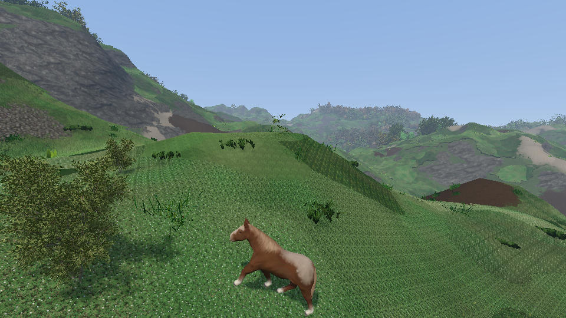
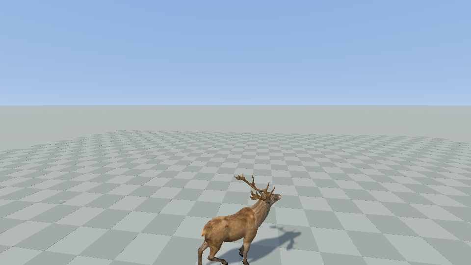

# Physical players

The players of Unity Dynamical (`Assets/Interaction/Scripts`: `GenericPlayer`, `FPSPlayer`, `VRPlayer`, `Hand`,
`Grabber`, `Thrower`; `Assets/Input/Scripts`), ported to the engine: a rigid body that stands, walks and jumps with
forces, VR hands that are rigid bodies driven to the controllers, an FPS player whose held object is a rigid body
on a drive, and which gets on an animal and rides it. Code in `src/logic/player/` (simulation library, no window or
headset), `src/logic/animals/steer.*` (the animal's side of a ride), `src/view/player_input.*`.

Scenes `player_fps` (desktop), `player_vr` (headset, the desktop keeps its flying camera), `player_horse` (the FPS
player among the forests and the herds, horses to ride) and `player_deer` (the physical red deer with its trained
policy, to ride on a flat ground). The other scenes keep `PlayerControl` and `VRControl`. `PlayerControl` is in every
rendered scene (`common/desktop.json`): it does nothing while an entity has a `DesktopView`. Captures:
`tests/capture/player_fps.capture.json` (pick up, carry, throw), `player_vr.capture.json` (the hands at rest,
without a headset), `player_horse.capture.json` and `player_deer.capture.json` (walk up to the animal, get on, ride,
run, get off); `tools/ride_video.py --ride horse|deer` films them.

```bash
cd build && ./RelWithDebInfo/dynamical.exe scene=player_fps fullscreen=false
cd build && ./RelWithDebInfo/dynamical.exe scene=player_vr fullscreen=false vr_mode=1
cd build && ./RelWithDebInfo/dynamical.exe scene=player_horse fullscreen=false                     # third_person=5: from behind
cd build && ./RelWithDebInfo/dynamical.exe scene=player_deer fullscreen=false
```

| | Keyboard and mouse | Gamepad | VR (`player_vr`) |
|---|---|---|---|
| Walk | WASD (the keys at those places, whatever the layout), along the view | left stick | left stick past half its travel, along the head |
| Run | left shift | left shoulder | A (right hand) |
| Jump | space | A | left stick click |
| Look / turn | mouse (left alt frees the cursor) | right stick | right stick: the play area turns around the head |
| Hold | E picks up what is looked at and drops it, left button throws, the wheel brings it nearer or further | X, right trigger, d-pad up and down | grip on what the hand touches (a body, the ground); let go to throw |
| Ride | jump against an animal gets on it; the walk keys along the view steer it, run is its run; jump gets off | the same | not yet |

## Components and systems

A player is an entity with a dynamic `RigidBody` at its eyes. What it can do is the components it carries; each
component has one system, and systems only meet through components. `makeFPSPlayer` and `makeVRPlayer` are two lists
of components.

| Component | What it is | System | When |
|---|---|---|---|
| `MouseKeyboardInput`, `ControllersInput`, `VRPlayerInput`, `ScriptedInput` | what the player asks, each a `GenericPlayerInput` (below) | `MouseKeyboardInput`, `ControllersInput` (viewer), `VRPlayerInput`; a test writes `ScriptedInput` | frame |
| `PlayerView` | where it looks; the walk follows its yaw | `LookTurn` (with a `LookTurn` component), `VRBody` | frame |
| `PlayerLegs` | stand, walk, jump (Unity's `GenericPlayer`) | `PlayerLegs` | physics step |
| `VRTracking` | head and hands of the headset, stage space | `VRPlayerInput`, a test | frame |
| `VRBody` | the body under the head (Unity's `VRPlayer`) | `VRBody` | frame |
| `Hand` | a rigid body hand asked to follow a controller | `VRHands` | physics step |
| `Grabber`, `Grabbed` | a hand that locks onto what it touches, and throws | `Grab` | physics step |
| `Holder`, `Held` | picks up what is looked at and holds it in front of the eyes | `Hold` | frame (decisions), physics step (target) |
| `BodyDrive` | a rigid body driven to a pose relative to another | `BodyDrives` | physics step |
| `DesktopView`, `ThirdPerson` | the desktop camera is this player's eyes, or behind them | `PlayerViewpoint` | frame, after `Physics` |
| `Rider` | gets on the animal it touches, steers it, sits on it (Riding, below) | `Mounting`, `MountSteering`, `RiderSeat` | frame, frame, physics step |
| `Mountable`, `MountCollider` | an animal that can be ridden: its saddle, the body to bump into | `Mountables` | frame |
| `AnimalSteer` | on an animal: the heading and the speed someone asks of it | `SteeredWalk` (kinematic animals), `AnimalBotSteer` (the physical one) | frame |

A hand and a held object are the same thing to the physics: a body with a `BodyDrive` anchored on the player.
`VRHands` and `Hold` only write the drive's target; `BodyDrives` owns the constraint.

**Physics rate.** Unity's `FixedUpdate` is the `FixedSteps` context variable (`physics/physics_sys.h`): a system adds
a step in `preinit`, `Physics` calls the steps before each of its 60 Hz Jolt steps, in the order of the scene's
system list (legs, the rider's seat, hands, grab, hold, drives). `TerrainNeeds` asks `TerrainColliders` for the ground
under the legs, which the body's capsule does not reach.

**Scene order** (`pre`): `PlayerSpawn`, the input systems, `LookTurn` or `VRBody`, `Mounting`, `MountSteering`,
`SteeredWalk`, `AnimalAnimation`, `AnimalGait`, `Mountables`, `PlayerLegs`, `RiderSeat`, `VRHands`, `Grab`, `Hold`,
`BodyDrives`, `PlayerModels`, then `RigidBody`, `TerrainColliders`, `Physics`, and `PlayerViewpoint` last.

## Input (`GenericPlayerInput`)

Unity's `GenericPlayerInput` is an abstract component with one function per thing a player can ask, and one
subclass per device. The same here (`logic/player/generic_input.h`): `getMovementAxis`, `getViewAxis` (with
`viewIsDelta`: a mouse turns by its motion, a stick at a rate), `getJumpButton`, `getPrimaryActionButton`,
`getSecondaryActionButton`, `getInteractButton`, `getRunButton` (Unity's `GetWalkingButton`), `getControlAxis`,
`isActive`. Three components implement it; each holds the state of its device, written once a frame by the
device's system, and says what that state means:

- `MouseKeyboardInput` (Unity's `KeyboardPlayerInput`): which of W, A, S, D, space, left shift and E are down, as
  **physical keys** (SDL scancodes: the places of those keys on a QWERTY keyboard, Z Q S D on an AZERTY one), the
  mouse's motion, buttons and wheel. The mouse is captured; left alt gives it to the menus and takes it back.
- `ControllersInput` (Unity's `MultiControllerInput`): the first gamepad SDL finds, looked for every second while
  there is none; not opened in captures. A dead zone of 0.2 on the sticks. The control axis is the d-pad (Unity's was
  the right stick, which looks too). Not tried with a gamepad yet.
- `VRPlayerInput`: the headset's controllers, with Unity's thresholds (sticks past half their travel). The `VRInput`
  context variable stays the raw state of the headset, written by the renderer.

`playerInput(reg, entity)` is Unity's `GetInput`: the entity's `ScriptedInput` when it has one (tests), else among
its devices that are active the one used last (`last_action`), so the FPS player listens to the keyboard and to a
gamepad without a setting. Nothing copies the answers into a struct: `LookTurn`, `PlayerLegs`, `Hold`, `VRBody`,
`Mounting` and `MountSteering` each call the functions they need. Buttons are states; a system that acts on a press
keeps the state it last saw (`Holder::was_interact`, `Rider::was_jump`), as Unity's scripts do.

## Riding (`Rider`, `Mountable`, `AnimalSteer`)



Four systems, each with one thing to do, and the animal's own:

- **`Mountables`** (params `species`, `range`, `walk`, `run`): animals of the species listed get a `Mountable`,
  measured once per species on its skin, with no file per animal: the saddle is the top of the back between the hips
  of the hind and of the fore legs (as `analyseGait` finds them), nearer the fore legs; the joint that moves that
  skin carries it (`AnimalPose`), so the rider goes up and down with the back; the box of the trunk is what a player
  bumps into. Mountables within `range` of a `Rider` get that box as a kinematic body (a `MountCollider` entity).
  The speeds a rider asks are the walk clip's times `walk` (2) and the run clip's times `run` (2.4): the procedural
  walk takes quicker then longer steps, and beyond that the body sinks between its legs.
- **`Mounting`**: on the press of jump, the `Mountable` that the player's body touches (within `Rider::reach`,
  30 cm; at the chest or at the legs) is got on: the legs go limp, the animal gets an `AnimalSteer`, its collider
  joins the player's collision group. On the next press the rider gets off, to the animal's left with the speed it
  had. Off too when the animal is gone, or when the body is more than `lost` (2 m) from its seat. The press that got
  on or off does not jump (`PlayerLegs::jump_locked`).
- **`MountSteering`**: the walk axis turned by the yaw of the view is the heading asked (W: where the player looks,
  S: the other way, A and D: to the sides), its length the speed: the animal's walk, its run with the run button.
  Nothing asked: it stands. The view stays free: the animal turns to it, not the other way round.
- **`RiderSeat`**: the body is not pinned. A force holds it over the saddle: it carries the weight, and asks for the
  saddle's place and velocity like a critically damped spring (`stiffness` 9 1/s), which comes in over half a second
  and is capped at 40 m/s². The body's acceleration has no jump: getting on lifts it to the saddle in about a
  second, and a horse that starts, turns or stops carries it without a jolt (a few cm of lag at a walk, 15 cm while
  it gets to its run). What the player holds still works from the saddle.

`AnimalSteer` (`logic/animals/steer.h`) is all the animal knows of its rider: a heading, a speed, and whether that
speed is its run. Two kinds of animals follow it.

**Kinematic** (`SteeredWalk`): the animals of the library (`Animal`, `AnimalGait`), those of `MountSpawn` and of
the herds. The speed follows the one asked like a damped spring (its change is eased too), the heading turns at a
rate its length allows, the animal stays on the ground (`stepWalker`), plays its idle, its walk or its run, and
`AnimalGait` plants its feet. `HerdSys` lets go of a member that has an `AnimalSteer` (it only records where it is,
and the others keep off it) and has it walk back to the herd once it is let go and has halted; a steered animal
whose herd is despawned stays, nobody's.



**Physical** (`AnimalBotSteer`, scene `player_deer`): the ragdoll of a world with its walker policy
(docs/physical-agents/reports/animal-agents.md). The worlds are other registries with their own physics, so the host
gets a stand-in, `AnimalBotProxy`: a `Transform` that is the animal's model space where its trunk stands, an
`AnimalPose` of its joints from the segments, and so a `Mountable` and a collider like any other animal. Its
`AnimalSteer` becomes the `WalkCommand` of the animal's observation: the speed asked, within what its ranges
trained, and a turn toward the heading no tighter than its trained turns (a deer at a walk turns a quarter in
about 5 s). Without a rider it stands (`free`: `wander` gives it back the draws of its task). The policy is
optional: without a model the ragdoll holds its standing pose. The rider is carried by the saddle's force alone and
does not weigh on the ragdoll (the policy never trained with a load); when the animal falls and its episode
starts again elsewhere, the seat is lost and the rider is on its feet. `player_deer`'s defaults are the run
`build/runs/animal_deer_red_gaits_20m` (stands, walks and runs by speed) with the body frozen in its `_env`.

Limits: VR players do not ride yet (no `Rider` on them); the rider has no body to see, and no pose on the animal;
plants have no colliders, a rider goes through the trees as the walker does; the horse's run is 3.1 m/s, what
its clips and the procedural walk give.

## The body (`PlayerLegs`)

A capsule over the upper half of the body, its top at the eyes, 70 kg, rotation locked (`RigidBody::lock_rotation`).
The legs are forces, with Unity's values (`VRPlayer.prefab`), all of the form gain x speed error x mass / 10:

- **Stand**: a ray from the eyes down `height + 0.2`. On a hit the body is pushed up by
  `stand_force (stand_speed x 2 x min(0.5, height - distance) + ground speed - own speed)`, capped at `leg_force`,
  never down. It asks for a speed, so the body settles 9.8 cm under its height, where that force is its weight. The
  ray sees bodies too: the player stands on boxes, and rides what moves.
- **Walk**: `walk_force (direction x speed - velocity over the ground)`, horizontal; 2 m/s, 4 running; nothing in
  the air (`air_walk` 0).
- **Jump**: while standing, `jump_force (jump_speed - vertical speed)`, capped.

`applied_force` keeps the step's leg forces: the hands get the same acceleration (Unity's `ApplyForcesToHands`), so
their drives do not have to carry them along. What the FPS player holds does not (Unity's `WeaponFollowsBody` would
give it): standing cancels gravity for whatever shares the legs' forces, and a held body has to weigh on its drive.

## The drive (`BodyDrive`)

Unity's hand is a `ConfigurableJoint` to the player whose drives have no spring and a damper of e^40: a velocity
drive. Each step it asks for

    feed forward x max(1 - |error|, 0) + gain x error / step

with the gains of `Hand.prefab` (0.607 of the position error and 0.183 of the angle closed per step, 10000 N and
10000 N m per axis). Here: a Jolt `SixDOFConstraint` between the anchor and the body, every axis free, velocity motors
on all six with force limits. The motor is solved with the contacts: a hand stops on a wall and pushes the player
back, a body too heavy for the hold's 1500 N stays on the ground. The anchor gets the reaction.

## VR (`VRBody`, `Hand`, `Grabber`)

- The body is at the head. It moves by what the head moves in the room, the right stick turns the play area around
  it, the legs' height is the head's height over the stage floor (crouching crouches). `PlayerViewpoint` writes the
  `VRRig` that puts the tracked head on the body.
- **Pose hold** (Unity's gladiator B9): while the session is not focused, and for two frames after, head and hand
  poses are held; the second frame re-bases the head. A system menu never moves the body.
- **Hands**: 1.5 kg boxes with gravity. Target = where the controller is from the head, turned with the play area;
  the controller's velocity is the feed forward. More than 1 m from its target a hand is put there (and lets go of
  what it held). Before a controller is tracked the hand waits at a rest pose.
- **Grab**: grip over 0.5 and the hand within 2 cm of something: a Jolt `FixedConstraint` at the contact point. A
  dynamic body is carried; the ground or a static body holds the hand, and the drive pulls the player (climbing).
  Released, a body leaves with the player's velocity plus the controller's (Unity's `Thrower`).
- **Collisions**: one group per player (`PlayerCollision`), a sub group per role. Off: body and hands, a hand and
  what it holds (back on 0.1 s after it lets go), the FPS body and what it holds.

Left out of the port: fingers, haptics, weapons (`WeaponMount`, `DirectWeaponControl`), powers, sounds, `Limp`
beyond the flag.

## FPS (`LookTurn`, `Holder`)

Mouse look, the camera at the body. `interact` casts a ray along the view (3 m); a dynamic body it meets gets a
`BodyDrive` anchored on the player, whose target is `distance` in front of the eyes and turns with the view (Unity's
`Weapon`: the joint's target follows the camera axis). Dropped when it is more than 1.5 m from its place.

## Tests

`PLAYER.*` in `tests/unit/player.cpp`, on a flat ground with a `ScriptedInput` and scripted `VRTracking`: standing
height, walk and run speeds, jump, a hand following its controller, the failsafe, room-scale motion, turning and the
pose hold, grab, carry and throw, grabbing the ground, the FPS hold, a body too heavy, a hand against a wall.

`MOUNT.*` in `tests/unit/mount.cpp`, on the same ground with a `Mountable` that is no animal of the library: what
each input component answers and which one speaks; jump next to the animal gets on (and is a jump away from one),
the body reaches the saddle within 2 cm and its acceleration stays under the seat's cap; the walk axis along the
view steers (heading within 2°, the walk's and the run's speed, the animal's acceleration without a jump), the rider
within 12 cm of its seat at a walk; jump gets off, to the left, on its legs, and the animal is bumped into again; an
animal moved away or destroyed under its rider. `HERD.2` in `tests/unit/animals.cpp`: a herd lets go of a steered
member, takes it back, and leaves it when the herd goes.

The physical deer is only run in its capture (`tests/capture/player_deer.capture.json`). Not run in a headset, nor
with a gamepad yet.
