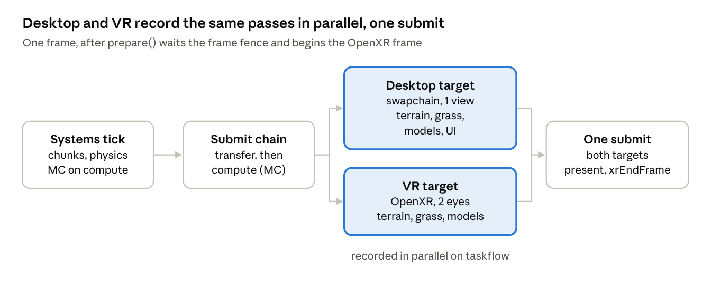

# Dynamical — Marching cubes, grass, glTF, VR and Jolt port

Oct 30, 2026 · Paul Boursin

## Summary

`master` now brings back the 2019–2020 voxel engine on top of the current code: GPU marching cubes terrain, raymarched grass, glTF models and OpenXR VR. It also adds Jolt physics, with terrain colliders meshed on the CPU around moving bodies.

The 2D tile map game (tile rendering, heightmap world, SPH particles, AI) is archived in `archive/tilemap/` and no longer compiled. EnTT moved from the bundled 3.8.1 header to 3.16 from vcpkg, and every call uses the current EnTT and vulkan.hpp APIs.

The work is two commits on top of the old master:

| Commit | What it does |
| --- | --- |
| `b7d1f43` | Jolt physics, CPU marching cubes terrain colliders, thrown and dropped boxes |
| `dbdd287` | Marching cubes, grass, glTF, VR, EnTT 3.16, archive of the tile map game |

## Branches and history

The old master is kept as `people-v2`; `master` was fast-forwarded to the port.

| Branch | Points to | Notes |
| --- | --- | --- |
| `master` | the port | ahead of `origin/master` until pushed |
| `port/mc-grass-gltf-vr` | `b7d1f43` | the branch the port was developed on |
| `people-v2` | `67480dd` "fixed plan" | old master: the tile map game |
| `docs/physical-agents` | `7cabbab` | physical agents plan |

Where the restored code came from:

- **Marching cubes and grass**: the 2019 voxel engine, last intact at `9dbaee1` (Nov 2020) before `666d763` "removed marching cubes". Grass was last enabled at `ce848a5` and commented out in `a633f93` (Sep 2019).
- **Grass lookup data**: `raycast_data.bin` recovered from `b7722a8`.
- **VR and glTF**: the `vr` branch (Dec 2020), which already had separate desktop and VR renderers. Its Bullet physics was not ported.

## What was archived

Everything built on the tile map moved to `archive/tilemap/`, mirroring its old `src/` paths; CMake only globs `src/`, so none of it compiles. The AI went with it because every behavior, path and need ran on `MapManager` positions.

| Area | Archived files |
| --- | --- |
| Tile map rendering | `map_render.*`, `map_upload.*`, `maprender` shaders |
| Heightmap world | `logic/map/*`, `chunk_generation`, `map_configurator`, `map_editor`, `water_flow`, map settings |
| Particles (SPH) | `particle_simulation.*`, `particle.comp.glsl` |
| Sprite objects | `object_render.*`, `objectrender` shaders |
| AI and gameplay | `ai/*`, `pather`, `basic_needs`, `harvest`, `eat`, `action_bar`, `selection`, `devmenu`, `factories` |
| Top-down camera | `systems/camera.cpp`, `components/camera.h` |

`archive/tilemap/README.md` lists what to port (EnTT calls, terrain mapping) to bring a part back. The same code runs as-is on `people-v2`.

## Rendering architecture

The desktop window and the headset are two independent render targets that record the same scene passes in parallel each frame.



Each target owns its render pass, framebuffers, command buffers and view uniforms; only the scene passes are shared.

- **Targets**: `ClassicRender` (desktop swapchain, one view per frame) and `VRRender` (one swapchain, framebuffer set and view per eye). Color formats differ, so every pass builds one pipeline per target.
- **Scene passes** (`ScenePass`): `TerrainPass`, `GrassPass`, `ModelPass`, `UIPass` (desktop only). `update()` runs once on the main thread (ImGui upload, material sets); `record()` runs for both targets at once and only reads the registry.
- **Sync**: one fence per frame, waited in `prepare()`. Transfer, compute and graphics are chained with semaphores, each stage waiting only if the one before had work; one submit holds both command buffers and consumes the semaphores even when nothing renders.
- **Conventions**: Y up, -Z forward, 1 unit = 1 m; Vulkan clip space (Y flipped, depth 0–1); the `ViewUBO` (view-projection, camera position, time) is set 0 of every scene pipeline.
- **Fixes to master's renderer**: the desktop depth attachment was written in a read-only layout, the swapchain overflowed when the driver gave more images than asked, and a suboptimal swapchain threw.

## Marching cubes terrain

The terrain is a density field (> 0 is solid) meshed by a compute shader; meshes never come back to the CPU.

- **Chunks**: 64³ cubes of 4 m (256 m per side), sampled on a 67³ grid that includes a 1-sample border for normals, stored `[x][z][y]`.
- **Density** (`TerrainGenerator`): a FastNoise2 fractal heightfield plus 3D noise for overhangs. `sample()` fills any box of the grid, so chunks and physics colliders read identical values.
- **Streaming**: `ChunkManagerSys` creates chunk entities within the view distance (768 m by default) of the desktop camera and the VR play area and unloads them past one extra chunk. `ChunkGeneratorSys` computes up to 16 chunks at a time on the taskflow executor, nearest first; all-solid or all-empty chunks keep only their mean.
- **GPU meshing** (`TerrainSys`): up to 8 chunks per frame are copied to a staging ring and dispatched on the compute command buffer. Each chunk gets a slot: a vertex buffer of 32,768 triangles and an indirect draw command whose vertex count the shader fills. Slots of unloaded chunks are reused 5 frames later, once no frame in flight can read them.

Fixes over the 2019 shader:

- The draw counter is reset with `vkCmdUpdateBuffer` before the dispatch; the old in-shader reset raced across workgroups.
- A second tiny dispatch clamps the vertex count to the buffer size; the old shader could write past the buffer.
- Normals point out of the solid; the old ones pointed in, compensated in the shading.
- Density samples line up with the shader's border offset; the old generator was shifted by one cube.

## Raymarched grass

> Replaced since by rays baked against a 3D grass model: see [grass.md](grass.md). `raycast_data.bin` and the 2D baker described here are gone.

The 2019 grass is back and on by default; it has no blade geometry. `GrassPass` redraws each terrain chunk as a shell lifted by the grass height.

- For each of 3 layers, the fragment shader projects the view ray into a wind-animated tangent frame. It then looks up a baked 3D texture (128 × 128 positions × 32 ray angles) that stores the distance to the nearest blade and its normal.
- The texture comes from `resources/raycast_data.bin`, baked offline by `tools/raycast` (2D rays against 4 × 4 jittered circles per tile). A 512² tiled noise texture breaks the repetition.
- The shader writes its own depth, so blades hide each other and the ground correctly.
- New: a slope mask keeps grass on flat ground (normal.y ≥ 0.75); slopes show the rock texture of the terrain pass.
- Tile size, height, base normal and noise are tunable live in the debug menu, as in the 2019 debug window.

## glTF models

Models load through tinygltf and are drawn by `ModelPass` from any entity with a `Transform` and a `ModelRenderable`.

- **Loader** (`gltf_loader.cpp`): `.gltf` or `.glb`, triangle primitives with position, normal and first UV set, base color factor and texture. Node transforms of the default scene are baked into one vertex and one index buffer; missing normals are computed flat. No skins, morph targets or sparse accessors.
- **ModelManager** (context variable): loads each file once and returns the entity holding its `ModelC`. Instances point at it, so one upload serves many boxes.
- **Materials**: one descriptor set per material, allocated on the main thread before recording; untextured materials use a 1×1 white texture.
- **Assets**: `resources/models/box.gltf` (a generated unit cube) is the demo model. Any `.gltf` or `.glb` dropped in `resources/models` is loaded at startup, scaled to about 4 m and placed behind the spawn.

tinygltf comes from vcpkg pinned to 3.0.0 port-version 1 (`overrides` in `vcpkg.json`). The first port of 3.0.0 no longer installs: GitHub now serves a tarball with a different hash, which upstream vcpkg fixed in port-version 1.

## VR (OpenXR)

VR renders alongside the desktop window when a headset is found and falls back silently to desktop-only otherwise; `vr_mode=0` turns it off.

- **Startup order**: `VRContext` creates the OpenXR instance first, because it decides the Vulkan instance and device extensions, the minimum API version and the GPU. The session, stage space (local if absent) and one swapchain per eye are created once the device exists.
- **Fallback**: no runtime, no Vulkan support or no headset (`XR_ERROR_FORM_FACTOR_UNAVAILABLE`) disables VR and destroys the XR instance.
- **Frame loop** (`VRRender`): session events are polled each frame; while running, `xrWaitFrame` and `xrBeginFrame` happen in prepare. Eye images are acquired before recording, eye poses are located again just before the view buffers are written, and `xrEndFrame` runs after the GPU submit (with no layers when the runtime says not to render).
- **Pacing**: with VR on, the desktop swapchain uses mailbox (or immediate) presentation so the monitor's refresh rate never throttles the headset.
- **Projection**: built from each eye's asymmetric field of view in Vulkan clip space; the view is the inverse of play-area transform × eye pose.

Controls (`VRActions`, bindings for Oculus Touch, Valve Index and the Khronos simple controller):

| Input | Action |
| --- | --- |
| Left thumbstick | Walk, relative to where the head looks; the play area follows the terrain height |
| Right thumbstick | Smooth turn |
| Right trigger | Spawn a box in the hand, thrown with the hand velocity × 1.5 |
| Hand poses | Small kinematic boxes that push dynamic bodies |
| R key (desktop) | Move the play area under the desktop camera |

## Jolt physics

Jolt 5.5 replaces the Bullet setup of the `vr` branch. Terrain collision is meshed on the CPU only where bodies are or are heading, not read back from the GPU.

**Simulation** (`PhysicsSys`, `PhysicsWorld`):

- Fixed 60 Hz step, at most 4 steps per frame; a slower frame drops simulation time instead of spiralling.
- Dynamic bodies' `Transform`s are interpolated between the last two steps, so they move smoothly at 120 fps.
- Adding a `RigidBody` (box or sphere; dynamic, kinematic or static) next to a `Transform` creates the body; removing it or destroying the entity removes it.
- Kinematic bodies follow their `Transform` (the VR hands). Dynamic bodies use continuous collision (`LinearCast`) so thrown boxes do not tunnel through thin triangles, and enhanced internal edge removal so they slide smoothly.
- Jolt runs its own job threads (half the cores minus one) beside the taskflow executor.

**Terrain colliders** (`TerrainColliders`):

1. The world is cut in fixed cells of 16³ cubes (64 m). Fixed cells are cached and shared between bodies, unlike per-body regions.
2. Each frame, each dynamic body's bounds are swept by its velocity over the coming steps. Overlapped cells are built in parallel, added in sorted order, then the step runs, so body order never depends on thread timing.
3. Cells on the path 1 s ahead are prefetched on taskflow; their bodies are only added once required.
4. A cell copies its 17³ samples from the loaded chunk, or samples `TerrainGenerator` directly, so collision works without rendering or streaming (headless runs).
5. `MarchingCubes` (CPU) uses the same edge table as the shader but shares one vertex per crossed edge, which Jolt needs to recognise internal edges. Winding is checked against the density gradient.
6. Cells unused for 5 s of simulation time are removed.

At startup 12 boxes rest on 6 cells (3,777 triangles), built in about 0.07 ms.

## Dependencies, build and controls

| Dependency | Change |
| --- | --- |
| EnTT | 3.8.1 header in `lib/entt` → 3.16 from vcpkg; all calls ported (`reg.ctx().get<T>()`, `all_of`, tag structs instead of `entt::tag`) |
| joltphysics | new, 5.5.0 |
| `openxr-loader[vulkan]` | new, 1.1.54 |
| tinygltf | new, 3.0.0#1 (pinned) |
| nlohmann-json | new, used by tinygltf |
| Vulkan headers | 1.4.341; instance and device now ask for Vulkan 1.1 (compute subgroup operations) |
| FastNoise2 | kept, now drives the marching cubes density |

Build and run (Visual Studio 2022, `VCPKG_ROOT` set):

```
git submodule update --init
cmake --preset vcpkg
cmake --build build --config Debug
cd build
./Debug/dynamical.exe fullscreen=false window_width=1280 window_height=720 vr_mode=1
```

Shaders compile with `--target-env vulkan1.1`. `-DDYNAMICAL_BUILD_TOOLS=ON` builds `tools/raycast`. Settings now save to `config.6.json` (the old file's map settings no longer apply); `view_distance` and `vr_mode` can be passed as `key=value` arguments.

| Desktop input | Action |
| --- | --- |
| WASD, Space, Left Ctrl | Fly, up, down |
| Right mouse (hold) | Look around |
| Mouse wheel / Left Shift | Change speed / sprint ×8 |
| Left click | Throw a box |
| R | Move the VR play area under the camera |
| P | Pause game time |
| Esc | Quit |

## Testing

Debug and Release both build; all runs were on an RTX 5080 in a 1280 × 720 window, without a headset.

| Check | Result |
| --- | --- |
| Terrain, grass, models, UI render | about 120 fps; 116 chunks loaded, 42 meshed |
| Vulkan synchronization validation | clean, after fixing a depth hazard (render pass dependency) |
| 1.3 km flight | chunks stream in and out, slots recycled, no errors |
| Startup physics | 12 boxes land and sleep on 6 terrain cells |
| Thrown boxes (simulated clicks) | 8 boxes fly and land |
| Stress: 162 bodies | about 3 ms per step in Debug |
| No headset, `vr_mode=1` | falls back to desktop, logs the reason |
| Window close | clean shutdown, exit code 0 |

Not tested:

- VR rendering, controllers and kinematic hands with a real headset.
- Repeatability of physics runs.
- Building `tools/raycast`.

## Limitations and next steps

- **Simplified from 2019**: one level of detail, raw chunk storage. The sparse octree compression and the unused LOD scaffolding were not ported.
- **No terrain editing yet**: chunks are meshed once; a rebuild already gets a fresh GPU slot, but nothing edits densities.
- **Collider shapes**: dropped-in glTF models get a box around their bounds, not their mesh.
- **Cell seams**: a body sliding across two terrain cells can still feel a small bump; overlapping cells by one cube would remove it.
- **Placement**: spawn heights use the 2D heightfield only, so objects can start slightly inside or above overhangs.
- **AI**: archived with the tile map; it needs positions and pathfinding on the marching cubes world to come back.

Suggested next steps:

- [ ] Test VR on a headset (hands, throwing, pacing with the desktop window)
- [ ] Push `master` and `people-v2` once reviewed
- [ ] Physical agents: walker bodies on the terrain colliders, per the plan in `docs/physical-agents/`
