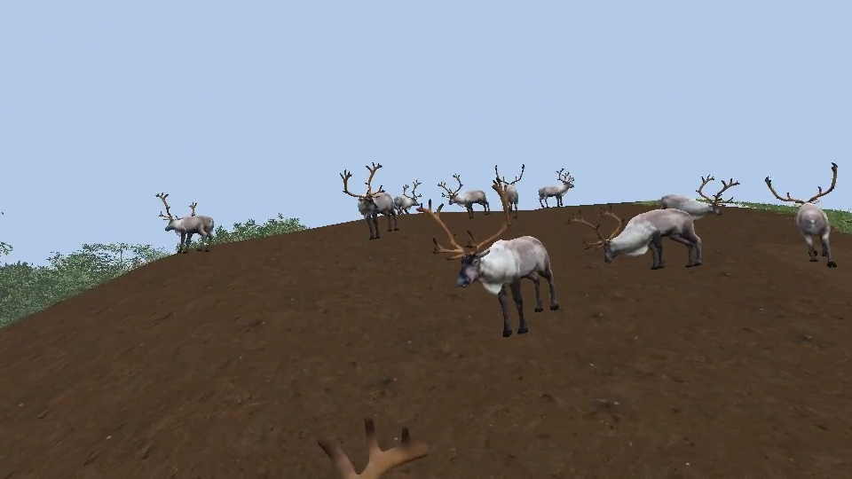
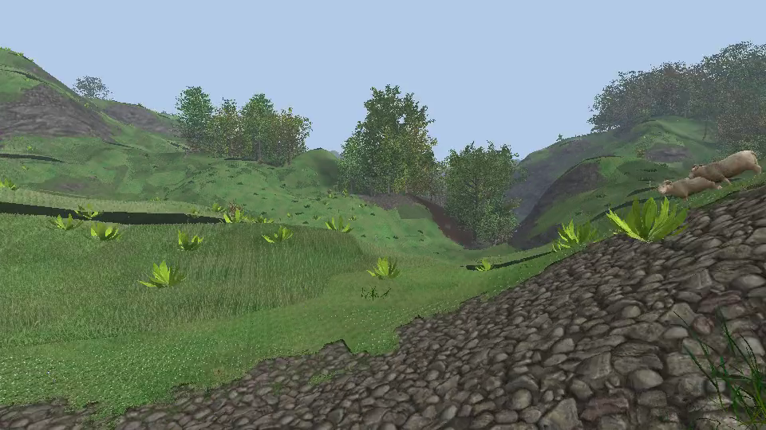
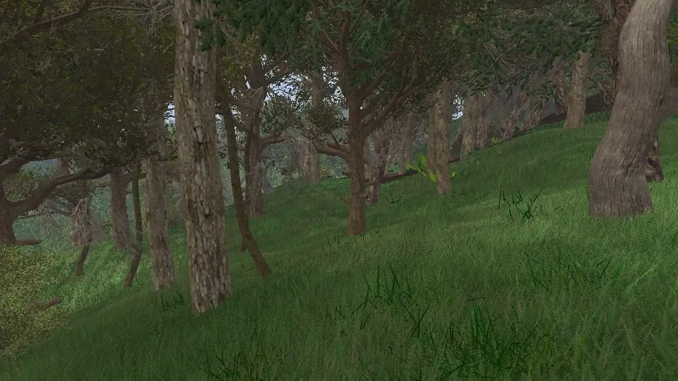

# A walk over the land

One scene with what the land has: the patches of mud, stones and sand and their relief ([ground.md](ground.md),
[ground-relief.md](ground-relief.md)), the grass with its height map and its species in patches
([grass/15-species.md](grass/15-species.md)), the forests and the shade under them ([forest.md](forest.md)), the
herds and their procedural walk ([animals.md](animals.md)). The camera walks through it as it does through the
forests: 100 m of open land, a forest, 100 m of open land.







```bash
cd build && ./RelWithDebInfo/dynamical.exe scene=tautavel_walk                 # the walk
build/venv/Scripts/python tools/forest_video.py --scene tautavel_walk          # build/artifacts/forest_video/tautavel_walk_seed2.mp4
build/venv/Scripts/python tools/forest_video.py --scene tautavel_walk --seed 4 --preview 80    # 80 frames of another walk
```

## The scene

`resources/scenes/tautavel_walk.scene.json`: the passes `terrain`, `grass`, `vegetation`, `animals`, and the
systems `Forest`, `Herds`, `CameraWalk`, `AnimalAnimation`, `AnimalGait`. No VR, no physics.

| Variable | Default | |
|---|---|---|
| `forest_seed` | 2 | places the forests, so it picks the walk too |
| `distance`, `lead`, `speed` | 330 m, 100 m, 3.3 m/s | the walk, the open land at each end of it: 100 s |
| `soil` | 1 | how much the line is picked for the soil it crosses; 0: the soil is not looked at either |
| `watch` | 45 m | the camera turns to the herds this close; 0: not at all |
| `herd_cell`, `herd_density`, `herd_range`, `herd_radius` | 70 m, 0.9, 30 m, 260 m | more herds than in `forest_herds`, and they stay near their home: a herd is seldom further than a clearing away |
| `herd_seed`, `forest`, `herds`, `patch_size`, `coverage`, `max_slope`, `eye_height` | | as in `forest_walk` and `forest_herds` |

## What `CameraWalk` does more

Three parameters, all off by default (`forest_walk` is as it was):

- `lead`: metres of open land before the forest and after it (45 m without it).
- `soil`: the lines that pass the forest test get up to `soil` more for the bare soil their open ends cross
  (`soilOn`: half for how many of the three kinds, half for the metres of each, 30 at most), read in a `SoilField`
  with the parameters the renderer bakes its maps with. During the walk the camera looks down at the soil 4 m
  ahead (17° under the horizon: the relief shows at a grazing angle), unless a herd is close.
- `herds`: the 60 best lines (30 without it) get up to 1 more for the herds whose home is 8 to `herds` metres from
  them (`herdsBy`, through `HerdSys::describe`; those of the forest part count 0.3, trees hide them). During the
  walk the camera turns to the nearest herd within that distance that is not behind it, 85° to the side at most.
  The walk waits while an animal is loading, as a capture does: herds come and go with the camera.

The looks are critically damped (`follow`), over the sway of the walk. The log says which line was picked, how
much soil and how many herds it has (0 to 1), and each herd the camera turns to.

## Not done

- A herd in the way is walked through: the path only goes round the plants.
- The camera turns to the middle of a herd whether it is seen or not: a hill or the trees may hide it.
- The line is picked on the homes of the herds; they graze up to `herd_range` from them.
- Captures are 960 x 540 (`src/view/game.cpp`).
